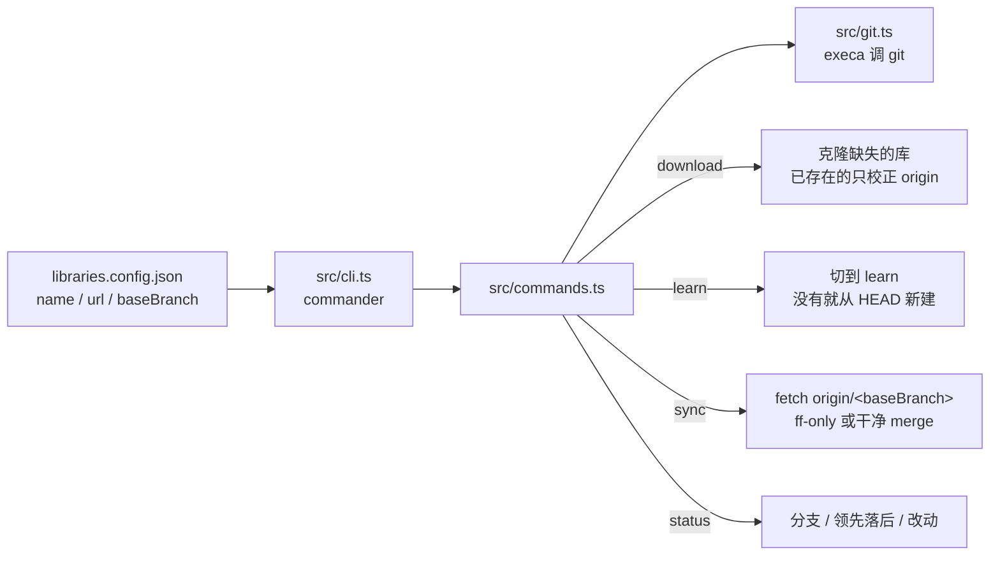

# learn-notes

学习笔记仓库：笔记在 `notes/`（整个 `notes/` 是一个 Obsidian vault），上游源码克隆在 `projects/`。
笔记的写作规范见 [AGENTS.md](./AGENTS.md)。

## 内部库（`projects/`）

`projects/` 下的克隆由根目录的 TypeScript 工具 `internal-libs` 管理，用 `tsx` 直接跑源码，不需要构建。
库清单只维护 `libraries.config.json`，不用手写 `git clone`。



| 命令 | 作用 |
| --- | --- |
| `pnpm libs:download` | 克隆清单里缺失的库；已存在的仓库只把 `origin` 校正成配置里的 url |
| `pnpm libs:learn` | 全部切到 `learn`（没有该分支就从当前 HEAD 新建） |
| `pnpm libs:sync` | fetch 远端 `baseBranch` 最新提交，合进 `learn` |
| `pnpm libs:status` | 巡检：分支、是否在 learn、领先/落后、改动数、最新提交 |

通用选项：`--only ai,genkit`、`--config <path>`、`--root <dir>`、`--dry-run`、`--json`、`--no-color`；
`sync` 额外支持 `--stash`（合并前暂存已跟踪改动，合并后自动 pop）。

也可以直接用 `pnpm libs <命令>`，例如 `pnpm libs sync --only genkit --stash`。

### 代码规范

代码在 `src/`，每个文件不超过 **200 行**（`oxlint` 的 `max-lines` 规则卡住，超了直接报错）。

| 命令 | 作用 |
| --- | --- |
| `pnpm typecheck` | `tsc --noEmit` 类型检查 |
| `pnpm lint` | `oxlint src`，含 `max-lines: 200`、`no-unused-vars` |
| `pnpm format` | `oxfmt src` 格式化 |
| `pnpm format:check` | 只检查不改文件 |
| `pnpm check` | typecheck + lint + format:check |

**别对 `projects/` 跑 lint/format**：那里面是上游克隆。`.oxlintrc.json` 和 `.oxfmtrc.jsonc` 都把 `projects/**`、`notes/**` 放进 `ignorePatterns`，两条命令也都只传 `src`，新增脚本时别把它们扩到仓库根。

### 分支模型

- 每个库的 `learn` = 远端主干（`baseBranch`）+ 本地学习改动，笔记引用的就是 `learn` 上的源码。
- `sync` 先试 `merge --ff-only`；learn 上已有提交导致分叉时退回普通 `merge`，冲突就 `git merge --abort` 回滚，批量跑完不会留下半合并状态。
- 工作区有**已跟踪文件**改动时默认跳过合并（未跟踪文件不挡合并）；加 `--stash` 才会 `git stash` → 合并 → `stash pop`。pop 冲突时改动完整留在 `git stash` 里，工作区带冲突需手动解决。
- 退出码：`0` 正常，`1` 有失败项；`--json` 时 stdout 只有 JSON。

### 加一个新库

只改 `libraries.config.json`，代码不用动：

```json
{ "name": "foo", "url": "git@github.com:owner/foo.git", "baseBranch": "main" }
```

- `name` 同时是 `projects/` 下的目录名和 `--only` 的取值。
- `baseBranch` 省略时按 `main`；上游用 `master` 的要显式写（如 `json-schema`）。
