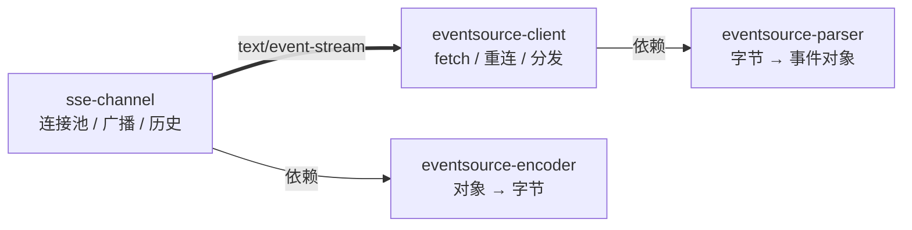
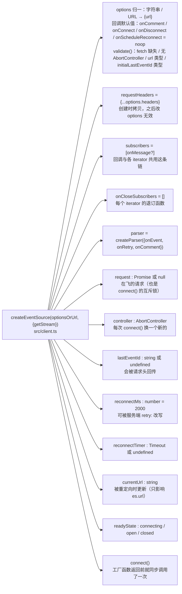
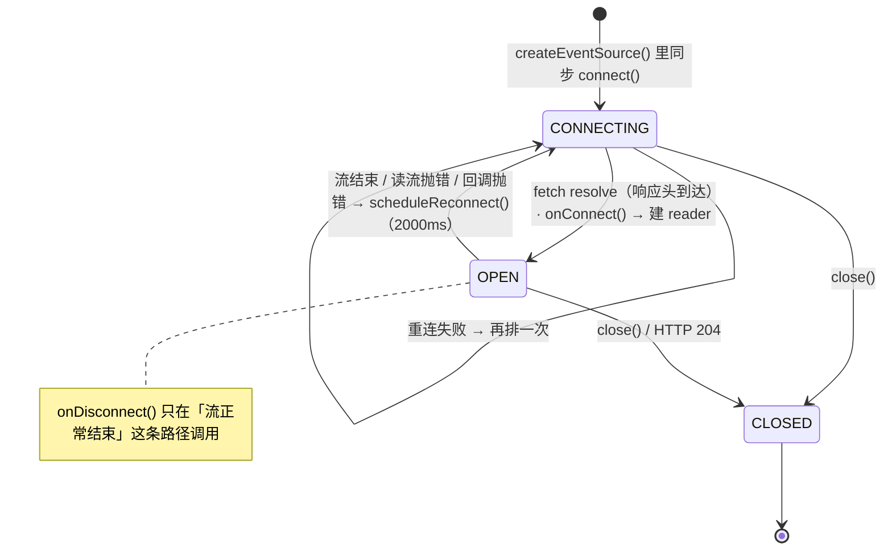
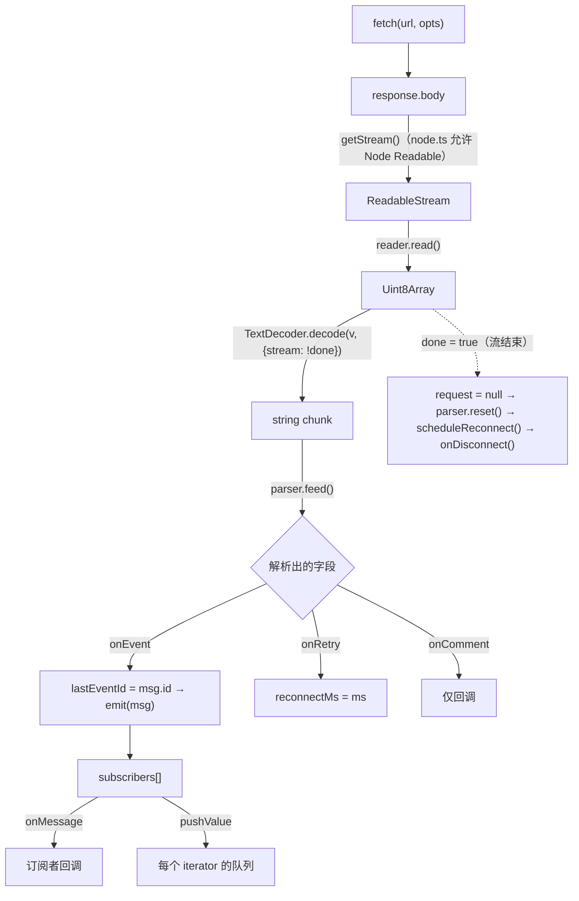
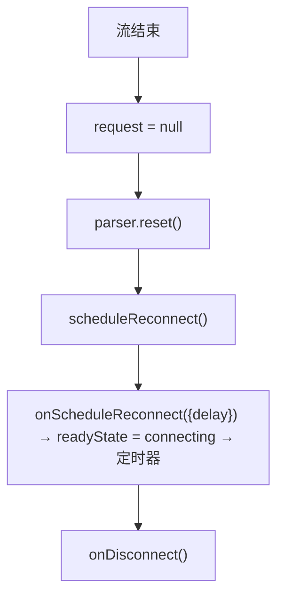
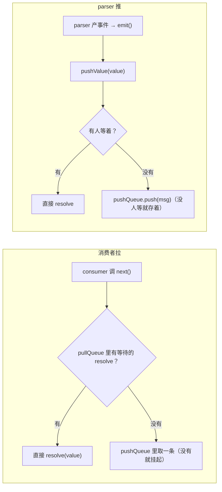
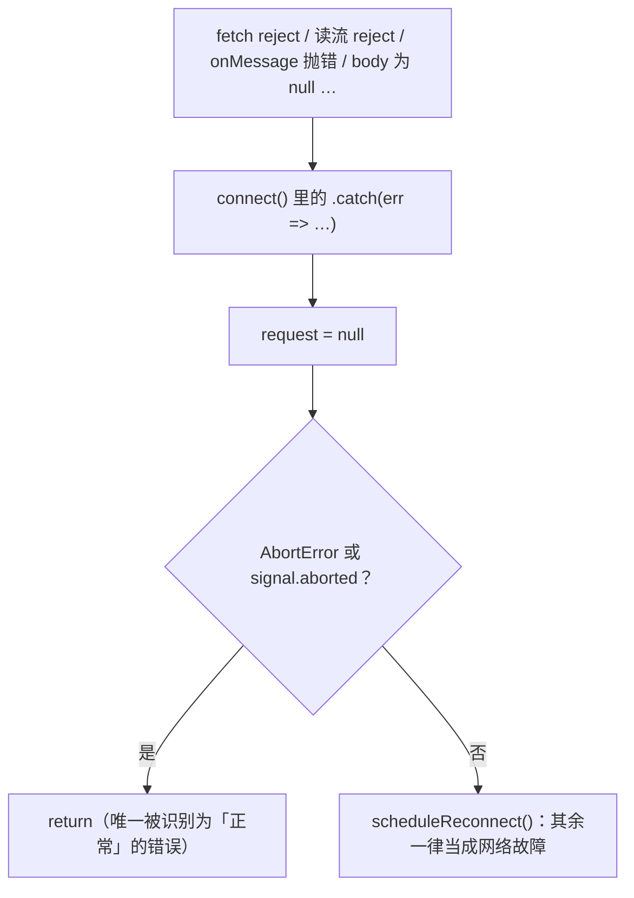
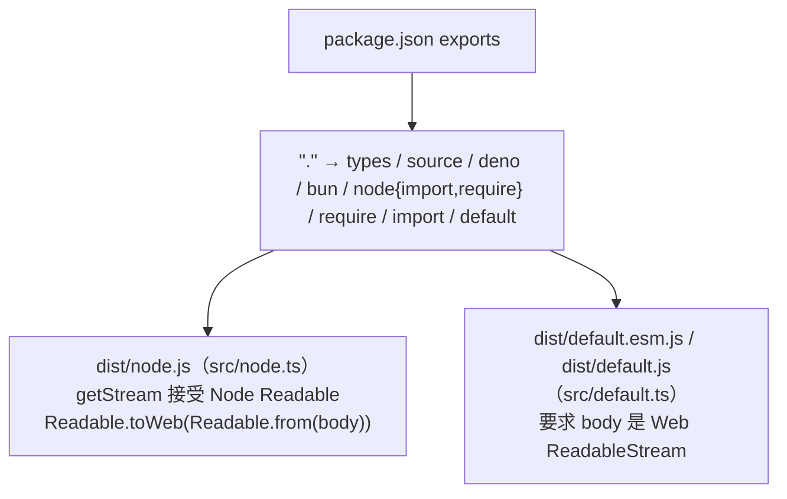
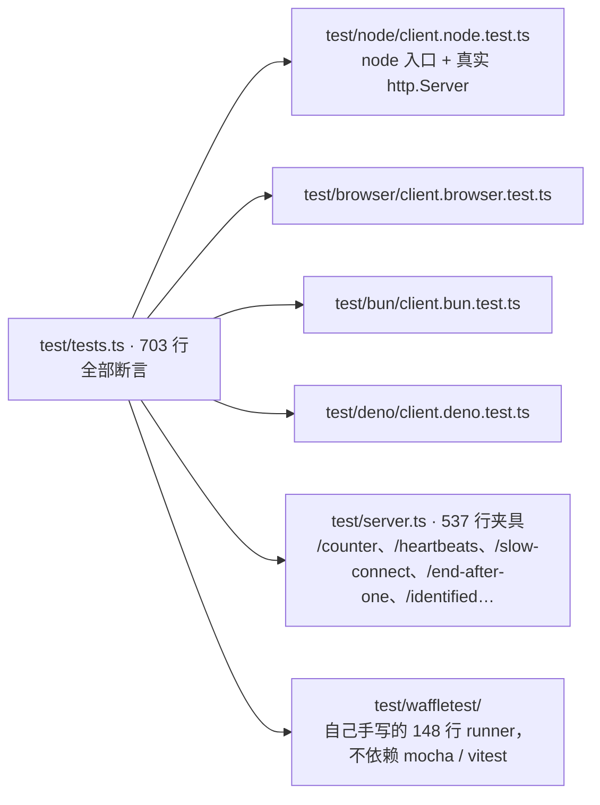

# eventsource-client 说明

> 源码：`eventsource-client/` —— npm 包 `eventsource-client` 上游仓库（作者 rexxars / Espen Hovlandsdal）
> 版本：`1.2.0`，MIT，TypeScript，Node ≥ 18
> 读法：§1–§4 是速查；§5–§8 是主路径（生命周期 / 请求 / 读流 / 重连）；§9–§11 是 iterator、错误处理、关闭；§13 起是实测与坑。

## 目录

| 章节                                                 | 内容                                         |
| ---------------------------------------------------- | -------------------------------------------- |
| [§1 一句话](#1-一句话)                               | 这个库是什么                                 |
| [§2 是什么、不是什么](#2-是什么不是什么)             | 定位、和 eventsource / parser 的关系         |
| [§3 快速上手](#3-快速上手)                           | 三种用法                                     |
| [§4 结构](#4-结构一个-client-的全部状态)             | 文件地图 + 全部状态                          |
| [§5 生命周期与 readyState](#5-生命周期与-readystate) | 状态机、回调触发顺序                         |
| [§6 发请求](#6-发请求)                               | 头、优先级、请求选项                         |
| [§7 读流与分发](#7-读流与分发)                       | 解码 → parser → fan-out                      |
| [§8 断开与重连](#8-断开与重连)                       | 默认 2000ms、`retry:`、无退避无上限          |
| [§9 async iterator](#9-async-iterator)               | pull/push 队列、多 iterator、没有背压        |
| [§10 错误处理](#10-错误处理)                         | 没有 onError、状态码被忽略、回调抛错被吞     |
| [§11 关闭与重启](#11-关闭与重启)                     | `close()` 做了什么、`close()` 后 `connect()` |
| [§12 环境适配](#12-环境适配)                         | 包 exports、`default.ts` vs `node.ts`        |
| [§13 实测行为表](#13-实测行为表)                     | 这次跑出来的 20 条                           |
| [§14 坑清单](#14-坑清单)                             | 按危险程度排                                 |
| [§15 版本历史与测试](#15-版本历史与测试)             | 1.0.0 → 1.2.0、四环境共用测试套              |

## 1. 一句话

用 `fetch()` + Web Streams 写的 EventSource **客户端**：拿一个流，喂给 `eventsource-parser`，把每条消息交给 `onMessage` 或 `for await` 的迭代器；断开就自己重连，带上 `Last-Event-ID`。

它**故意不**兼容浏览器的 `EventSource` API——没有 `addEventListener`、没有 `onopen/onerror`，换成字符串 `readyState`、异步迭代、任意 method/body/header。所以它更像「SSE 版的 fetch 包装」而不是「EventSource polyfill」。

## 2. 是什么、不是什么



**是什么**：

- 一个 `createEventSource()` 工厂，返回 `{close, connect, lastEventId, url, readyState, [Symbol.asyncIterator]}`（`eventsource-client/src/types.ts` 的 `EventSourceClient`）。
- 两个环境入口：`default.ts`（浏览器/Bun/Deno，要求 `body instanceof ReadableStream`）和 `node.ts`（额外接受 Node `Readable`，用 `Readable.toWeb()` 转）。
- 重连策略固定：失败后 `setTimeout(connect, reconnectMs)`，`reconnectMs` 默认 2000，可被服务端的 `retry:` 覆盖。

**不是什么**：

- **没有 `onError` / 没有 error 对象**：网络错误、非 2xx、body 缺失、用户回调抛错，全部被 `.catch()` 吞掉后变成「重连」（§10）。
- **不做退避**：没有指数退避、没有抖动、没有最大重试次数，服务端说 `retry: 0` 就是 0ms 死循环（§8，实测 60ms 内重连 51 次）。
- **不做背压**：iterator 的 `pushQueue` 无上限，慢消费者就是内存涨（§9，实测 5000 条全缓存、一条不丢）。
- **不检查 HTTP 状态码**（除了 204）：500 的 JSON 错误体照样喂给 parser（§10）。
- **不做事件名过滤**：所有事件都派发，`event` 字段只是消息上的一个属性。

## 3. 快速上手

```ts
import { createEventSource } from 'eventsource-client';

const es = createEventSource({
  url: 'https://example.com/sse',
  headers: { Authorization: 'Bearer …' }, // 浏览器 EventSource 做不到的事
  onMessage: ({ data, event, id }) => console.log(event, id, data),
});

es.readyState; // 'connecting' → 'open' → …
```

三种拿消息的方式（选一个即可，可混用）：

```ts
// 1. 回调
createEventSource({ url, onMessage: ({ data }) => console.log(data) });

// 2. 异步迭代（连接断了会自动重连，iterator 不结束）
for await (const { data } of es) {
  console.log(data);
  if (done) break;
}
es.close(); // 注意：break 不会关连接

// 3. 只给 URL
createEventSource('https://example.com/sse');
```

> [!warning] 三个必知点
>
> 1. `break` 跳出 `for await` **不会**关连接，必须自己 `es.close()`（README 与 `src/client.ts` 的 iterator 实现都这样要求）。
> 2. `close()` 之后立刻 `connect()` 通常**无效**——`request` 还没被 abort 的 rejection 清空（§11，实测）。
> 3. 任何回调里抛出的异常都会让客户端当成网络故障去重连，**错误本身不会冒泡给你**（§10，实测）。

## 4. 结构：一个 client 的全部状态



文件地图（`eventsource-client/src/`，运行时共 607 行）：

| 文件              | 行数 | 作用                                                      |
| ----------------- | ---- | --------------------------------------------------------- |
| `client.ts`       | 304  | 全部行为：状态机、请求、读流、重连、iterator              |
| `types.ts`        | 162  | `EventSourceOptions` / `EventSourceClient` / `FetchLike*` |
| `node.ts`         | 54   | Node 入口 + `getStream()`（`Readable.toWeb`）             |
| `default.ts`      | 44   | 浏览器入口 + 严格版 `getStream()`（必须是 Web 流）        |
| `abstractions.ts` | 23   | `EnvAbstractions`：两个入口唯一的差异                     |
| `constants.ts`    | 20   | `CONNECTING` / `OPEN` / `CLOSED`（字符串，不是数字）      |

## 5. 生命周期与 readyState



回调里看到的 `readyState`（实测，`onConnect` 时还没变 OPEN）：

| 时机                         | 值                                |
| ---------------------------- | --------------------------------- |
| `createEventSource()` 返回后 | `connecting`                      |
| `onConnect()` 内             | `connecting`                      |
| `onMessage()` 内             | `open`                            |
| `onScheduleReconnect()` 内   | `open`（之后再被置成 connecting） |
| `onDisconnect()` 内          | `connecting`                      |

`readyState` 是**字符串**而不是 `EventSource` 的 0/1/2（`src/constants.ts` 里注释直接写了「Why make it harder to read than it needs to be?」）。

## 6. 发请求

```ts
// src/client.ts 的 getRequestOptions()
{
  mode, credentials, body, method, redirect, referrer, referrerPolicy,   // 透传
  cache: 'no-store',                                                    // 写死
  signal: controller.signal,                                            // 写死
  headers: {
    Accept: 'text/event-stream',   // 默认
    ...requestHeaders,             // 用户的 headers（创建时拷贝）
    ...(lastEventId ? {'Last-Event-ID': lastEventId} : undefined),  // 最后覆盖
  },
}
```

四个后果：

1. **`Last-Event-ID` 优先级最高**：用户自己在 `headers` 里写 `Last-Event-ID` 会被 `lastEventId`/`initialLastEventId` 覆盖（实测：`initialLastEventId: 'client-set'` 压掉手写的 `'user-set'`）。
2. **`cache: 'no-store'` 强制**，绕开浏览器缓存。
3. **`signal` 不能覆盖**（源码里留了 `@todo allow interception`）。
4. `method`/`body` 会**每次重连都重发**；body 是字符串没问题，是流就会在第一次被消费掉（README 的 Todo 里就挂着这条）。

`initialLastEventId` 只在收到带 `id` 的消息之前生效；一条 `id:` 空行会把 `lastEventId` 变成空字符串，于是后续请求**不再发** `Last-Event-ID` 头（实测）——想续传就别发空 id。

## 7. 读流与分发



几个细节：

- **`TextDecoder` 手动用**（不是 `TextDecoderStream`），`{stream: !done}` 让被切断的多字节字符能跨 chunk 拼回来（1.1.0 起「支持没有 `TextDecoderStream` 的环境」）。
- **`parser.reset()` 会重置 parser 内部的 `lastEventId`**，但客户端自己那份 `lastEventId` 保留，下次请求照样带上。
- **注释（`:` 开头）不进 `onMessage`，也不进 iterator**，只进 `onComment`；parser 会剥掉一个前导空格（`: hello` 和 `:tight` 都给 `hello`／`tight`，实测）。
- **多订阅者各拿一份**：`emit` 是 `forEach`，两个 iterator 都会收到全部消息（不是竞争消费，实测）。

## 8. 断开与重连

```ts
function scheduleReconnect() {
  onScheduleReconnect({ delay: reconnectMs }); // ① 先通知
  if (controller.signal.aborted) return; // ② 用户在回调里 close() 了就停
  readyState = CONNECTING;
  reconnectTimer = setTimeout(connect, reconnectMs);
}
```

规则：

| 事项               | 行为                                                                                             |
| ------------------ | ------------------------------------------------------------------------------------------------ |
| 默认间隔           | **2000ms**（写死在 `client.ts` 的 `reconnectMs` 初值）                                           |
| 服务端控制         | `retry: N` → `onRetry(N)` → `reconnectMs = N`，**下一次**重连即生效                              |
| 退避 / 抖动 / 上限 | **都没有**。`retry: 1000000000` 就等 10 亿毫秒；`retry: 0` 就是 0ms 死循环（实测 60ms 内 51 次） |
| 重试次数           | 无限。只有 `close()` 和 HTTP 204 能停                                                            |
| 非法的 retry       | `retry: abc`、`retry: 1.5`、`retry: -50` 都被 parser 忽略 → 保持 2000（实测）                    |
| 重定向             | `es.url` 会变成重定向后的 URL，但**重连仍然请求 `options.url`**（实测）                          |
| `onDisconnect`     | 只有「流正常结束」路径调用；fetch 直接 reject 时**不调用**（实测）                               |

触发顺序（同一次断开，实测）：



即 **`onScheduleReconnect` 一定早于 `onDisconnect`**，这个顺序是刻意的（`onDisconnect` 里 `close()` 能取消已经排好的重连，测试 `will not reconnect after explicit close() in onDisconnect` 就锁这条）。

## 9. async iterator



- `forEach` 分发 → **每个 iterator 各复制一份**，互不影响。
- `pushQueue` **无上限**：消费者慢，消息全在内存里攒（实测 5000 条不丢）。
- `next()` 在 `finished || readyState === 'closed'` 时立刻返回 `{done: true}`，不会等新消息。
- `iterator.return()` / `iterator.throw(err)` **只结束这一个 iterator**（从 `subscribers` 和 `onCloseSubscribers` 里摘掉、清空自己的队列、把挂起的 `next()` 全部 resolve 成 `done`），连接和别的订阅者照常。`throw()` 自身则 reject 传入的错误。
- **`es.close()` 结束所有 iterator**；重连不会复活它们，要重新开 iterator（测试 `closed iterators stay done when the source reconnects…` 锁这条）。
- 连接断了重连时 iterator **不结束**，`next()` 就静静等着（实测：等满 2002ms 后拿到重连后的下一条）。
- `for (const x of es)` 会立刻抛错：`EventSource does not support synchronous iteration. Use 'for await' instead.`

## 10. 错误处理

**这个库没有错误通道。** 所有异常都走同一条路：



实测清单：

| 场景                          | 结果                                                                                                                         |
| ----------------------------- | ---------------------------------------------------------------------------------------------------------------------------- |
| `fetch` reject（连接被拒）    | `onScheduleReconnect(2000)`，**没有 `onDisconnect`**，状态 `connecting`，无限重试                                            |
| HTTP 500 + JSON 错误体        | `onConnect` 照常触发，**错误体被当 SSE 喂给 parser**；若体里恰好有 `data:` 行就真变成消息（实测拿到 `message: leaked-body`） |
| HTTP 204                      | `onConnect()` → `onDisconnect()` → `close()`；状态 `closed`，不重连                                                          |
| 200 但 `body == null`         | 抛 `Missing response body` → 被 catch 吞掉 → 重连（实测）                                                                    |
| 用户 `onMessage` 抛错         | 错误被吞，连接中断并重连，**onDisconnect 不触发**（实测）                                                                    |
| 用户 `onDisconnect` 抛错      | 外层 catch 再排一次重连 → **两个定时器并发**（实测 `onScheduleReconnect` 被调 2 次）                                         |
| 用户 `onConnect` 里 `close()` | 不好：`onConnect` 之后代码继续执行并把 `readyState` 写回 `open`（实测）                                                      |

没有 `onError` 回调、没有 `error` 事件、没有抛出的 Promise——想要可观测性只能自己包 `fetch` 或在回调里记日志。

## 11. 关闭与重启

```ts
function close() {
  readyState = CLOSED;
  controller.abort(); // 中断网络流
  parser.reset();
  clearTimeout(reconnectTimer); // 取消待执行的重连
  onCloseSubscribers.forEach(fn => fn()); // 结束所有 iterator
}
```

它**没有**做的事：`request` 不置空、`subscribers` 不清空（iterator 自己退订）、`lastEventId` 保留。

于是有了这个坑：

```
es.close()            → readyState = 'closed'，request 仍是那个在飞的 Promise
es.connect()          → if (request) return     ← 直接返回，什么都没发生
（等 abort 的 rejection 进 catch，request = null）
es.connect()          → 这才真正开始新连接（实测）
```

更糟的一种：如果自定义 `fetch` 不理会 `signal`（很多 polyfill / 测试桩都不理会），被 abort 的 `reader.read()` 永远不 settle，`request` 就永远是那个 Promise——**客户端卡死在 `closed`，`connect()` 永远无效**（实测，200ms 后仍无第二次请求）。

正确姿势：

- 不要在 `close()` 的同一个 tick 里 `connect()`；要重启就等一会儿，或在 `onScheduleReconnect` / `onDisconnect` 里先 `close()` 再 `connect()`（官方测试就是这么干的）。
- 204 之后想重连也不行：204 路径是 `onDisconnect()` → `close()`，你在 `onDisconnect` 里 `connect()` 会被随后的 `close()` 掐掉（实测仍是 2 次请求后 `closed`）。

## 12. 环境适配



- 两个入口只差一个 `getStream` 函数（`src/abstractions.ts` 的 `EnvAbstractions`），其余逻辑全在 `client.ts`，所以浏览器包里不会打进 `node:stream`。
- `node.ts` 会检查 `Readable.toWeb` 是否存在，没有就明确报错「Node.js 18 or higher required」。
- `default.ts` 的 `getStream` 只做 `instanceof ReadableStream` 校验，否则抛 `Invalid stream, expected a web ReadableStream`——**用自定义 `fetch` 时返回 Node 流会立刻炸**（要走 `node.ts`）。
- README 支持矩阵：Node ≥ 18、Chrome ≥ 63、Safari ≥ 11.3、Firefox ≥ 65、Edge ≥ 79、Deno ≥ 1.30、Bun ≥ 1.1.23。

## 13. 实测行为表

验证方式：把 `eventsource-client/src/default.ts` 和本地 `eventsource-parser` 源码用 `tsx` 直接跑（仓库根目录的 `tsx`），`fetch` 换成返回内存 `ReadableStream` 的桩函数，所以下表是「客户端自身逻辑」的结果，不含真实网络。

| #   | 输入                                             | 观察到的行为                                          |
| --- | ------------------------------------------------ | ----------------------------------------------------- |
| 1   | 创建后立刻读 `readyState`                        | `connecting`（工厂里已 `connect()`）                  |
| 2   | `onConnect` 里读 `readyState`                    | `connecting`（OPEN 在之后才设）                       |
| 3   | `onScheduleReconnect` 里读                       | `open`（还没切到 connecting）                         |
| 4   | 流正常结束                                       | `onScheduleReconnect` → `onDisconnect`，顺序固定      |
| 5   | 服务端 `retry: 60`                               | 之后每次重连都是 60ms，无退避                         |
| 6   | `retry: 0`                                       | 0ms 重连，60ms 内 51 次                               |
| 7   | `retry: -50` / `1.5` / `abc`                     | 全部忽略，保持 2000                                   |
| 8   | `retry: 1000000000`                              | 原样采用，不设上限                                    |
| 9   | `fetch` 直接 reject                              | 只有 `onScheduleReconnect`，没有 `onDisconnect`       |
| 10  | HTTP 500 + 可解析成 SSE 的体                     | 体内容变真消息                                        |
| 11  | HTTP 204                                         | `onConnect` 也触发，然后 `onDisconnect` + `closed`    |
| 12  | 200 + `body: null`                               | `Missing response body` 被吞，转为重连                |
| 13  | `onMessage` 抛错                                 | 被吞 + 重连，无 `onDisconnect`                        |
| 14  | `onDisconnect` 抛错                              | 额外再排一次重连（2 个定时器）                        |
| 15  | 注入 `initialLastEventId: 'client-set'` + 手写头 | 手写头被覆盖                                          |
| 16  | 服务端发 `id:` 空行                              | `lastEventId` 变 `''`，后续请求不再发 `Last-Event-ID` |
| 17  | 重定向（`redirected: true`）                     | `es.url` 变新地址，重连仍请求原始 `options.url`       |
| 18  | 慢消费者 + 5000 条消息                           | 全部缓存、不丢（无背压上限）                          |
| 19  | `close()` 后同 tick `connect()`                  | 无效（`request` 还没清）                              |
| 20  | `close()` 在 `onConnect` 里                      | `readyState` 被写回 `open`，流继续被消费              |

## 14. 坑清单

| 级别 | 行为                                                                | 出处 |
| ---- | ------------------------------------------------------------------- | ---- |
| 崩   | 没有 `onError`：500/网络错/回调异常都静默变重连，排障只能靠日志     | §10  |
| 崩   | 服务端 `retry: 0` → 0ms 重连风暴（没有下限）                        | §8   |
| 挂   | `close()` 紧接 `connect()` 无效；`fetch` 不理会 `signal` 时永久卡死 | §11  |
| 挂   | `onDisconnect` 抛错 → 双重重连定时器 → 连接数翻倍                   | §10  |
| 挂   | `close()` 写在 `onConnect` 里 → 状态错、流还在读                    | §10  |
| 漏   | 慢消费者无上限缓存，内存随消息量线性涨                              | §9   |
| 漏   | `break` 不关连接，忘了 `close()` 等于永不重连也永不释放             | §3   |
| 错   | 只认 204；其它状态码/错误体一律当 SSE 解析                          | §10  |
| 错   | 重定向后重连回原地址（依赖服务端再重定向）                          | §8   |
| 错   | `id:` 空行打断续传                                                  | §6   |
| 磨   | `method` / `body` 每次重连重发；流式 body 只有第一次能成功          | §6   |
| 磨   | `for (const x of es)` 直接抛错；用 `for await`                      | §9   |

## 15. 版本历史与测试

版本（`eventsource-client/CHANGELOG.md`）：

| 版本           | 变化                                                                           |
| -------------- | ------------------------------------------------------------------------------ |
| 1.0.0          | 首版：Node ≥ 18、async iterator、`onScheduleReconnect`、204 关闭               |
| 1.1.0          | 支持「只传 URL」、兼容无 `TextDecoderStream` 的环境、同步迭代报错              |
| 1.1.1          | 修 `close()` 后残留重连                                                        |
| 1.1.2          | 允许在 `onDisconnect` 里 `close()` 取消重连                                    |
| 1.1.3          | 升级 `eventsource-parser` v3                                                   |
| 1.1.4          | 排重连前检查 `signal.aborted`                                                  |
| 1.1.5          | 在 `onScheduleReconnect` 里 `close()` 也能阻止重连                             |
| 1.2.0          | 新增 `onComment`                                                               |
| 未发版（HEAD） | iterator 幂等清理：`return()`/`throw()` 后挂起的读全部 settle、缓存丢弃（#20） |

测试结构是「一套用例、四个环境」：



`client.ts` 的状态机被这几组用例锁得最死：`will not reconnect after explicit close() in {onDisconnect,onScheduleReconnect}`（`close()` 的三个时机）、一整套 `iterator {return,throw,close}` × `{0,1,3}` 挂起读的矩阵（#20 的回归）、`close settles all subscribers`、`breaking one iterator leaves other subscribers…`。想看「重连到底怎么算成功」直接读 `will reconnect with last received message id if server disconnects`。
