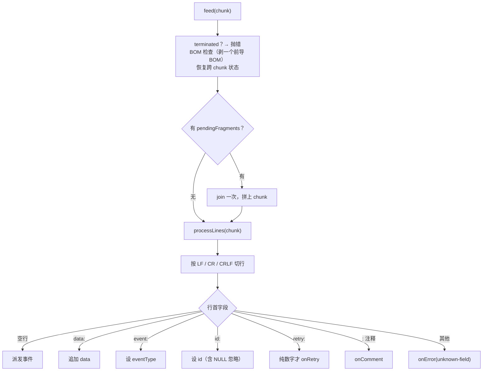

# eventsource-parser 说明

> 源码：`eventsource-parser/` —— npm 包 `eventsource-parser` 上游仓库（作者 rexxars / Espen Hovlandsdal）
> 版本：`4.1.3`，MIT
> 读法：§1–§4 是五分钟速查；§5–§10 是机制详解（行协议状态机 → 字段语义 → 换行 → 性能 → 内存 → 错误）；§11 往后是关系、版本史与附录。

## 目录

| 章节                                                               | 内容                              |
| ------------------------------------------------------------------ | --------------------------------- |
| [§1 一句话](#1-一句话)                                             | 这个库是什么                      |
| [§2 是什么、不是什么](#2-是什么不是什么)                           | 定位、依赖、文件地图              |
| [§3 快速上手](#3-快速上手)                                         | 最小可跑示例 + 最容易踩的坑速查   |
| [§4 API 速查](#4-api-速查)                                         | 两个入口、feed/reset、类型与回调  |
| [§5 解析机制：行协议状态机](#5-解析机制行协议状态机)               | 主流程图 + 状态变量               |
| [§6 字段语义：五种字段怎么处理](#6-字段语义五种字段怎么处理)       | data / event / id / retry / 注释  |
| [§7 换行与 BOM：CR 的坑](#7-换行与-bomcr-的坑)                     | 三种行结束符、跨 chunk、BOM       |
| [§8 性能：三条热路径优化](#8-性能三条热路径优化)                   | LF 快路径 / 字符码前缀 / 分片缓冲 |
| [§9 内存防护：maxBufferSize](#9-内存防护maxbuffersize)             | 上限怎么算、溢出后如何            |
| [§10 错误处理：ParseError](#10-错误处理parseerror)                 | 三种 ErrorType 的触发与语义       |
| [§11 和 eventsource-encoder 对跑](#11-和-eventsource-encoder-对跑) | 编解码往返的真实结果              |
| [§12 版本历史](#12-版本历史)                                       | 3.0 → 4.1 的断点与修复            |
| [§13 同目录相关库](#13-同目录的相关库)                             | 选型对照                          |

## 1. 一句话

把**一段 `text/event-stream` 字节流**变成**一个个事件对象**的工具。源码共 879 行（`src/` 五个文件），复杂度集中在两件事上：**行协议状态机**（§5–§7）和**性能**（§8）。它是 `eventsource-encoder` 的镜像——那边只编码，这里只解析。

## 2. 是什么、不是什么

**是什么**：零运行时依赖、source-agnostic 的流式 SSE 解析器。`package.json` 的 `dependencies` 为空，devDependencies 只有 `eventsource-encoder`（测试用）、vitest、oxfmt/oxlint、changesets 等。

**不是什么**：不做网络请求、不管连接/重连/背压/保活，也不解析 `EventSource` 那个完整的浏览器 API。它只做「喂字节 → 回调事件」，是 eventsource-client、polyfill 的积木。README 开篇即声明：要现代客户端看 `eventsource-client`。

工程面：

- `type: "module"`，**只有 ESM 构建**（4.0 起砍掉 CJS）。`exports` 给 `source`（`./src/index.ts`）和 `default`（`./dist/index.js`）；stream 变体单独在 `./stream` 子路径导出，为的是让没有 `TransformStream` 构造器的环境也能加载主包（`package.json` 的 `exports`）。
- `engines.node >= 22.12`（4.0 起，原为 18/20）；CI 同时跑 Node、Bun、Deno（`package.json` 的 `test:bun` / `test:deno`）。
- `files` 只发 `dist` + `src`，`sideEffects: false`。
- 用 changesets 发版，`CHANGELOG.md` 自动生成。

文件地图（`src/` 五个文件，全部运行时逻辑）：

| 文件        | 行数 | 作用                                              |
| ----------- | ---- | ------------------------------------------------- |
| `parse.ts`  | 576  | 全部实现：`createParser` + 状态机 + 热路径        |
| `types.ts`  | 138  | 4 个接口：parser、message、callbacks、config      |
| `stream.ts` | 118  | `EventSourceParserStream`（TransformStream 包装） |
| `errors.ts` | 44   | `ParseError` 类 + `ErrorType` 联合                |
| `index.ts`  | 3    | 纯 re-export                                      |

## 3. 快速上手

```ts
import { createParser, type EventSourceMessage } from 'eventsource-parser';

const parser = createParser({
  onEvent(event: EventSourceMessage) {
    console.log('id:', event.id ?? '<none>');
    console.log('event:', event.event ?? '<none>');
    console.log('data:', event.data);
  },
});

for await (const chunk of getSomeReadableStream()) {
  parser.feed(chunk); // 任意切分，不必对齐行边界
}

parser.reset(); // 换一条新流前必须 reset
```

stream 变体（Node 22.12+ / 现代浏览器）：

```ts
import { EventSourceParserStream } from 'eventsource-parser/stream';

const eventStream = response.body
  .pipeThrough(new TextDecoderStream())
  .pipeThrough(new EventSourceParserStream());
```

> [!warning] 最容易踩的坑（后面各有一整节）
>
> 1. `event` 字段**默认是 `undefined`，不是 `'message'`**——和浏览器 `EventSource` 的 `onmessage` 语义相反（§6.2）。
> 2. `event.id` 只反映**本块自己声明的 id**，不跨块持久；要断点续传得用 `onId` 自己维护 `lastEventId`（§6.3）。
> 3. `retry: `（空串）会**报错**，不像 `event`/`id`/`data` 空值那样静默（§6.4）。
> 4. `data:` 值里出现裸 `\r` 会**吞掉后面的内容**（§7.1）。
> 5. `reset({consume: true})` **不会补派事件**，只触发已缓冲行的字段副作用（§4.3）。
> 6. `maxBufferSize` 溢出后 parser 进入**终止态**，再 `feed` 直接抛错（§9）。

## 4. API 速查

两个入口，全部状态都在闭包内，外部不可见。

| 导出 / 类型                | 签名 / 形状                                                                         | 作用                                 |
| -------------------------- | ----------------------------------------------------------------------------------- | ------------------------------------ |
| `createParser(config)`     | `(ParserConfig) => EventSourceParser`（`parse.ts:23`）                              | 建 parser 实例                       |
| `parser.feed(chunk)`       | `(string) => void`（`parse.ts:77`）                                                 | 喂一段字节，任意切分                 |
| `parser.reset({consume?})` | `({consume?: boolean}) => void`（`parse.ts:506`）                                   | 复位状态，换新流前必须调用           |
| `EventSourceParserStream`  | `TransformStream<string, EventSourceMessage>`（`stream.ts:78`）                     | stream 变体，事件从 stream 本身流出  |
| `EventSourceMessage`       | `{data: string, event?, id?}`（`types.ts:40`）                                      | 解析出的事件；`data` 唯一必填        |
| `EventSourceParser`        | `{feed, reset}`（`types.ts:10`）                                                    | parser 实例接口                      |
| `ParserCallbacks`          | `onEvent/onId/onRetry/onComment/onError`（`types.ts:66`）                           | 回调集合                             |
| `ParserConfig`             | `ParserCallbacks + {maxBufferSize?}`（`types.ts:119`）                              | `createParser` 入参                  |
| `ParseError`               | `Error` 子类（`errors.ts:12`）                                                      | 解析错误，带 `type/field/value/line` |
| `ErrorType`                | `'invalid-retry' \| 'unknown-field' \| 'max-buffer-size-exceeded'`（`errors.ts:5`） | 错误类型联合                         |

### 4.1 回调触发时机

| 回调        | 触发时机                                                                  |
| ----------- | ------------------------------------------------------------------------- |
| `onEvent`   | 空行结束一个「含 data」的块时（`dispatchEvent`，`parse.ts:487`）          |
| `onId`      | 空行结束一个「含合法 id」的块时，**在 onEvent 之前**，无论块里有没有 data |
| `onRetry`   | 遇到纯数字 `retry:` 字段时（`processField`，`parse.ts:443`）              |
| `onComment` | 遇到 `:` 开头的行时（`parseLine`，`parse.ts:381`）                        |
| `onError`   | 完整行是未知字段 / 非法 retry / 缓冲区溢出时                              |

### 4.2 `feed` 的语义：只进不出

`feed(chunk)` **不返回**解析结果（`types.ts:19` 的注释明说 "does not return a parsed message"），全靠回调。chunk 可以任意切分——不到行尾的尾巴会被 hold 住，拼到下一段（§8.3）。

### 4.3 `reset({consume: true})` 到底做了什么

`reset` 清空所有状态（`parse.ts:506-520`）。传 `consume: true` 时，**只**把尚未成行的缓冲内容当作「补了一个换行」解析一次（`parseLine(incompleteLine, 0, len)`）——但这**不会派发事件**，因为没有空行。实测：

```ts
const p = createParser({ onEvent: e => console.log('EVENT', e) });
p.feed('data: partial'); // 没换行，缓存在 pendingFragments
p.reset({ consume: true }); // 不输出 EVENT —— data 被写进缓冲又清掉

const q = createParser({ onError: e => console.log('ERR', e.type, e.value) });
q.feed('retry: abc'); // 缓存的合法前缀（retry:）
q.reset({ consume: true }); // ERR invalid-retry "abc" —— 触发了字段副作用
```

所以 `consume: true` 的实用价值是**收尾时把已缓冲的非法字段（如非法 retry）报告出去**，不是「flush 出最后一条事件」。README 那句 "flush any remaining data" 容易误读。真正要 flush 事件得自己在流的末尾补一个 `\n\n`。

## 5. 解析机制：行协议状态机

SSE 是行协议：`field: value` 每行一个字段，空行结束一条消息。解析器维护 5 个状态变量，`feed` 把字节切成行，逐行改状态、空行派发。



状态变量（`parse.ts:38-62`）：

| 变量                 | 含义                                  |
| -------------------- | ------------------------------------- |
| `pendingFragments`   | 尚未成行的尾巴（分片存，见 §8.3）     |
| `data` / `dataLines` | 当前块的 data 累积值 / 已见 data 行数 |
| `eventType`          | 当前块的 event 类型                   |
| `id`                 | 当前块的 id（含 NULL 则忽略）         |
| `skipNextLineFeed`   | 上一 chunk 尾的 `\r` 待定，见 §7.2    |
| `skippingLine`       | 正在丢弃一条不可能合法的行            |
| `terminated`         | 缓冲区溢出后置位，feed 抛错           |

**派发函数** `dispatchEvent`（`parse.ts:487`）是整个状态机的唯一出口：

```ts
function dispatchEvent() {
  if (id !== undefined) onId?.(id); // id 先报，且块无 data 也报
  if (dataLines > 0) {
    onEvent?.({ id, event: eventType, data }); // 只有 data 才产生事件
  }
  id = undefined; // 注意：id 在这里被清零（§6.3 的坑）
  data = '';
  dataLines = 0;
  eventType = undefined;
}
```

关键点：**只有含 `data:` 的块才会产生事件**。纯 `id:`/`retry:`/注释块只改状态或触发对应回调，不产生 `onEvent`。

## 6. 字段语义：五种字段怎么处理

字段名**区分大小写、不做 case folding**（`processField` 的 `switch` 精确匹配，`parse.ts:443`）。五种合法字段：`data` / `event` / `id` / `retry` / 注释（`:`）。

### 6.1 `data:` —— 拼接 + 剥一个空格

- 每行 `data:` 的值追加进 data 缓冲；多行用 `\n` 连接（`parse.ts:453` 附近的 `dataLines === 0 ? value : \${data}\n${value}\`）。
- **只剥冒号后的一个空格**：`data:x` → `"x"`，`data: x` → `"x"`，`data:  x`（两个空格）→ `" x"`（实测）。这是 SSE 规范规定的行为，不是偷懒。

```js
feed('data: a\ndata: b\n\n'); // → {data: 'a\nb'}
feed('data:  x\n\n'); // → {data: ' x'}   ← 两个空格保一个
```

### 6.2 `event:` —— 空值重置为 undefined

`event:` 设 `eventType`，**空串重置为默认**（`eventType = value || undefined`）。所以：

```js
feed('event: a\ndata: 1\n\nevent: \ndata: 2\n\n');
// → [{event:'a', data:'1'}, {data:'2'}]   ← 第二个无 event 字段
```

> [!warning] 默认是 `undefined`，不是 `'message'`
> 浏览器 `EventSource` 会把未声明 event 的事件落到 `onmessage`（默认 `message`）；这个 parser **不补**，`event` 就是 `undefined`（`types.ts:40` 的注释明确写了这点）。消费方要自己 `event.event ?? 'message'`。

### 6.3 `id:` —— 含 NULL 忽略，且不跨块持久

- 值含 `\0`（U+0000）时整字段忽略（`parse.ts:406` 附近的 `if (!value.includes('\0')) id = value`）。
- 空 id 是合法值：`id: ` 会报 `''`（实测）。

> [!warning] `event.id` 是本块自带 id，不持久
> `dispatchEvent` 末尾 `id = undefined`（`parse.ts:497`），所以下一块没写 `id:` 时，`event.id` 是 `undefined`，而不是沿用上一条的 id。实测：
>
> ```js
> feed('id: 1\ndata: a\n\ndata: b\n\n');
> // → [{id:'1', data:'a'}, {data:'b'}]   ← 第二条没有 id
> ```
>
> 这与浏览器 `EventSource`（`MessageEvent.lastEventId` 持久）以及 WHATWG 规范里「last event ID buffer 持久」的语义不同。要断点续传，按 README 的做法用 `onId` 自己维护：
>
> ```ts
> let lastEventId = '';
> const parser = createParser({
>   onId: id => {
>     lastEventId = id;
>   }, // 只在有新 id 时被调，天然持久
>   onEvent(event) {
>     /* 用 lastEventId 拼 Last-Event-ID 头 */
>   },
> });
> ```

### 6.4 `retry:` —— 纯数字才认，否则报错

- 值由纯 ASCII 数字组成（`/^\d+$/`）才 `onRetry(parseInt(value, 10))`；`retry: 0` 合法，会报 `0`。
- **其它一律 `onError`**，包括**空串**：`retry: ` 不匹配 `/^\d+$/` → `invalid-retry`（实测）。这与 `event`/`id`/`data` 的空值静默处理不对称——`retry` 的空值是错误。

```js
feed('retry: 500\nretry: abc\nretry: \n\n');
// → onRetry(500)；onError invalid-retry "abc"；onError invalid-retry ""
```

### 6.5 注释（`:` 开头）—— 默认丢弃

注释客户端读不到，用途是保活。不配 `onComment` 时整行丢弃（4.0 起，未配回调的注释不缓冲）；配了才回调。前导空格**不剥**：`: comment` 报的是 `" comment"`（带前导空格，README 有 NOTE）。这与 encoder 那侧的 `encodeComment` 语义正好对应。

### 6.6 未知字段 —— 只有完整行才报错

字段名不是上面五种（如 `foo: bar`），在**完整行**里触发 `onError`，`type: 'unknown-field'`，附 `field`/`value`/`line`。4.0 的关键变更：**不可能成为合法字段的不完整行会被提前丢弃，不触发 onError**（`shouldBufferTrailing` 只缓冲 `data`/`event`/`id`/`retry`/`:` 开头的尾巴，`parse.ts:213`）。

## 7. 换行与 BOM：CR 的坑

SSE 规范把 **`\n`、`\r`、`\r\n` 三种都当行结束符**。`processLines` 里先看 chunk 里有没有 `\r`：没有走 LF 快路径，有走慢路径（逐个找最近的 `\r`/`\n`，`parse.ts:257` 起）。

### 7.1 `data:` 值里的裸 CR 会吞内容

和 encoder 那侧（[../eventsource-encoder/overview.md](../eventsource-encoder/overview.md) §8.2）是同一枚硬币的另一面：裸 CR 在值里就是行结束符，客户端一定断行。实测：

```js
feed('data: a\rb\n\n');
// → {data: 'a'} + onError unknown-field value:''   ← b 成了无冒号的字段名，直接丢
```

所以「想保留 CR」对 parser 同样无解——只能让上游 `JSON.stringify` 包一层（`\r` → `\\r`，报文里没有裸 CR），或 base64。

### 7.2 跨 chunk 的 `\r` 歧义

chunk 结尾的 `\r` 是二义的：可能是裸 CR 行结束，也可能是 `\r\n` 的前半（`\n` 在下一 chunk）。解析器用 `skipNextLineFeed` 记住「下一 chunk 开头若遇 `\n` 要吞掉」（`parse.ts:156-175` 的 `resumeAfterSkip`）。实测三种行结束符 + 跨 chunk 拆分结果一致：

```js
feed('data: a\rdata: b\r\r'); // CR：→ {data:'a\nb'}
feed('data: a\r\ndata: b\r\n\r\n'); // CRLF：→ {data:'a\nb'}
feed('data: a\r', '\ndata: b\r\n\r\n'); // CRLF 跨 chunk 拆：→ {data:'a\nb'}
feed('data: a\r', 'data: b\n\n'); // 裸 CR 跨 chunk：→ {data:'a\nb'}
```

这是 3.0.4 修的 bug（"cr+lf spanning chunks emit two events instead of one"）。

### 7.3 BOM：一个前导 BOM 剥掉，跨 chunk 也认

先补基础：**BOM = Byte Order Mark（字节顺序标记）**，是 Unicode 字符 **U+FEFF**（`ZERO WIDTH NO-BREAK SPACE`，零宽不换行空格），放在字节流/文件开头标识字节序和编码。同一个 U+FEFF 按不同编码写出来是不同字节：UTF-8 是 `EF BB BF`（三字节，纯「标记我是 UTF-8」），UTF-16 大端是 `FE FF`、小端是 `FF FE`——「Byte Order」这名字就来自 UTF-16/32 靠 `FE FF`/`FF FE` 互为反序来判断多字节码点高位在前还是低位在前。

UTF-8 的 BOM 其实是多余甚至有害的：不影响解码，但会**混进第一个字段名**。Windows 记事本/某些编辑器/服务器爱在流开头塞一个，若解析器不剥，第一个字段名会变成 `\uFEFFdata`，匹配不上 `data:`/`event:`/`id:`，**第一条事件就丢了**。所以 `feed` 开头剥**一个**前导 BOM，两种形态都认：解码后的 `U+FEFF` 和原始三字节 `0xEF 0xBB 0xBF`（`parse.ts:84-95`）。剥 BOM 的检查会**等待**：空 chunk 不会提前终结检查（4.1.1 修复），前缀不匹配的字节原样当输入。实测：

```js
feed('\uFEFFdata: x\n\n'); // 解码形态 → {data:'x'}
feed('\xEF\xBB', '\xBFdata: x\n\n'); // 原始形态跨 chunk → {data:'x'}
```

## 8. 性能：三条热路径优化

SSE 的绝大多数流量是「`data: ...` + 空行」的短消息（ChatGPT 式流）。库在保证规范正确的前提下，把常见形状做成了常数开销。

### 8.1 LF 快路径

`processLines` 先 `chunk.indexOf('\r')`，没有 `\r` 就走纯 LF 扫描：每次 `indexOf('\n')` 找下一行，`data:`/`event:` 的判定**内联**在循环里，不做慢路径的 CR 簿记（`parse.ts:261` 起）。这是 3.0.7 的 "~3.75x faster" 主要来源。

### 8.2 字符码前缀判定，替代 `startsWith`

`isDataPrefix` / `isEventPrefix` 手写 charCodeAt 比较（`parse.ts:537` / `parse.ts:562`），注释说 benchmark 显示比 `chunk.startsWith('data:', i)` 快约 20%。`shouldBufferTrailing` 也用首字符码先粗筛（`:`=58 / `d`=100 / `e`=101 / `i`=105 / `r`=114），再用 `isPotentialField` 逐字符确认（`parse.ts:213` 起）。

这里有个「为什么用 `charCodeAt(i)` 而不是更简洁的 `line[i]`」的点：两者在这个函数里**功能完全等价**——`isPotentialField` 的循环 guard `i < line.length && i < field.length` 把 `i` 锁在有效下标内，`line[i]` 永远是定义过的单字符；函数末尾 `charCodeAt(field.length) === 58` 越界时返回 `NaN`、`line[field.length] === ':'` 越界时是 `undefined`，都判 false，行为一致。差别只在**返回类型**：`charCodeAt` 返回数字（UTF-16 code unit，一个小整数），`line[i]` 返回长度为 1 的字符串对象；数字 `!==` 是单次整数比较，字符串 `!==` 要走字符串相等逻辑。实测这个循环里 `charCodeAt` 快约 2 倍（15–22ms vs 33–34ms / 300 万次）。这是热路径上「可读性让位给常数开销」的典型取舍，和 `isDataPrefix` 的注释是同一套逻辑。

### 8.3 分片缓冲，避免 O(N²)

一条大 `data:` 被切成很多小块时，若每 `feed` 都 `prefix + chunk` 字符串拼接会 O(N²)。`feed` 把未成行的尾巴**存成数组分片**（`pendingFragments`），只在行结束符到达时 `join` 一次（`parse.ts:38-55` 的注释 + `parse.ts:130` 附近的 join）。这是 3.0.8 的修复。4.1.3 又把慢路径里「含大量 CR 行」的二次扫描修掉了（`crIndex`/`lfIndex` 复用，`parse.ts:300` 附近）。

## 9. 内存防护：maxBufferSize

默认不设上限，恶意/故障流可以让缓冲无界增长。传 `maxBufferSize`（字符数）封顶。两处缓冲会计入（`types.ts:119` 的注释说清）：

1. 尚未成行的合法尾巴（`pendingFragmentsLength`）；
2. 进行中事件已累积的 data（`data.length`）。

检查点在 `checkForBufferOverflow`（`parse.ts:226`）：两者之和超限 → 发 `max-buffer-size-exceeded` 错误、清空所有状态、置 `terminated = true`。之后 **`feed` 直接抛错**（`parse.ts:78`），直到 `reset()`。

```ts
const p = createParser({ maxBufferSize: 3, onError: e => console.log(e.type) });
p.feed('data: '); // 'data: ' 6 字符 > 3，立即溢出 → max-buffer-size-exceeded
p.feed('more'); // throw: Cannot feed parser: it was terminated…
p.reset(); // 复位，可继续
```

stream 变体里这个错误**无条件 `controller.error`**（`stream.ts:98`），即使 `onError` 设的是忽略——因为底层 parser 已不可恢复，而 stream 包装层无法调用 `reset`。

## 10. 错误处理：ParseError

`ParseError`（`errors.ts:12`）是 `Error` 子类，带 `type` / `field?` / `value?` / `line?`。三种 `ErrorType`：

| type                       | 触发                                                          | 携带                   | 是否致命 |
| -------------------------- | ------------------------------------------------------------- | ---------------------- | -------- |
| `unknown-field`            | 完整行是未知字段（`processField` 的 default，`parse.ts:443`） | `field`/`value`/`line` | 否       |
| `invalid-retry`            | `retry:` 值非纯数字（含空串）                                 | `value`/`line`         | 否       |
| `max-buffer-size-exceeded` | 缓冲超 `maxBufferSize`                                        | 无（消息含上限数）     | **是**   |

- **默认忽略**：`onError` 不配时错误静默吞掉（多数客户端选择忽略并重试）。
- 前两种错误不打断解析，`feed` 继续跑；第三种终止 parser。
- 4.0 起，被提前丢弃的不完整行**不**触发 `onError`，也没有 `line`/`field`/`value` 可查。

## 11. 和 eventsource-encoder 对跑

两边是同一作者、同一协议的两端：`eventsource-encoder` 编码，`eventsource-parser` 解析。用 Node 直接对跑（两仓库都没 dist，靠 type stripping）：

```js
import { encode } from '../eventsource-encoder/src/encode.ts';
import { createParser } from './src/parse.ts';

const events = [];
const p = createParser({ onEvent: e => events.push(e) });
p.feed(encode({ id: '42', event: 'tick', data: 'a\nb' }));
// → [{id:'42', event:'tick', data:'a\nb'}]  ← 逐字节往返还原
```

编码侧在 `data` 里做换行归一（`\r\n`/`\r` → `\n`）和逐行前缀，解析侧按行拼回——所以多行 data 能无损往返；而**裸 CR 语义**两边都保不住（encoder 归一、parser 断行），这就是两边文档各自 §7/§8 写「CR 无解」的共同原因。防注入视角：encoder 把注入的 `\n` 变成「同字段下一行」，parser 端看到的就是合法多行 data，不会误判成新字段——两边的责任正好咬合。

## 12. 版本历史

| 版本  | 要点                                                                                                |
| ----- | --------------------------------------------------------------------------------------------------- |
| 3.0.0 | 回调从 `onParse` 单回调拆成 `onEvent`/`onRetry` 等对象回调；`ParsedEvent` 改名 `EventSourceMessage` |
| 3.0.4 | 修 CRLF 跨 chunk 拆成两条事件的 bug                                                                 |
| 3.0.7 | LF 快路径 + 单遍行处理，约 3.75x 提速                                                               |
| 3.0.8 | 修单事件跨多 chunk 的 O(N²)（分片缓冲）                                                             |
| 3.1.0 | 新增 `maxBufferSize`                                                                                |
| 3.1.1 | 修 `id:` 含 NULL 清空已缓冲 id 的 bug                                                               |
| 4.0.0 | 要求 Node ≥22.12、砍 CJS、不完整非法行提前丢弃（不再缓冲）                                          |
| 4.1.0 | 新增 `onId` 回调（含无 data 的块）                                                                  |
| 4.1.1 | 修前导 BOM 跨空 chunk / 跨 chunk 拆分导致首事件丢失                                                 |
| 4.1.2 | 修处理 chunk 中强制缓冲上限检查                                                                     |
| 4.1.3 | 修慢路径含大量 CR 行时的二次扫描                                                                    |

## 13. 同目录的相关库

| 库                    | 职责                                         | 与本库关系                   |
| --------------------- | -------------------------------------------- | ---------------------------- |
| `eventsource-encoder` | 编码：对象 → `text/event-stream` 字节        | 镜像，测试里用它生成 fixture |
| `eventsource-client`  | 现代全功能客户端（连接/重连/背压）           | 本库是它的积木               |
| `eventsource`         | WHATWG `EventSource` API 的跨运行时 polyfill | 本库可作为其底层解析器       |

选型上：要**完整客户端**（自动重连、Last-Event-ID 管理）用 `eventsource-client`；要**只解析**的轻量积木用本库；要**编码**用 `eventsource-encoder`。
