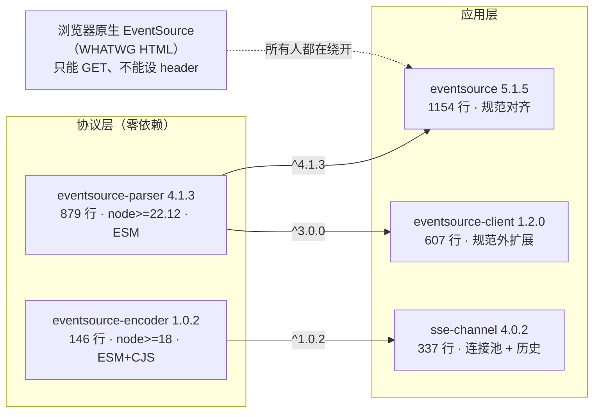
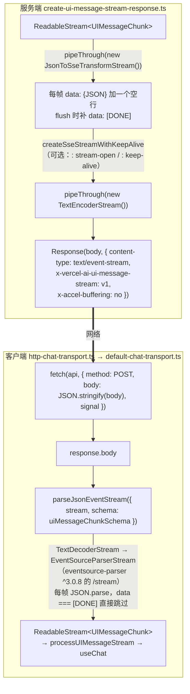
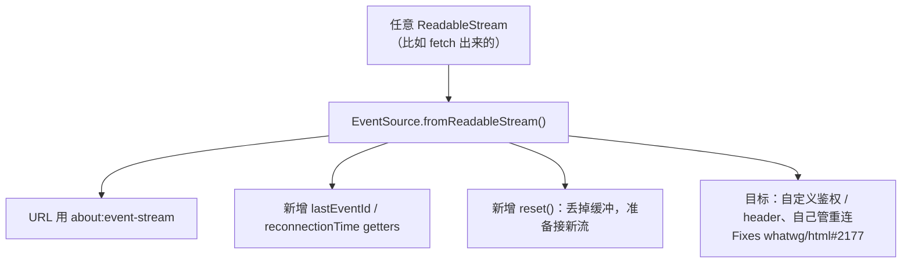

# SSE 生态：五个仓库、原生 API 与它的天花板

一条 SSE 连接要两个人干：一端把事件编成 `data: …\n\n`，另一端解回来。这个仓库里五个包正好把这条线切成两半、两个方向，外加一个浏览器标准的"官方 API"横在旁边——而所有人都在绕开它。

本文回答五件事：五个包怎么分工、两端如何握手、为什么 `eventsource-client` 不对齐标准、AI SDK 用什么姿势、以及原生 `EventSource` 为什么被弃用、规范会不会改。

## 目录

- [0. 一张图看清生态](#0-一张图看清生态)
- [1. 五个仓库的分工](#1-五个仓库的分工)
- [2. 两端如何握手](#2-两端如何握手实测)
- [3. `eventsource-client` 为什么不对齐标准](#3-eventsource-client-为什么不对齐标准)
- [4. AI SDK 的做法](#4-ai-sdk-的做法)
- [5. 为什么大家不用原生 EventSource](#5-为什么大家不用原生-eventsource)
- [6. 规范会不会改](#6-规范会不会改)
- [7. 结论](#7-结论)

## 0. 一张图看清生态



注意 `eventsource-parser` 上分出了两个 major：官方客户端吃 v4，扩展客户端还停在 v3（见 §1.2）。

## 1. 五个仓库的分工

### 1.1 同一个作者，三种定位

五个包作者都是 Espen Hovlandsdal（`rexxars`），所以不是重复造轮子，是刻意拆分：

| 项目                  | 版本  | 角色                                         | 方向 | 依赖                         | 源码    |
| --------------------- | ----- | -------------------------------------------- | ---- | ---------------------------- | ------- |
| `eventsource-parser`  | 4.1.3 | 协议层：字节流 → 事件对象，零依赖            | 解   | —                            | 879 行  |
| `eventsource`         | 5.1.5 | 规范级客户端（WHATWG 语义，七个运行时测试）  | 解   | `eventsource-parser@^4.1.3`  | 1154 行 |
| `eventsource-client`  | 1.2.0 | 规范外的现代客户端（fetch + async iterator） | 解   | `eventsource-parser@^3.0.0`  | 607 行  |
| `eventsource-encoder` | 1.0.2 | 协议层：事件对象 → 字节，零依赖              | 编   | —                            | 146 行  |
| `sse-channel`         | 4.0.2 | 老式 Node 服务端通道（连接池 + 历史 + ping） | 编   | `eventsource-encoder@^1.0.2` | 337 行  |

`eventsource` 的 README 自己写了分工：「如果你要一个限制更少 API 的现代替代品，去看 `eventsource-client`」。两个客户端不是版本先后，是两条独立维护线。

### 1.2 两个客户端为什么不合并

```
eventsource 5.1.5        → eventsource-parser ^4.1.3   (engines node>=22.12，ESM-only)
eventsource-client 1.2.0 → eventsource-parser ^3.0.0   (engines node>=18)
                            支持 Chrome 63 / Safari 11.3 / Firefox 65 / Deno 1.30 / Bun 1.1.23
```

`eventsource-client` 承诺的兼容面（Chrome 63 那个年代）让它上不了 parser v4，所以两条线各走各的版本。这也是生态里同时存在 parser v3 和 v4 的原因之一（AI SDK 也在 v3，见 §4）。

### 1.3 `sse-channel` 与 `eventsource-encoder` 的关系

`sse-channel` 4.0.1 之前自己手写拼接字节，4.0.1 把 `parseMessage` 整体换成 `encoder.encode()`（提交 `41daab0 Validate message fields for newlines before sending`，删掉 46 行）。这是**新库给老库打补丁**，不是老库演进：`eventsource-encoder` 1.0.0 出在 2024-10，`sse-channel` 的 4.0.0 停在 2020-11。

编码抽走之后 `sse-channel` 剩下的才是它的本体：连接池 `connections[]`、历史环形缓冲 `history[]`、每 20s 的 `:\n` 心跳、按 `Last-Event-ID` 补发。

### 1.4 使用量（npm 周下载，2026-11-11 ~ 11-17）

```
eventsource-parser    124,534,359
eventsource           105,749,643
eventsource-client        380,622
eventsource-encoder       106,892
better-sse（生态外）      126,233
sse-channel                 2,027
```

`sse-channel` 已经基本没人用了，但它仍是"服务端通道"这一层唯一现成的参考实现。

## 2. 两端如何握手（实测）

`eventsource`（客户端）× `sse-channel`（服务端）是作者故意的搭配：`sse-channel/package.json` 的 devDependencies 里就写着 `eventsource: ^4.1.0`，测试里直接拿它当客户端。两者真正耦合的只有三件事：

```
① retry            服务端写 "retry: 300\n"       → 客户端把 #reconnectInterval 改成 300
② Last-Event-ID    客户端重连发头 "2"             → 服务端 sendEventsSinceId(res, '2') 补发
③ 注释心跳         服务端每 20s 写 ":\n"          → 客户端解析成 comment，不派发
```

用 `eventsource/.probe/interop.mts` 真跑（真实 fetch，不构建），结果：

| 场景                                                          | 结果                                                                                                                                                                                              |
| ------------------------------------------------------------- | ------------------------------------------------------------------------------------------------------------------------------------------------------------------------------------------------- |
| A：`retryTimeout: 300`，发 id 1/2 后掐 socket，断线期间发 3/4 | `+321ms` 收到 `error{message:'TypeError: terminated: other side closed'}`（`code` 为 `undefined`），`+628ms` 重连 → **retry 生效（307ms）**，请求头 `last-event-id="2"`，补发 `3`、`4` 且顺序正确 |
| B：id 用字符串 `'900'` → `'1000'`                             | 重连头 `"900"`，`'1000' <= '900'` 字典序为真 → **一条都不补**，`1000` 永久丢失                                                                                                                    |
| C：ping 的 `:\n`                                              | 700ms 内 `message` 事件数 = 0（注释不派发）                                                                                                                                                       |
| 附带发现                                                      | **新建连接不带 `Last-Event-ID` 时一条历史都不补**：`sse-channel/lib/sse-channel.js` 里 `lastEventId = … \|\| 0`，随后 `if (lastEventId)` 直接跳过                                                 |

所以"这两个库能不能配"的答案是能，但**契约里必须写死一条**：id 用自增数字、ASCII、单调递增。B 场景就是破约后的表现——静默丢消息，不报错。

## 3. `eventsource-client` 为什么不对齐标准

它的 README 开头叫 "Another one?"，明说 **Does NOT attempt to be API-compatible with the browser EventSource API**。原因是规范 API 的形状装不下面向程序的客户端：

| 需求                              | 规范 API               | `eventsource-client`                                 |
| --------------------------------- | ---------------------- | ---------------------------------------------------- |
| POST/PATCH/DELETE、带 body        | 只能 GET               | `method` / `body`                                    |
| 自定义 header（鉴权、追踪）       | 只能 `withCredentials` | `headers`                                            |
| 换 fetch 实现（代理、超时、mock） | 不允许                 | `fetch`                                              |
| Node 风格消费                     | DOM 事件               | `for await (const {data,id,event} of es)`            |
| 初始续传位置                      | 不能设                 | `initialLastEventId`                                 |
| 看注释行                          | 不可见                 | `onComment`                                          |
| 订阅名为 `error` 的事件           | `error` 被占用         | 可以                                                 |
| 观察重连时机                      | 只有一个 `error`       | `onConnect` / `onDisconnect` / `onScheduleReconnect` |

立场是显式的，`eventsource-client/src/constants.ts` 第一行注释：

```ts
// ReadyStates, mirrors WhatWG spec, but uses strings instead of numbers.
// Why make it harder to read than it needs to be?
export const CONNECTING = 'connecting'; // 规范是 0
```

配套还有：没有 `MessageEvent`（回调直接给 `EventSourceMessage` 普通对象）、不是 `EventTarget`（没有 `addEventListener`）、`close()` 之后还能 `connect()` 复活（规范里 CLOSED 是终局）。

代价有两处是**行为级偏差**，不只是 API 风格：

1. **完全不校验 `Content-Type`**。`eventsource-client/src/client.ts` 的 `onFetchResponse` 只判 `204`、`!body`、流类型；`Accept: text/event-stream` 只是发出去。官方 `eventsource` 有五道闸（204 / 非 200 / content-type / CLOSED / body），会把 `text/event-streaming`、`application/json` 一律拒掉。
2. **"可配置重连策略"还没实现**。README 特性列表写着 "Supports configurable reconnection policies"，但同一份 README 的 Todo 里还挂着 `- [ ] Configurable reconnection policy`。1.2.0 实际只有默认 `let reconnectMs = 2000`（官方是 3000）、服务端 `retry:` 经 `onRetry(ms)` 覆盖、`onScheduleReconnect({delay})` 只用来观察。

一个对齐的细节值得记：`onEvent` 里 `if (typeof msg.id === 'string') lastEventId = msg.id`，空 `id` 会把它清成 `''` 且不再发头——和官方同款行为，续传的坑两边一致。

## 4. AI SDK 的做法

AI SDK 的传输是「**SSE 帧 + 自研 JSON chunk 协议**」，四个现成库一个都没用，只借了 parser：



四个设计取舍：

1. **两端共用同一个解码点**：`ai/packages/provider-utils/src/parse-json-event-stream.ts` 那 20 行既吃 provider 的模型流（`createEventSourceResponseHandler`），也吃自己的 UI 流（`processResponseStream`）。
2. **编码不用 `eventsource-encoder`**：`JSON.stringify` 的输出不含裸 `\r`/`\n`，逐行加前缀 + 拒换行这套防护在这里是多余的。
3. **放弃 `Last-Event-ID` 续传**：全仓库 grep 0 命中。恢复走 `ChatTransport.reconnectToStream`（`GET {api}/{chatId}/stream`，`204` = 没有可恢复的流），续传状态挂在服务端的 chatId → stream 上。
4. **协议版本靠自定义头**：`x-vercel-ai-ui-message-stream: v1`。SSE 本身没有版本位，这是自己补的兼容开关。负载是 31 种 `UIMessageChunk`（`text-start` / `text-delta` / `tool-input-*` / `reasoning-*` / `error` / `finish-step` …），错误在流内当成数据发，因为开流之后状态码已经发出去了。

keep-alive 那段值得一提：`ai/packages/ai/src/ui-message-stream/create-sse-stream-with-keep-alive.ts` 只在 `controller.desiredSize > 0` 时才 enqueue 心跳，`keepAliveMs` 超过 `2147483647` 直接抛错——正好是 `sse-channel` 里 `| 0` 截断那个坑的显式防线。

## 5. 为什么大家不用原生 EventSource

一句话：**线格式很稳，`EventSource` 对象很僵**。

| 类别     | 具体问题                                     | 后果                                            |
| -------- | -------------------------------------------- | ----------------------------------------------- |
| 硬约束   | 只能 GET，不能带 body                        | POST prompt（AI SDK 全场景）、大 payload 全废   |
| 硬约束   | 不能设 header                                | 鉴权只剩 cookie / query token                   |
| 硬约束   | 不能换 fetch                                 | 代理、超时、mock、Workers 里自定传输都不行      |
| 消费模型 | DOM 事件（`onmessage` + `addEventListener`） | Node/CLI 里只能用回调，没有 `for await`         |
| 错误模型 | 一个 `error` 事件，拿不到状态码、拿不到 body | 4xx/5xx 时 `event.data` 被丢（见 §6 的 #12340） |
| 重连     | 浏览器自己管，只受 `retry:` 影响             | 无退避、无抖动、无上限、无回调、关不掉          |
| 无       | 版本协商、背压、注释可见性                   | 自研协议要自己补（§4 的版本头、`: keep-alive`） |

还有一层常被忽略的：**Node 至今没有默认的全局 `EventSource`**。Node 24.19 上实测：

```
node -e "typeof EventSource"                      → undefined
node --experimental-eventsource -e "typeof ..."   → function
```

服务端/CLI 从第一天就必须引第三方实现，而第三方实现"顺手加点功能"就不再是规范了——`eventsource-client` 就是这条路的产物（§3）。规范覆盖不到的地方，自然退化。

## 6. 规范会不会改

`text/event-stream` 不是独立 RFC，它活在 WHATWG HTML 标准里，所以改动要跟整本 HTML 一起走。截至 2026-11，`whatwg/html` 里 EventSource 相关的 issue / PR：

| 编号            | 内容                                              | 状态                           |
| --------------- | ------------------------------------------------- | ------------------------------ |
| **#2177**       | Setting headers for EventSource（2016-12 开）     | **open，76 条评论，10 年**     |
| **#12272**      | Add `EventSource.fromReadableStream()`（2026-03） | open，非 draft，1 个文件       |
| **#13140**      | 清掉过期的 `Last-Event-ID`（2026-10）             | open                           |
| #12578          | 给 EventSource 排队任务指定 task source           | open                           |
| #12381 / #12363 | BFCache 相关澄清                                  | open                           |
| #12340          | 4xx/5xx 不该丢 `event.data`                       | open，近期无评论               |
| #11976          | 派发事件用 task source                            | closed（2025-12 **未 merge**） |

结论：**边角语义在修，API 形状纹丝不动**。十年里被反复讨论的能力扩展只有 header 一项，且至今未落地；上表里近一年没有一项真正 merge 进去（唯一的 #11976 是被关掉而不是合并）。

真正有希望的是 #12272 的思路——不改造构造函数，而是加旁路：



也就是让 `EventSource` 从"客户端"降格成"解析器包装"，网络层交给 fetch。这条路兼容（构造函数语义不动），是唯一现实可行的方向；但它一旦落地就与 `eventsource-parser` 严重重叠，这大概是它仍躺在 open 里的原因之一。

顺带一个对照：`#13140` 要修的正是 §2/§3 里实测到的那个坑（`id:` 空行把缓冲清成 `''` 之后行为不明）。规范现在是**按 bug 报告在追生态实现**，而不是在演进 API。

## 7. 结论

1. **线格式可以放心用**：`data: …\n\n`、`id:`、`retry:`、`:` 注释十年没变，穿透代理也稳。
2. **别指望 `EventSource` 对象会变好**：web compat 让构造函数基本冻结，能力扩展只能走新 API，而新 API 的评审以年计。
3. **"没人用原生"本质是"没人用那段 DOM 绑定"**：AI SDK 那套（fetch + parser + 自研 chunk + 版本头）几乎就是 `fromReadableStream()` 想要的样子，只是它 2024 年就自己先做了。
4. **选型落点**：协议层用 `eventsource-parser` / `eventsource-encoder`；客户端要规范行为用 `eventsource`，要 POST / 自定义 fetch / async iterator 用 `eventsource-client`；服务端要现成的连接池 + 历史补发只有 `sse-channel`（并接受它的遗留行为），或者用 encoder + 框架原语自己写。

## 验证方式

- 互通实测：`eventsource/.probe/interop.mts`（tsx 直跑 `eventsource/src/index.ts`，`require` 加载 `sse-channel/index.js`，真实 fetch 打本地 http 服务），一次跑完 A/B/C 三个场景，`process.exit(0)` 收尾。输出里的时间戳是 `+Nms` 相对时间。
- 运行时事实：`node -v` = v24.19.0；`typeof EventSource` 与 `--experimental-eventsource` 对照实测。
- 规范现状：`api.github.com` 的 `repos/whatwg/html/issues` 与 `/pulls` 查询，读 `state` / `created_at` / `updated_at` 字段。
- 下载量：`api.npmjs.org/downloads/point/last-week/<pkg>`，区间 2026-11-11 ~ 11-17。

## 相关

- [eventsource 说明](overview.md)：规范级客户端的全部机制
- [eventsource-client 说明](../eventsource-client/overview.md)：规范外客户端的机制
- [eventsource-parser 说明](../eventsource-parser/overview.md)：解码层
- [eventsource-encoder 说明](../eventsource-encoder/overview.md)：编码层与防注入
- [sse-channel 说明](../sse-channel/overview.md)：服务端连接池、历史补发、遗留行为
