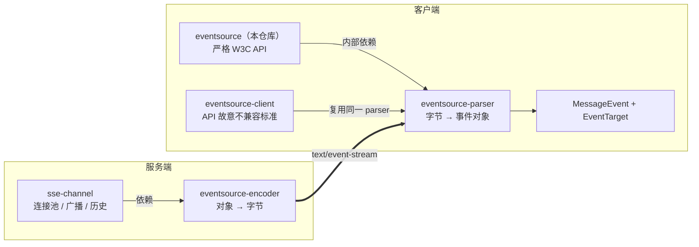
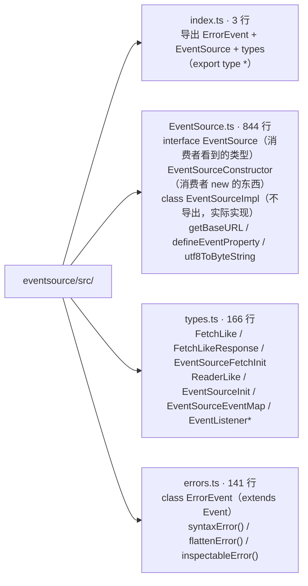
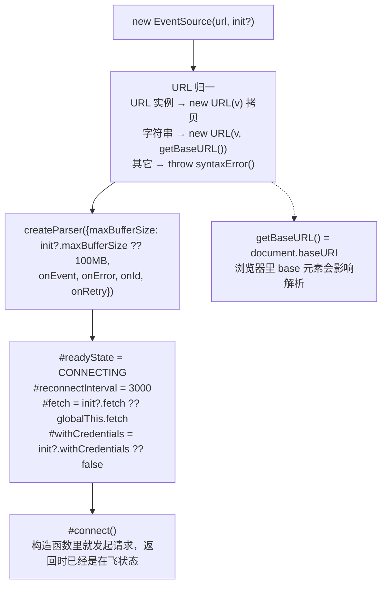
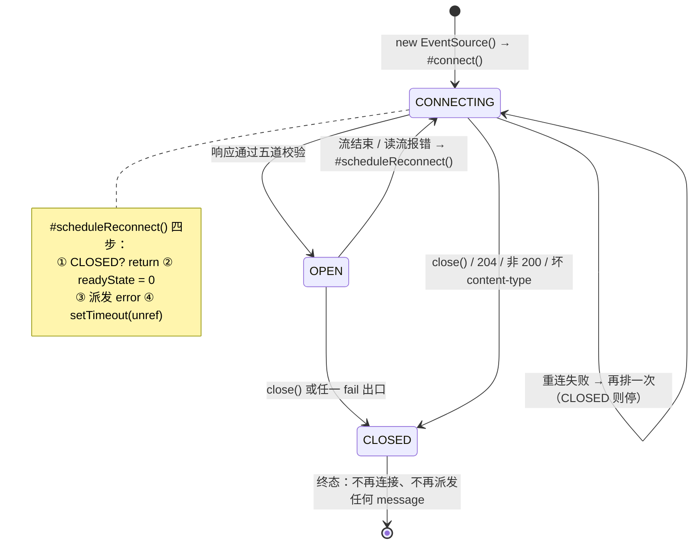
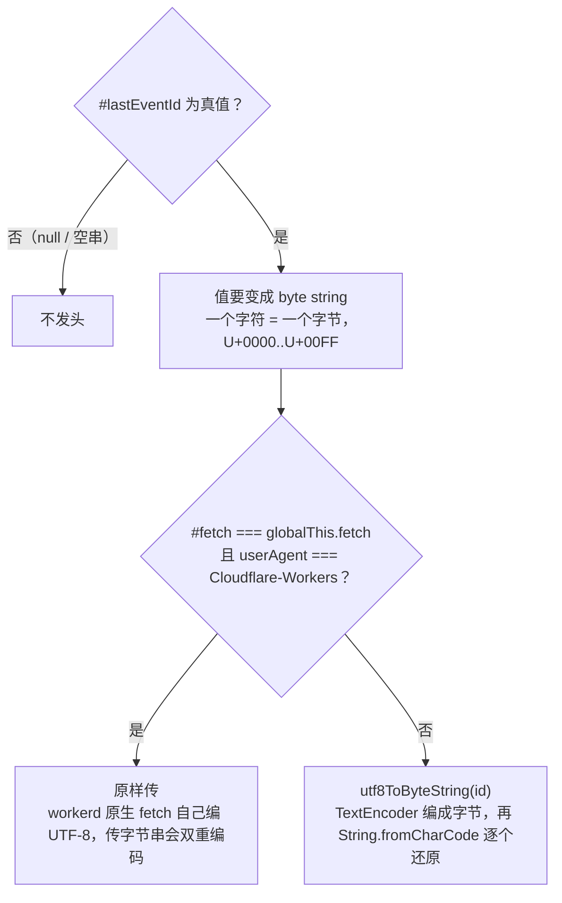
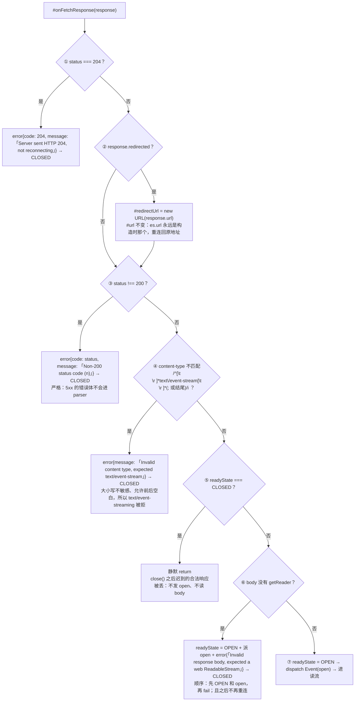
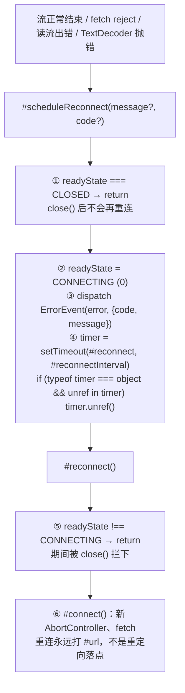
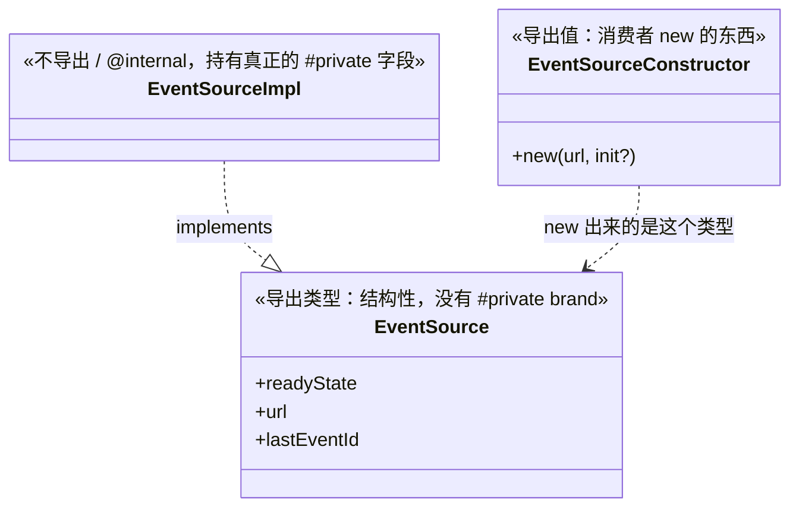
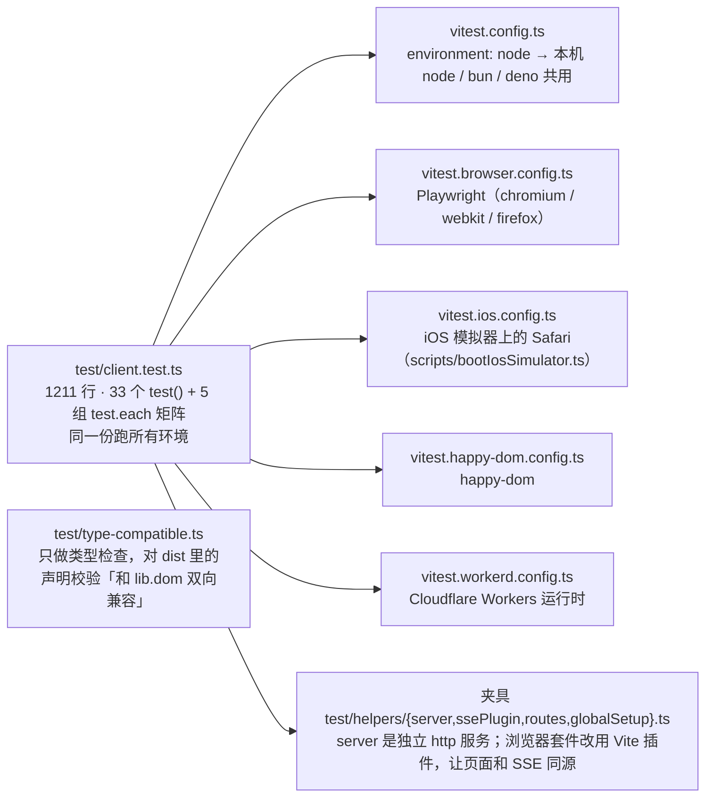

# eventsource 说明

> 源码：`eventsource/` —— npm 包 `eventsource`（GitHub `EventSource/eventsource`，作者 rexxars / Espen Hovlandsdal）
> 版本：`5.1.5`，MIT，TypeScript + ESM（v5 起不再发 CJS），Node ≥ 22.12
> 运行时只有 4 个文件 1154 行：`src/EventSource.ts`（844）、`src/types.ts`（166）、`src/errors.ts`（141）、`src/index.ts`（3），唯一依赖 `eventsource-parser@^4.1.3`
> 读法：§1–§4 是速查；§5–§9 是主路径（生命周期 → 发请求 → 校验 → 读流 → 分发）；§10–§14 是重连、关闭、错误模型、环境适配、类型设计；§15 起是实测与坑。

## 目录

| 章节                                                  | 内容                                            |
| ----------------------------------------------------- | ----------------------------------------------- |
| [§1 一句话](#1-一句话)                                | 这个库是什么                                    |
| [§2 是什么、不是什么](#2-是什么不是什么)              | 定位，和 client / parser / encoder 的关系       |
| [§3 快速上手](#3-快速上手)                            | 最小用法、自定义 fetch                          |
| [§4 结构](#4-结构文件与状态)                          | 文件地图、导出面、全部私有字段、构造顺序        |
| [§5 生命周期](#5-生命周期与-readystate)               | 状态机、事件顺序                                |
| [§6 发请求](#6-发请求)                                | 请求选项、Last-Event-ID 编码                    |
| [§7 响应校验](#7-响应校验五个出口)                    | 五个 fail 出口、content-type 正则               |
| [§8 读流与解析](#8-读流与解析)                        | decoder/parser 生命周期、半条事件怎么丢         |
| [§9 事件分发](#9-事件分发与-lasteventid)              | MessageEvent 构造、lastEventId 语义、`on*` 属性 |
| [§10 断开与重连](#10-断开与重连)                      | `retry:` 覆盖、无退避无上限、timer.unref        |
| [§11 关闭](#11-关闭)                                  | `close()` 五步、close 后迟到响应的行为表        |
| [§12 错误模型](#12-错误模型)                          | ErrorEvent 扩展、两种 error、错误文案表         |
| [§13 环境适配](#13-环境适配)                          | workerd、Safari、Node/Bun/Deno、浏览器          |
| [§14 类型设计](#14-类型设计为什么是-interface--const) | 为什么导出 interface + const 而不是 class       |
| [§15 实测行为表](#15-实测行为表)                      | 这次跑出来的 25 条                              |
| [§16 坑清单](#16-坑清单)                              | 按危险程度排                                    |
| [§17 版本历史与测试](#17-版本历史与测试)              | 5.1.5 → 3.x、一套用例跑七个运行时               |

## 1. 一句话

浏览器 `EventSource` 的**严格实现兼 polyfill**：`fetch()` 拿一个流，喂给 `eventsource-parser`，再用 `EventTarget` 派发；断开自动重连，带上 `Last-Event-ID`，并接受服务端 `retry:` 指定的间隔。

它和同作者的 `eventsource-client` 是两条路线：**这个库的目标是「和浏览器一模一样」**，超出规范的只有三处（§2 末尾）；`eventsource-client` 则故意不兼容标准 API。



## 2. 是什么、不是什么

**是什么**：

- `new EventSource(url, {withCredentials, fetch, maxBufferSize})`，`EventTarget` 子类，`readyState` 是数字 `0|1|2`，`CONNECTING/OPEN/CLOSED` 三份常量挂在实例和构造器上。
- 真重连：流正常结束、`fetch` reject、读流报错，都走同一条 `#scheduleReconnect` → `#connect` 路径（§10）。
- 真 `Last-Event-ID`：`#lastEventId` 跨重连保留，重连请求头里回传（§6）。
- 五个校验出口，全部按规范 fail 掉（§7）。

**不是什么**：

- **不做退避**：没有指数退避、没有抖动、没有最大重试次数。服务端说 `retry: 0` 就是 0ms 死循环（§15 实测 1ms 一次）。
- **不认 Node 裸 `http` 流**：只要 `body.getReader`，`Readable` 得自己转（这是 `eventsource-client` 用 `node.ts` 入口解决的事）。
- **不发 comment 事件**：心跳注释被 parser 直接丢掉，没有 `onComment` 钩子（`eventsource-client` 有）。
- **不把非 200 的响应体当事件流**：状态码不对直接 fail，5xx 的错误体不会进 parser（这点比 `eventsource-client` 严格，见 §7）。
- **没有 CJS 产物**：`"type": "module"`、`exports` 只有 `default`；Node 22.12 起可以 `require()` ESM，v5 借此去掉了双包风险。
- **不负责写 SSE**：编码是 `eventsource-encoder` 的事。

超出规范的部分只有三处，都在 README 的 "Extensions" 一节：`ErrorEvent` 的 `code`/`message`、`maxBufferSize` 选项、`fetch` 覆盖（配套 `Symbol.for('eventsource.supports-fetch-override')` 探测符号）。

相关：[eventsource-client 说明](../eventsource-client/overview.md)（同作者的非标准客户端，适合对读）、[eventsource-parser 说明](../eventsource-parser/overview.md)（本库的唯一依赖）、[eventsource-encoder 说明](../eventsource-encoder/overview.md)（反方向）、[sse-channel 说明](../sse-channel/overview.md)（服务端）。

## 3. 快速上手

```ts
import { EventSource } from 'eventsource';

const es = new EventSource('https://example.com/sse');

es.addEventListener('message', e => console.log(e.data, e.lastEventId));
es.addEventListener('notice', e => console.log('event: notice ->', e.data));
es.addEventListener('error', err => {
  // 非标准的扩展字段，用来区分「要重连」和「彻底失败」
  console.log(err.code, err.message, es.readyState);
});

setTimeout(() => es.close(), 10_000); // close() 之后不再重连
```

要加请求头（浏览器 `EventSource` 做不到）就走 `fetch` 覆盖：

```ts
const es = new EventSource(url, {
  fetch: (input, init) =>
    fetch(input, {
      ...init,
      headers: { ...init.headers, Authorization: `Bearer ${token}` },
    }),
});
```

代理 / HTTP2 / 忽略证书同理：换成 `undici` 的 `fetch` + `Agent` / `dispatcher`，库本身不提供这些选项（v3 删掉了）。

## 4. 结构：文件与状态



一个实例的全部私有字段（`EventSourceImpl`，全部是真 `#private`）：

```
#readyState       number                  0 | 1 | 2
#url              URL                     构造时快照（5.1.4：拷贝，防调用方后续改 URL 对象）
#redirectUrl      URL | undefined         最近一次响应的落地地址，每次响应重置；只影响 origin
#withCredentials  boolean
#fetch            FetchLike               构造时取 init.fetch ?? globalThis.fetch
#reconnectInterval number = 3000          可被服务端 retry: 改写
#reconnectTimer   Timeout | undefined     在等的重连定时器
#lastEventId      string | null = null    Last-Event-ID 的来源
#controller       AbortController | undefined  每次 #connect() 新建
#parser           EventSourceParser       createParser({maxBufferSize, onEvent, onError, onId, onRetry})
#onError / #onMessage / #onOpen          只记录 `on*` 属性那条注册，addEventListener 的不记
```

构造顺序（`constructor`）：



## 5. 生命周期与 readyState



一次成功连接的事件顺序（实测，见 §15）：

```
+  0ms  fetch 调用 #1
+  8ms  open        readyState=1
+  9ms  foo         data="hi"   lastEventId="7"
+  9ms  error       readyState=0   ← 流结束，开始等重连（code/message 都是 undefined）
+110ms  fetch 调用 #2（服务端 retry: 100）
```

注意 `open` 是在**响应头和 content-type 都通过之后**才派的，不是 fetch resolve 时。

## 6. 发请求

`#getRequestOptions()` 组出来的 `init`（`EventSourceFetchInit`）：

| 字段          | 值                                                 | 备注                                      |
| ------------- | -------------------------------------------------- | ----------------------------------------- |
| `mode`        | `'cors'`                                           | 固定                                      |
| `redirect`    | `'follow'`                                         | 重定向交给 fetch，落点记进 `#redirectUrl` |
| `headers`     | `{Accept: 'text/event-stream', ...Last-Event-ID?}` | 见下                                      |
| `cache`       | `'no-store'`                                       | 避免中间层缓存住无限流                    |
| `signal`      | `#controller.signal`                               | `close()` 靠它中止                        |
| `credentials` | `withCredentials ? 'include' : 'same-origin'`      | **只在 `'window' in globalThis` 时设置**  |

`credentials` 那行的注释是：某些环境（比如 Cloudflare Workers）给不支持的请求对象赋 `credentials` 会崩，所以非浏览器环境直接不写这个字段。实测 Node 下传到自定义 `fetch` 的 init 是：

```
{"mode":"cors","redirect":"follow","headers":{"Accept":"text/event-stream"},"cache":"no-store","signal":{}}
```

`Last-Event-ID` 的编码是三环境三套：



为什么非要转：头值只能是 byte string，`fetch()` 遇到 > U+00FF 的字符直接抛 `TypeError`，遇到 U+0080..U+00FF 会当 Latin-1 单字节发出去。5.1.3 之前没转，导致 `id: €` 的服务端**每次重连都失败**（fetch 抛错 → 再次重连 → 再抛）。

实测：`id: €é` 时自定义 `fetch` 收到的头是 `"â\u0080\u00acé"`，charCodes `226,130,172,195,169`，正好等于 `€é` 的 UTF-8 字节 —— 与原始 Unicode 字符串不相等。自己包一层 fetch 转发给 workerd 的人，得先把它解码回 Unicode。

## 7. 响应校验：五个出口

`#onFetchResponse` 是 async 方法，按顺序过闸：



`#failConnection(message?, code?)` = `close()` + 派 `ErrorEvent('error', {code, message})`。因为 `close()` 里会 `abort()`，所以非 200 / CT 不对时**服务端的连接也会被掐掉**（5.1.2 修的正是「校验失败后没中止请求」）。

## 8. 读流与解析

```ts
const decoder = new TextDecoder(); // 每个响应一个新 decoder
const reader = body.getReader();
let open = true;
do {
  const { done, value } = await reader.read();
  // close() 后立刻停
  if (this.#readyState === this.CLOSED) {
    open = false;
    break;
  }
  if (value) this.#parser.feed(decoder.decode(value, { stream: !done }));
  if (!done) continue;
  open = false;
  this.#parser.reset(); // ← 丢掉未闭合的半条事件
  this.#scheduleReconnect();
} while (open);
```

几个容易忽略的点：

- **decoder 是流式的**（`{stream: !done}`），所以一个 UTF-8 字符被切在两个 chunk 之间也没事。`new TextDecoder()` 默认非 fatal，坏字节变成 U+FFFD 而不是抛错。
- **parser 每个响应 reset 两次**：响应开始时 reset 一次，流结束时再 reset 一次。所以断在 `data: half` 中间，那半个事件**永远丢了**，重连后服务端得靠 `Last-Event-ID` 重新补（实测：重连后只收到新响应里完整的那条）。
- **没有背压控制**：`read()` 一次一次拉，但每读到一块就同步 `feed` 完，回调里做重活会直接堵住读（浏览器 `EventSource` 也这样）。
- **这块 async 函数里任何抛出都会掉进 `.catch(#onFetchError)`** —— 因为 `fetch(...).then(#onFetchResponse).catch(#onFetchError)` 接的是整条链。于是「读流 reject」「chunk 不是 buffer 导致 `TextDecoder` 抛错」都会被当成网络故障：派一个 error，然后重连（测试 `throws on fetch() yielding chunks that are not buffers` 断言的就是这个 error 事件）。
- `reader.cancel()` 从头到尾没被调用，停读全靠 abort 掉 fetch 的 signal。

## 9. 事件分发与 lastEventId

`#onEvent(event: EventSourceMessage)`：

```
① readyState === CLOSED → return        ← 一个 chunk 里派发到一半被 close()，剩下的丢掉（5.1.2）
② origin = (#redirectUrl ?? #url).origin    ← 重定向后是落点 origin（实测：a.test 重定向到 b.test，事件的 origin 是 https://b.test）
③ lastEventId = #lastEventId ?? ''      ← 是「最后一条 id 字段的值」，不是本事件的 id
④ new MessageEvent(event.event || 'message', {data, origin, lastEventId})
⑤ workerd 补丁：构造器没吃下 origin / lastEventId 时用 defineEventProperty 补上
⑥ dispatchEvent(messageEvent)
```

`lastEventId` 的语义值得单独记（5.1.1 修的就是这里）：

| 流里的内容                           | 派发时的 `lastEventId` | 重连时的 `Last-Event-ID` |
| ------------------------------------ | ---------------------- | ------------------------ |
| `id: 7` + `data: a`                  | `"7"`                  | `"7"`                    |
| 之后 `data: no-id`                   | `"7"`（缓冲值，不变）  | `"7"`                    |
| `id` 空行（`id:` / `id` 后直接空行） | `""`                   | **不发**                 |
| 从没出现过 `id`                      | `""`                   | 不发                     |

`id:` 空行会把缓冲清成 `''`（规范要求），此后既不更新 `lastEventId` 也不再发头 —— 实测确认，这是最容易在断线续传里踩空的一处。

`on*` 属性和 `addEventListener` 的关系：`onmessage` 的 setter 只是 `removeEventListener` 旧的 + `addEventListener` 新的，所以在哪个 `MessageEvent` 上触发，完全由事件名决定：

- `#onEvent` 用 `event.event || 'message'` 当事件名 → 没有 `event:` 字段、或 `event: message`、或 `event:` 为空（`event` / `event: ` 都算空串）时，`onmessage` 都会触发；`event: other` 不触发。
- v5 起两者按**注册顺序**执行（v4 及以前 `on*` 总是先跑）。

实测：

```
先 es.onmessage 再 addEventListener('message')  →  onmessage → listener
先 addEventListener('message') 再 es.onmessage  →  listener → onmessage
```

## 10. 断开与重连



重连间隔来源只有一个：`#reconnectInterval`，默认 3000，被 parser 的 `onRetry` 改写（服务端 `retry:` 字段）。实测（默认预算内数请求次数）：

| 服务端发的             | 实际间隔                    |
| ---------------------- | --------------------------- |
| `retry: 5`             | 5–6ms（另有首次 14ms 开销） |
| `retry: 0`             | 1ms 一个，60 次不喘气       |
| `retry: 1000000000`    | 只发 1 次，之后安静等       |
| `retry: 1.5`（非整数） | 忽略，仍用默认 3000ms       |
| `retry: abc`（非法）   | 忽略，仍用默认 3000ms       |

没有退避、没有抖动、没有次数上限 —— 服务端 `retry: 0` 就是自己打自己。客户端也不校验 `retry` 上界。

`unref()` 只对 Node/Bun 的 Timeout 对象做（浏览器/Deno 返回数字，`'unref' in timer` 会假）。这一条让「等着重连」不再阻止进程退出，v5.0.0 加的。

## 11. 关闭

```ts
close(): void {
  if (this.#reconnectTimer) clearTimeout(this.#reconnectTimer)
  if (this.#readyState === this.CLOSED) return
  if (this.#controller) this.#controller.abort()     // 在飞的请求立刻中止
  this.#readyState = this.CLOSED
  this.#controller = undefined
}
```

不清的东西：`#lastEventId`（实例不复用就无所谓）、`#reconnectTimer` 的引用、parser 的缓冲。也**不能**从 CLOSED 复活 —— 没有公开的 `reconnect()`/`open()`（这点和 `eventsource-client` 的 `connect()` 不同）。

close 之后各种「迟到」的东西会怎样（全部实测）：

| 迟到的东西                              | 行为                                                                |
| --------------------------------------- | ------------------------------------------------------------------- |
| 200 + 合法 content-type                 | 静默丢弃：不发 `open`、不发消息、body 不读（§7 闸 ⑤）               |
| 500 / 非法 content-type / body 非法     | **仍然派发 `error` 事件**（此时 `readyState` 已经是 2），不重连     |
| fetch reject（AbortError）              | 静默 return，无事件                                                 |
| fetch reject（其它错误）                | `#onFetchError` → `#scheduleReconnect` → 因 CLOSED 直接返回，无事件 |
| 已经 feed 进 parser、还没派发的剩余事件 | 被 `#onEvent` 的 CLOSED 检查挡掉（5.1.2）                           |

「500 迟到还派 error」是个不对称：闸 ⑤ 的 CLOSED 检查放在状态码校验**之后**，所以状态码失败会绕过它。监听器里 `close()` 之后又收到一次 error 是正常的，别当 bug 排查。

## 12. 错误模型

`ErrorEvent extends Event`，比规范多两个字段（这就是「凭什么区分两种 error」的全部信息）：

```ts
class ErrorEvent extends Event {
  code?: number; // HTTP 状态码，网络错误时 undefined
  message?: string;
  // 另外实现了两个 inspect 钩子，让 console.log 能打出上面两个字段：
  //   [Symbol.for('nodejs.util.inspect.custom')]()   ← Node
  //   [Symbol.for('Deno.customInspect')]()           ← Deno
}
```

两种语义，同名同类型的事件：

| 触发                                 | `code`             | `message`                                                                  | 之后     | 派发时 `readyState` |
| ------------------------------------ | ------------------ | -------------------------------------------------------------------------- | -------- | ------------------- |
| fetch reject / 读流出错 / 流正常结束 | `undefined`        | `flattenError(err)`，流正常结束时 `undefined`                              | **重连** | 0                   |
| HTTP 204                             | `204`              | `Server sent HTTP 204, not reconnecting`                                   | 终止     | 2                   |
| 非 200                               | 状态码             | `Non-200 status code (500)`                                                | 终止     | 2                   |
| content-type 不对                    | 状态码（通常 200） | `Invalid content type, expected "text/event-stream"`                       | 终止     | 2                   |
| body 不是 web 流                     | 状态码             | `Invalid response body, expected a web ReadableStream`                     | 终止     | 2                   |
| parser 缓冲超 `maxBufferSize`        | `undefined`        | `Buffered data exceeded max buffer size of 104857600 characters`（默认值） | 终止     | 2                   |

判断套路：

```ts
es.addEventListener('error', err => {
  if (es.readyState === 2) console.log('彻底结束：', err.code, err.message);
  else console.log('会自己重连，先忍着：', err.message);
});
```

`flattenError(err)`：带 `.errors` 数组的错误（比如 `AggregateError`）把成员递归 join，`Error.cause` 递归拼在后面，都没有就取 `.message`。非 `Error` 值直接 `` `${err}` ``。

parser 的另外两类错误（`unknown-field`、`invalid-retry`）在这里被**完全忽略**（`#onParseError` 只认 `max-buffer-size-exceeded`），实测 `retry: abc` 和 `bogus: 1` 都不产生事件、也不影响后续消息。

## 13. 环境适配

| 环境               | 差异                                                                                                                         | 处理位置                                                                                |
| ------------------ | ---------------------------------------------------------------------------------------------------------------------------- | --------------------------------------------------------------------------------------- |
| Cloudflare Workers | `onmessage/onopen/onerror` 会被 workerd 的 EventTarget 再派发一次（workerd#6022），赋 `null` 只解一次                        | README 要求用 `addEventListener`                                                        |
| Cloudflare Workers | `MessageEvent` 构造器静默丢掉 `origin`/`lastEventId`（workerd#6995）                                                         | `defineEventProperty` 事后补写                                                          |
| Cloudflare Workers | 原生 `fetch` 自己把 header 编成 UTF-8                                                                                        | 判定 `#fetch === globalThis.fetch && userAgent === 'Cloudflare-Workers'` 时直传原字符串 |
| Cloudflare Workers | 赋 `credentials` 会崩                                                                                                        | `'window' in globalThis` 才设                                                           |
| Safari / WebKit    | 非 ASCII 的 `Last-Event-ID` 被二次 UTF-8 编码，服务端收到的是别的 id                                                         | 无解；README 建议服务端只用 ASCII id                                                    |
| Node / Bun         | 定时器是对象，会给事件循环续命                                                                                               | `timer.unref()`                                                                         |
| 浏览器             | `#connect()` 里用 `const fetch = this.#fetch; fetch(...)` 间接调用，因为 `this.#fetch()` 会把 `this` 绑成 EventSource        | `#connect()`（注释原文：浏览器测试里直接调用会挂）                                      |
| 全部               | 需要 `fetch` / `ReadableStream` / `TextDecoder` / `URL` / `Event` / `MessageEvent` / `EventTarget` / 私有字段 / `Symbol.for` | v5 起硬要求（无私有字段请用 4.x）                                                       |

`MessageEvent` 的补丁长这样，只在构造器没吃下参数时才动，其它运行时零成本：

```ts
const messageEvent = new MessageEvent(event.event || 'message', {
  data,
  origin,
  lastEventId,
});
if (messageEvent.origin !== origin)
  defineEventProperty(messageEvent, 'origin', origin);
if (messageEvent.lastEventId !== lastEventId)
  defineEventProperty(messageEvent, 'lastEventId', lastEventId);
```

用 `Object.defineProperty` 而不是赋值，是因为在把这两个属性实现成原型 getter 的运行时上，严格模式下的普通赋值会抛错。

## 14. 类型设计：为什么是 interface + const



直接 `export class EventSource` 会踩的坑：TypeScript 遇到含 `#private` 字段的 class，会在 `.d.ts` 里写一个 `#private` brand，导出的类型因此变成 **nominal（名义类型）**。结果就是消费者写

```ts
function connect(es: EventSource) { … }
connect(new globalThis.EventSource(url))   // ❌ 不行，哪怕形状完全一样
```

只能传这个包的实例，原生实现、mock、别的 polyfill 全部不兼容。拆成 interface + const 之后类型是结构性的，而运行时仍然是真私有字段（不会被遍历/序列化泄漏）。`Object.defineProperty(EventSourceImpl, 'name', {value: 'EventSource'})` 把类名改回来，`EventSource.name` 和 `console.log(es)` 的输出都跟以前一样。

`EventSourceConstructor` 单独导出，是为了让「接受一个实现来构造」的库能写出类型（`new (url, init?) => EventSource` + 三个静态常量）。

`EventSourceFetchInit` 里 `signal`、`headers`、`mode`、`cache`、`redirect` 都是必填 —— 因为库总是会传；自定义 `fetch` 不用再可选链。`ReaderLike.read()` 的 done 分支写成 `{done: true; value?: T | undefined}`，是为了同时满足 Node 与 DOM 两套 typings（4.1.1 修的）。

## 15. 实测行为表

在 `eventsource/` 里用仓库根的 `tsx` 直接跑 `src/index.ts`，`fetch` 换成返回内存 `ReadableStream` 的桩（`.probe/p*.mts`，跑完已删）。Node v24.19.0 + `eventsource-parser` 4.1.3。

| #   | 场景                                             | 结果                                                                               |
| --- | ------------------------------------------------ | ---------------------------------------------------------------------------------- |
| 1   | 正常一条消息 + 流结束                            | `open` → `foo` → `error`(无 code/message, readyState=0) → 3000ms 后重连            |
| 2   | `retry: 100`                                     | 第 2 次 fetch 在 +110ms                                                            |
| 3   | 监听里 `close()`，同一 chunk 还有 2 条事件       | 只派发了第一条，后面的全丢                                                         |
| 4   | 流读到一半 `controller.error()`                  | `error{message:'socket hang up'}`，readyState=0，正常重连                          |
| 5   | 断在 `id: 42\ndata: half` 中间                   | 半个事件丢弃；重连后 `lastEventId` 是 `""`（id 也没生效）                          |
| 6   | `status: 500` + body 里有 `data:` 行             | `error{code:500,'Non-200 status code (500)'}`，**不重连**，body 不解析             |
| 7   | `status: 204`                                    | `error{code:204,'Server sent HTTP 204, not reconnecting'}`，CLOSED                 |
| 8   | `content-type: text/event-streaming`             | `error{code:200,'Invalid content type…'}`，CLOSED                                  |
| 9   | `content-type: TEXT/EVENT-STREAM; charset=utf-8` | 正常收消息（大小写与参数都容忍）                                                   |
| 10  | 没有 content-type                                | 同 8                                                                               |
| 11  | `body: null` 或 `body: {read()}`                 | 先派 `open`，再 `error{code:200,'Invalid response body…'}`，CLOSED                 |
| 12  | `fetch` 直接 reject                              | `error{message:'boom'}`，readyState=0，重连                                        |
| 13  | 单行超过 `maxBufferSize: 64`                     | `error{message:'Buffered data exceeded max buffer size of 64 characters'}`，CLOSED |
| 14  | `retry: 0`                                       | 1ms 一次，60 次/100ms                                                              |
| 15  | `retry: 1e9`                                     | 只 1 次，之后不再重连（在测试窗口内）                                              |
| 16  | `retry: 1.5` / `retry: abc`                      | 忽略，默认 3000ms                                                                  |
| 17  | `id: 7` → 无 id 的消息 → `id` 空行               | `lastEventId` 依次 `"7"`、`"7"`、`""`；重连头只在第二次出现 `"7"`                  |
| 18  | `id: €é`                                         | 头里是 UTF-8 字节串（charCodes 226,130,172,195,169），不等于原字符串               |
| 19  | 重定向到 `https://b.test/…`                      | `es.url` 仍是原地址；消息 `origin` 是 `https://b.test`；重连打原地址               |
| 20  | `close()` 后迟到的 500                           | 仍然派发 `error{code:500}`，此时 readyState=2                                      |
| 21  | `close()` 后迟到的 200                           | 什么都不派发                                                                       |
| 22  | `close()` 时的在飞请求                           | `signal` 的 abort 触发                                                             |
| 23  | `new EventSource(123)` / `'/rel'`（无 document） | `DOMException: An invalid or illegal string was specified`                         |
| 24  | `maxBufferSize: -1`                              | 收完消息后 fail：`Buffered data exceeded max buffer size of -1 characters`         |
| 25  | `event:` 空串                                    | 当成 `message` 派发（`event.event \|\| 'message'`）                                |

## 16. 坑清单

1. **`close()` 之后仍可能收到一次 `error`**：只要那个迟到的响应是 500 / 坏 content-type / 坏 body，`#failConnection` 不看 readyState 就派发。按 readyState 判断，别按「收到 error 就以为还在连」。
2. **`id:` 空行 = 断线续传从此失效**：把缓冲清成 `''`，之后既不更新也不发头；要恢复必须再来一个非空 `id`。
3. **重连永远打原 URL**：重定向只是把 `origin` 换成落点，请求还在原地址（和 Chrome/Safari 一致，但和「301 应该打新地址」的直觉相反）。
4. **`retry: 0` 会打死自己**：没有退避兜底，`retry` 也没有上下界校验。
5. **非 ASCII `id` 的三种行为**：Node 里发 UTF-8 字节串（对服务器是正确字节，但字符串层面看起来是乱码）；Safari 二次编码（错）；workerd 直传（对）。服务端最好只用 ASCII id。
6. **`onmessage` 在 Cloudflare Workers 会触发两次**，且赋 `null` 解不掉 —— 一律用 `addEventListener`。
7. **`body` 必须是 web `ReadableStream`**：Node 的 `Readable` 要先 `Readable.toWeb()`；反过来，`body: {read(){…}}` 这种假 reader 会在派完 `open` 之后才报 `Invalid response body`。
8. **半个事件不会补**：`parser.reset()` 在流结束时清空，重连要靠服务端按 `Last-Event-ID` 重放。
9. **`maxBufferSize` 超限是终局**，不是重连：一个 100MB 没有换行的「行」会让整条连接彻底死掉（默认 100MB）。
10. **v5 不兼容老运行时**：没有私有字段的引擎（Chrome <84、Node <22.12）请用 4.x；CJS 消费者靠 Node 22.12+ 的 `require(ESM)` 兜底。
11. **`fetch` 覆盖里别把 `init.headers` 整个换掉**：`Last-Event-ID` 和 `Accept` 都在里面，要 `{...init.headers, …}` 合并。
12. **`es.url` 是构造时的快照**（5.1.4 起拷贝输入 URL 对象），调用方之后改自己的 `URL` 实例不会影响这个实例。

## 17. 版本历史与测试

版本（`eventsource/CHANGELOG.md` + `MIGRATION.md`）：

| 版本  | 变化                                                                                                                                        |
| ----- | ------------------------------------------------------------------------------------------------------------------------------------------- |
| 3.0.0 | 命名导出（不再是 default）；删 UMD、删 `headers`/代理/HTTPS 选项（改用 `fetch` 覆盖）；默认重连 3s；重定向后重连打原地址；严格 content-type |
| 4.0.0 | 要求 Node ≥ 20；`FetchLikeInit` 改名 `EventSourceFetchInit` 且属性必填                                                                      |
| 4.1.0 | 声明 `Symbol.for('eventsource.supports-fetch-override')`                                                                                    |
| 4.1.1 | `ReaderLike` 的 done 结果允许任意 `value`（TS 5.9 DOM lib）                                                                                 |
| 5.0.0 | 要求 Node ≥ 22.12；去掉 CJS 产物；`maxBufferSize` 超限即 fail；`on*` 与 `addEventListener` 按注册顺序；重连定时器 `unref()`                 |
| 5.1.0 | 导出类型改成结构性（interface + const）；chunk 类型收紧为 buffer；`on*` 的 `this` 有类型；修 workerd 的 `origin`/`lastEventId`              |
| 5.1.1 | 修 `lastEventId` 在「本条无 id」时变空；修 id-only 块不更新 `_Last-Event-ID`                                                                |
| 5.1.2 | 校验失败时 abort 请求；监听里 `close()` 后不再派发缓冲里剩余事件                                                                            |
| 5.1.3 | content-type 容许大小写、拒绝 `text/event-streaming`；修 `Last-Event-ID` 非 ASCII 双重编码 / fetch 抛 TypeError                             |
| 5.1.4 | 构造时拷贝 `URL` 对象                                                                                                                       |
| 5.1.5 | 升级 `eventsource-parser` 到 `^4.1.3`                                                                                                       |

测试结构是「**一套用例、七个运行时**」：



几个用例值得直接读：`will have correct ready state throughout lifecycle`（状态机全序列）、`will reconnect with last received message id if server disconnects`（续传）、`an ID from a block without data is used for reconnecting and later messages`（5.1.1 的回归）、`[NON-SPEC] unrefs the reconnection timer…`（进程能退出）、`redirects: handles {301,302,307,308} to {same,different} origin`（8 种组合，303 不在内）、`stops dispatching buffered $name events when a listener closes the connection`（5.1.2 的回归）、`provides a UTF-8 Last-Event-ID byte string to custom fetch for characters $name`（非 ASCII id 矩阵）、`aborts a rejected HTTP %i response before reporting failure`（§7 的 abort）、content-type 合法/非法矩阵（`Text/Event-Stream` / `\ttext/event-stream\t ; charset=…` / `text/event-stream+json` …）。

`test/helpers/env.ts` 里承认了一个环境差异：浏览器套件**不**传 `fetch`，让库自己回落到默认实现，理由是「浏览器拒绝丢了 receiver 的 `globalThis.fetch`」；Node/Bun/Deno 套件则显式注入 `globalThis.fetch`。注意 `#connect()` 里是 `const fetch = this.#fetch; fetch(...)` 的间接调用（注释说是为了避免 `this.#fetch()` 把 `this` 绑成 EventSource），两条路径的调用姿势其实一样 —— 想验证自己目标环境能不能用，别只看这段注释，直接跑一遍。
