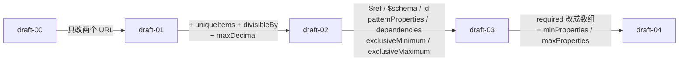

# draft 目录在讲什么

> 五份快照，一个目的：把每一版规范「长什么样」存下来。

## 1. 一句话

`draft-00` … `draft-04` **不是代码**，是每一版 JSON Schema 规范的 **meta-schema**（用 schema 描述 schema 自己）。运行时一行都不读，也不进 npm 包。

## 2. 每个目录里有什么

| 文件           | 作用                                                                |
| -------------- | ------------------------------------------------------------------- |
| `schema`       | 核心关键字（`type` / `properties` / `items` …）的元 schema          |
| `hyper-schema` | 在 core 上叠超媒体：`links`、`readonly`、`contentEncoding`、`pathStart` |
| `links`        | Link Description Object 的 schema（`href` / `rel` / `method` …）    |
| `json-ref`     | JSON Reference 规范。draft-00 ~ 03 有；draft-04 并进 core 的 `$ref` 后删掉 |

目录差异就三处：

- `draft-04` 没有 `json-ref`。
- `draft-03` 多一个 `examples/`，里面 5 个手写示例（address / calendar / card / geo / interfaces）。前三个是根目录旧示例挪进来的，提交 `8c1e8af` 里能看到 `address`/`calendar`/`card` 从根目录删除、出现在 `draft-03/examples/` 下。
- 根目录两份 `draft-zyp-json-schema-0{3,4}.xml` 是**规范正文**（IETF Internet-Draft 的 XML 源，作者署名 draft-zyp），不是 schema。

## 3. 五版的差别



| 版本 | 关键字的数量 | 相对上一版                             |
| ---- | ------------ | -------------------------------------- |
| 00   | 24           | —                                      |
| 01   | 24           | 只改 URI，语义零变化                   |
| 02   | 25           | 加 `uniqueItems`、`divisibleBy`；删 `maxDecimal` |
| 03   | 29           | 大改，现代骨架成型（`contentEncoding` 挪去 hyper-schema） |
| 04   | 30           | 加 `minProperties`、`maxProperties`；`required` 变数组 |

（数量是把 `schema` 的 `properties` 键数出来得到的，可以自己跑 `node -e` 复核。）

## 4. 逐版细看

### 4.1 draft-00 → draft-01：只改了 URL

两份文件 `diff` 完只有两行不同：`$schema` 和 `id` 的域名里 `draft-00` 变成 `draft-01`（提交 `8c1e8af` 的说明是 "Schema URIs are now namespace versioned"）。

所以打开这两份文件会觉得完全重复 —— 不是冗余，是给旧 URI 留的兼容层。

### 4.2 draft-01 → draft-02

```
+ uniqueItems
+ divisibleBy
- maxDecimal
```

### 4.3 draft-02 → draft-03：真正的断裂

```
+ $ref  $schema  id  required  dependencies
+ patternProperties  additionalItems
+ exclusiveMinimum  exclusiveMaximum

- optional  requires  minimumCanEqual  maximumCanEqual
- contentEncoding（从 core 挪去了 hyper-schema）
```

这里最容易记错的是 `required`，它的演变其实是三段：

| 版本 | 写法                                             | 位置     |
| ---- | ------------------------------------------------ | -------- |
| 02   | `"optional": false`（根本没有 `required`）       | 属性上   |
| 03   | `"required": true`（布尔，替换掉 `optional`）    | 属性上   |
| 04   | `"required": ["a", "b"]`（字符串数组）           | 对象上   |

所以「布尔变数组」是 **03 → 04** 的变化，不是 02 → 03。`draft-03/schema` 里 `required` 的定义就是 `{"type": "boolean", "default": false}`，`draft-04/schema` 里才是 `{"type": "array", "items": {"type": "string"}}`。

### 4.4 draft-03 → draft-04

```
+ minProperties  maxProperties
- format
```

另外两处形态变化：

- `id` 从 `{"type": "string", "format": "uri"}` 变成裸的 `{"type": "string"}`。
- `type` 把简单类型抽成一个内联定义（`id: "#simple-type"`，枚举里多了 `"any"`），`items` 改成 `$ref` 指向它。

注意这里的 `- format` 是**本仓库这份副本的问题**，不是规范的变化 —— 真实的 draft-04 是有 `format` 的。根目录的 `draft-zyp-json-schema-04.xml` 里提到 `format` 17 次，`draft-04/schema` 里一次都没有，对照着看就能确认这份 schema 是残缺的。

## 5. 实现停在哪一代

`validate.js` 是个**混合子集**：既读了 draft-03 的属性布尔 `required`，也读了 draft-02 的 `requires` / `maxDecimal` / `disallow` / `extends`。它没有完整实现任何一版。

| 关键字                     | 实现 | 说明                                              |
| -------------------------- | ---- | ------------------------------------------------- |
| `type` `extends` `disallow` | ✅   | `checkProp`                                       |
| `required`（属性布尔）     | ✅   | 只看真假，数组写法不认                            |
| `requires`（draft-02）     | ✅   | `checkObj` 第二轮                                 |
| `properties` `additionalProperties` | ✅ | `checkObj`                                   |
| `items` `minItems` `maxItems` | ✅ | 数组分支                                          |
| `pattern` `minLength` `maxLength` | ✅ | 字符串分支                                    |
| `minimum` `maximum`        | ✅   | 只在 `typeof` 两边相同时比较                      |
| `maxDecimal` `enum`        | ✅   | 前者数小数位，后者用 `===`                        |
| `default` `readonly`       | ✅   | `default` 只认真值；`readonly` 只在 changing 模式 |
| `optional`（draft-02）     | ❌   | 代码里没这个词                                    |
| `format`                   | ❌   | 只有一句注释提到                                   |
| `uniqueItems` `divisibleBy` | ❌  | draft-02 就有，但没实现                           |
| `$ref` `id` `dependencies` | ❌   | draft-03 的核心新增，一个都没接                    |
| `patternProperties` `additionalItems` | ❌ | 同上                                        |
| `exclusiveMinimum` `exclusiveMaximum` | ❌ | 同上                                        |
| `minProperties` `maxProperties` | ❌ | draft-04 新增                                   |
| `$schema`                  | ⚠️   | 只当内联 schema 对象用，URI 字符串会报错           |

这张表解释了为什么 README 要说「行为与体积稳定」：它连 draft-02 都没实现全，任何「补一个关键字」的改动都会改变下游包的结果。

## 6. 两个坑

1. **本仓库的 `draft-04/schema` 不完整**：里面没有 `format`，但同仓库的 `draft-zyp-json-schema-04.xml` 里提了 17 次。别拿这份 schema 当权威参考，查规范看 XML 或 json-schema.org。
2. **draft-00 和 draft-01 内容几乎相同**，只有两行 URL 不一样。别以为是复制粘贴出错。

## 7. 这些快照唯一的实际用途

`test/tests.js` 拿 `draft-03` 的 schema **校验它们自己**，四个文件都加载两遍：一次原样，一次删掉 `$schema`（变量名加 `-nsd` 后缀）。原样那份过不了 —— 因为 `$schema` 的值是 URI 字符串，校验器会把它当 schema 用（见 [quirks](quirks.md) 第 5 条）。实际跑起来只有 `-nsd` 的三组在用。

```bash
cd projects/json-schema && npx --no-install vows --spec test/*.js
# ✓ OK » 12 honored
```

实际在跑的自校验只有 `-nsd` 三组（另外还有三条安全回归）。所以 `draft-0*` 目录在这个仓库里**不参与运行**，只用来做一次自我验证。这也是判断「这仓库要不要动」的一个信号：连测试都只测自己能吃下自己的 schema。

## 8. 关键提交

| commit                 | 内容                                                                 |
| ---------------------- | -------------------------------------------------------------------- |
| `8c1e8af` (2010-11-11) | URI 加版本命名空间，一次性放进 draft-00 ~ 03 全部 schema，删掉旧示例 |
| `e22117f` (2011-11-15) | 初版 draft-04 schema，规范正文加入 JSON Pointer                       |
| `5a2ec23` (2021-11-24) | 合并 `hasOwnProperty` 安全修复，仓库最后一次实质改动                  |
