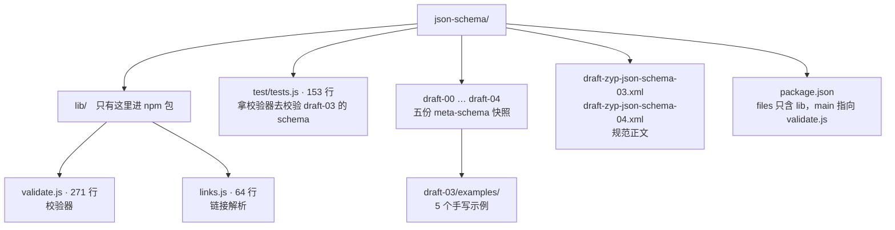

# 仓库导览

> `json-schema` —— 上游 kriszyp/json-schema，npm 包 `json-schema@0.4.0`

## 1. 一句话

这是一份**冻住的实现**：271 行的同步 JSON 校验器，加五份规范历史快照。

作者在 README 里写得很直白：这个包 "considered finished"，为了「依赖它的无数包的行为与体积稳定」而不再追规范。所以目录里有 `draft-04`，代码里却读不到 draft-03 的新关键字 —— 这不是没写完，是故意的。

## 2. 目录里都是什么



`package.json` 的 `files` 只有 `["lib"]`，所以 `draft-*`、`test/`、`*.xml` 装了包也看不到。它们只在这个仓库里有意义。

## 3. 两个文件，互不依赖

| 文件               | 行数 | 干什么                                       |
| ------------------ | ---- | -------------------------------------------- |
| `json-schema/lib/validate.js` | 271  | 校验：实例 + schema → `{valid, errors}`      |
| `json-schema/lib/links.js`    | 64   | 不校验，只从 `schema.links` 取 href 模板并填值 |

两个文件之间没有 `require` 关系，只是同一个包里一起发布。

`validate.js` 的导出方式有点绕：它让 `module.exports` 直接等于 `validate` 函数本身，再在函数上挂属性。所以三种写法都行：

```js
const validate = require('json-schema'); // 函数本体
const { validate } = require('json-schema'); // 同名属性，还是它
const V = require('json-schema/lib/validate.js'); // 直连文件，能摸到 _validate
```

只有第三条能拿到内部选项（`coerce` / `filter` / `existingOnly`），对外 API 不提供。

## 4. 能做什么、不能做什么

`validate.js` 真正读过的关键字：

| 分类       | 关键字                                                                                    |
| ---------- | ----------------------------------------------------------------------------------------- |
| 类型与继承 | `type`、`extends`、`disallow`                                                             |
| 对象       | `properties`、`additionalProperties`、`required`（写在属性上的布尔）、`requires`、`default`、`readonly`（只在 changing 模式生效） |
| 数组       | `items`（单个 schema，或按位置的数组）、`minItems`、`maxItems`                             |
| 字符串数字 | `pattern`、`minLength`、`maxLength`、`minimum`、`maximum`、`maxDecimal`、`enum`            |

代码里根本没读过的关键字：

- 本该校验的：`format`、`uniqueItems`、`divisibleBy`、`$ref`、`dependencies`、`patternProperties`、`additionalItems`、`exclusiveMinimum`、`exclusiveMaximum`、`minProperties`、`maxProperties`、`contentEncoding`
- 纯标注的：`id`、`title`、`description`

「没读」不等于「宽松通过」——这些字段写了也白写，校验结果和没写一模一样。具体表现见 [quirks.md](quirks.md)。

## 5. links.js 在做什么

schema 里可以写 `links: [{rel, href}]`。`getLink("brother", {brother_id: 33}, schema)` 会找到 `rel === "brother"` 那条，把 `href: "Brother/{brother_id}"` 里的占位符换成实例值，返回 `"Brother/33"`（`json-schema/lib/links.js` 的 `getLink` 和 `substitute`）。

两个细节：

- 第一次调用会把结果写到 `schema.__linkTemplates` 上做缓存（开关是 `cacheLinks`）。也就是说它会**改你传进来的 schema 对象**。
- 占位符对应的值是数组时，会拼成 `(4,5,8)` 这种形式（括号包住、逗号分隔），源码注释说这是为了让后端的 `store.get()` 能识别成数组。

## 6. 什么时候该用它

- 想读「校验器最小实现」：271 行，一次能读完 → 去 [walkthrough](validate-walkthrough.md)。
- 老项目里 `require('json-schema')` 行为古怪：先确认它只认 draft-02/03 那批关键字 → 去 [quirks](quirks.md)。
- 新项目要校验 JSON Schema：用 `ajv`。这个包连 `$ref` 都不解析，以后也不会加。
