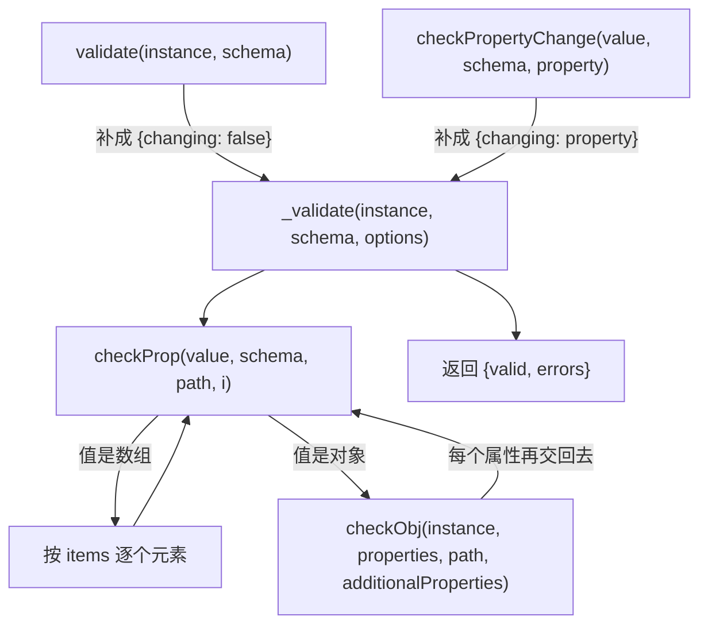
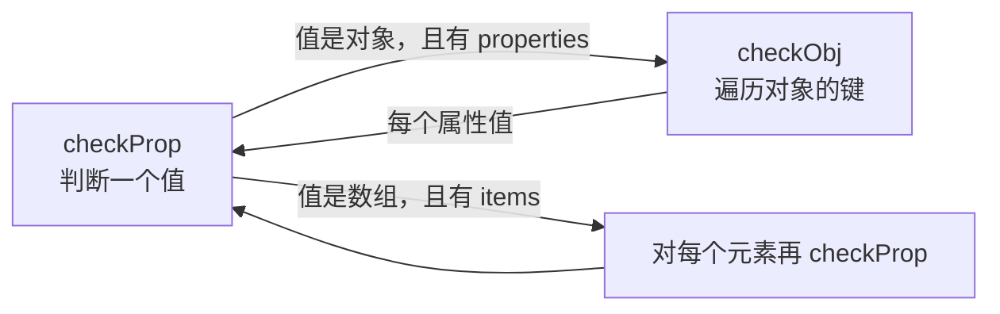
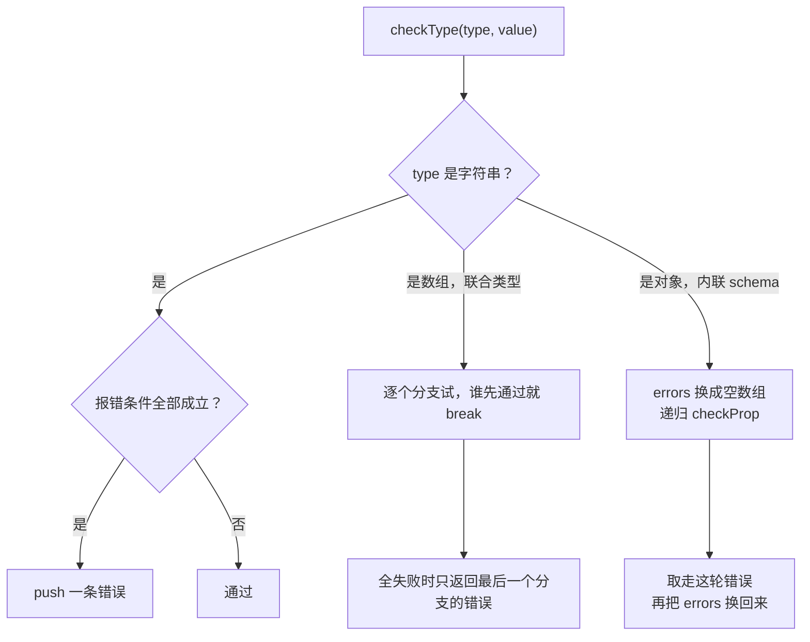
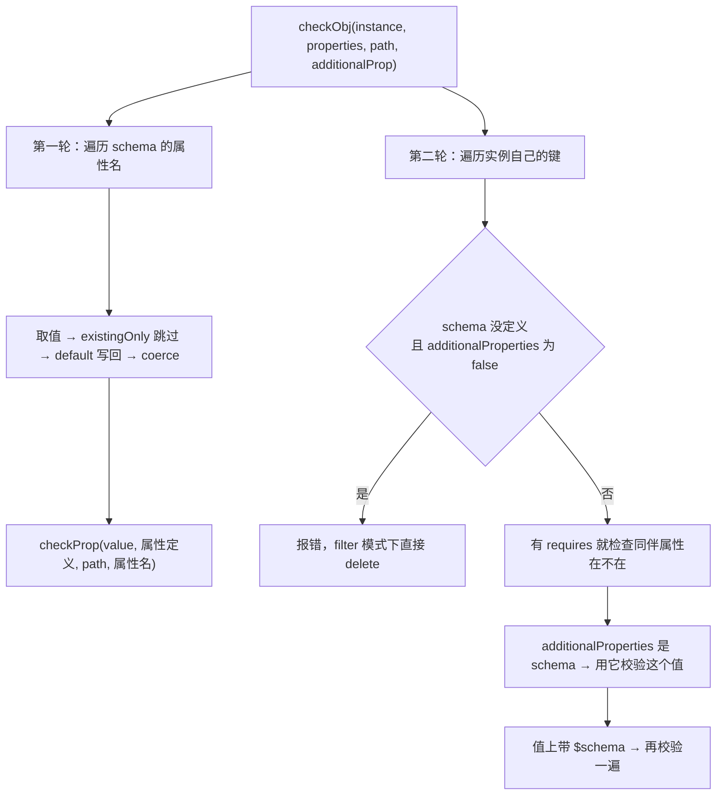

# 跟着 validate.js 走一遍

> 目标：读完能自己回答「`validate(x, schema)` 到底按什么顺序看东西」。
> 源码：`json-schema/lib/validate.js`，271 行，一次能读完。

## 0. 全局速览



一句话：两个入口都汇进 `_validate`；里面只有两个函数 —— `checkProp` 看「一个值合不合规」，`checkObj` 看「一个对象的键对不对」。它们互相调用，错误全部塞进同一个数组。

## 1. 两个入口，其实是一个函数

```js
function validate(instance, schema) {
  return validate(instance, schema, {changing: false});
}
```

第一眼会懵：这不是自己调自己吗。往下看有一行：

```js
var validate = exports._validate = function (instance, schema, options) { ... };
```

函数声明先被提升，`exports` 和 `exports.validate` 先指向那个两参数版本；等执行到这一行，同名变量又被改指向三参数版本。第一个 `validate` 内部的 `validate(...)` 是运行时按名字找，所以调的是新的、带 `options` 的那个。

好处很朴素：**对外只暴露两个参数，内部的选项不污染 API**。

第二个入口：

```js
exports.checkPropertyChange = function (value, schema, property) {
  return validate(value, schema, {changing: property || "property"});
};
```

同一个内部函数，只换了一个选项。

## 2. `changing` 不是一个值，是个开关

它被读了三处：

| 位置            | 用法                                                                        |
| --------------- | --------------------------------------------------------------------------- |
| `checkProp` 开头 | `if (_changing && schema.readonly)` → 报 "is a readonly field"              |
| `checkObj` 末尾  | `if (!_changing && value && value.$schema)` → 只在非 changing 模式做自校验  |
| `_validate` 末尾 | `checkProp(instance, schema, '', _changing || '')` → 它的值变成错误路径前缀 |

所以 `checkPropertyChange({a: 1}, schema, "user")` 报出来的路径是 `user.a` 而不是 `a`（实测）。名字取 `property`，实际干的是「路径起点 + 只读检查 + 关掉自校验」三件事。

## 3. 两个核心函数

`checkProp` 管「这一个值」，`checkObj` 管「这个对象的键」。`checkObj` 遇到属性又把值交回 `checkProp`，`checkProp` 遇到对象属性又调 `checkObj`。递归就这么转起来。



两边都是普通函数，没有类、没有状态对象，只共享两个闭包变量：`errors` 和 `options`。

## 4. path 是拼出来的

最绕的是这一行：

```js
path += path ? (typeof i == 'number' ? '[' + i + ']'
             : typeof i == 'undefined' ? ''
             : '.' + i)
             : i;
```

拆开就是：路径已经有点东西时，数字下标用 `[0]`，字符串键用 `.name`，没传下标就什么都不加；路径还是空的时候，直接把 `i` 接上去。

| 进来的 `path` | `i`         | 出去的结果    |
| ------------- | ----------- | ------------- |
| `''`          | `''`        | `''`          |
| `''`          | `0`         | `'0'`         |
| `'user'`      | `'name'`    | `'user.name'` |
| `'user.tags'` | `0`         | `'user.tags[0]'` |
| `'user.tags'` | `undefined` | `'user.tags'` |

为什么要有 `typeof i == 'undefined'` 这一支？因为 `checkType` 里递归调 `checkProp(value, type, path)` 时只传了三个参数，`i` 是 `undefined`。没有这一支，路径会多一截 `.undefined`。

但它只挡住了「path 非空」的情况。path 为空时走最后那个 `: i`，`'' + undefined` 就是字符串 `"undefined"` —— 所以写在根上的 `type: {…}` 会报出 `undefined.a` 这种路径（实测，见 [quirks](quirks.md)）。

## 5. 开头那个 if 在挡什么

```js
if ((typeof schema != 'object' || schema instanceof Array) &&
    (path || typeof schema != 'function') &&
    !(schema && getType(schema))) { ... }
```

三个条件同时成立才进去。逐个翻译：

1. `typeof schema != 'object' || schema instanceof Array` —— schema 不是普通对象。**数组也算不合格**。
2. `path || typeof schema != 'function'` —— 要么已经在下层（path 非空），要么它根本不是函数。意思是「只有根上允许直接传构造函数」。
3. `!(schema && getType(schema))` —— 它自己也没写 `type`，也不是认识的构造器。

进去之后只有三种结局：

| schema 是什么               | 结果                                                            |
| --------------------------- | --------------------------------------------------------------- |
| 函数                        | 用 `instanceof` 判，不通过报 "is not an instance of the class/constructor" |
| 其它真值（字符串、`true`…） | 报 "Invalid schema/property definition …"                       |
| `undefined` / `null`        | 什么都不报，直接 `return null`                                  |

最后一行很关键：tuple 形式的 `items` 数组比实例短时，多出来的元素拿到的是 `undefined`，于是**静默跳过**，不报错。

这也解释了为什么 `validate(1, true)` 会报 "Invalid schema/property definition true"：布尔 schema 是 draft-06 才有的东西，这个实现不认识。

## 6. getType：type 还能写成构造函数

```js
function getType(schema) {
  return schema.type || (primitiveConstructors[schema.name] == schema && schema.name.toLowerCase());
}
```

前半句好懂：写了 `type` 就用 `type`。

后半句是给「直接传构造器」准备的：如果 schema 本身就是 `String`，那 `schema.name` 是 `"String"`，`primitiveConstructors["String"]` 又正好是 `String`，两边 `==` 成立，于是返回 `"string"`。表里只有 `String / Boolean / Number / Object / Array / Date` 六个。

实测 `validate("a", String)` 通过，`validate(3, V.Integer)` 也通过 —— `Integer` 只是 `{type: "integer"}` 的语法糖，而且是个共享对象，改它会污染所有调用方。

## 7. checkType：六个条件连成一条链

报错条件长这样（原文是一行，这里拆开了）：

```js
typeof type == 'string' && type != 'any' &&
(type == 'null' ? value !== null : typeof value != type) &&
!(value instanceof Array && type == 'array') &&
!(value instanceof Date && type == 'date') &&
!(type == 'integer' && value % 1 === 0)
```

读法：**全部成立才报错**，所以每个 `!(...)` 都是一次豁免。

- `array`：数组的 `typeof` 是 `"object"`，本来会被判成不是 array，靠豁免救回来。
- `date`：同理，`Date` 实例的 `typeof` 也是 `"object"`。
- `integer`：`5 % 1 === 0`，豁免。

整数这条有个副作用：`"5" % 1` 也是 `0`，所以**数字字符串能通过 `integer` 检查**，而 `number` 检查会拒绝它。实测 `validate("5", {type: "integer"})` 是 valid。

三种分支：



联合类型（`type: ["string", "number"]`）那里要注意：全都不行时只保留**最后一个分支**的错误，其它分支试错时的报错不会留下。

对象形式的 type（`type: {properties: {...}}`）会先把 `errors` 换成一个空数组，跑完再换回来。原因是这段代码在「试着匹配一个分支」，分支失败的错误不能留在总账里。这是全文件唯一保存/恢复 `errors` 的地方。

## 8. 值不存在时，只看一个关键字

```js
if (value === undefined) {
  if (schema.required) addError("is missing and it is required");
}
```

就这么多。这里读的是**写在属性上的布尔** `required`（draft-03 的写法）：

```js
{ properties: { name: { type: "string", required: true } } }
```

对象级的数组写法 `required: ["name"]`（draft-04 才有的）它完全不读 —— `checkObj` 只遍历 schema 里那些「属性名」键，`required` 这个键本身不会被当成属性。实测 `validate({}, {properties: {a: {type: "string"}}, required: ["a"]})` 是 valid。

顺带一个坑：这里只判断真假。`required: []` 是空数组，也是真值，照样报缺失（实测）。

## 9. 值存在时，一串独立的 if

后面是一条条排下去的独立判断，互不影响，只有一处是二选一：

```js
if (value instanceof Array) { ... items ... }
else if (schema.properties || schema.additionalProperties) { checkObj(...) }
```

因为用了 `else`，**数组永远不会进 `checkObj`**。所以 `validate([1], {type: "object", properties: {a: {type: "number"}}})` 是 valid；而同一个 schema 传字符串 `"x"` 就会报 "an object is required"（实测）。

`checkObj` 开头那句 `instance instanceof Array` 的判断，实际上永远走不到 —— 数组在上一层就被分走了。

再往下依次是：`pattern` → `maxLength` / `minLength` → `minimum` / `maximum` → `enum` → `maxDecimal`。几个要注意的：

- `minimum` 只在 `typeof value == typeof schema.minimum` 时比较。所以 `{type: "string", minimum: "c"}` 做的是字典序比较，不是数字比较。
- `enum` 用 `===`，数字 `1` 和字符串 `"1"` 不相等。
- `maxDecimal` 把值转成字符串，用正则数小数点后有几位。

这一整串都在 `value !== null` 里面。所以 `null` 只过类型检查，`required`、`properties`、`enum` 一个都不查。

## 10. checkObj：两轮遍历



第一轮按 **schema** 走，跳过 `__proto__` 和 `constructor` 这两个键：

1. 从实例取值，取不到就是 `undefined`。
2. 内部选项 `existingOnly` 开着，就跳过未定义的属性。
3. 有 `default` 就写回实例 —— 条件是 `propDef["default"]` 本身为真，所以 `default: 0`、`default: ""`、`default: false` **不会生效**。
4. `coerce` 开着就转换并写回。
5. 交给 `checkProp`。

第二轮按 **实例** 走：

1. schema 没定义、又 `additionalProperties === false` → 报错；`filter` 模式下改成直接 `delete`。
2. 有 `requires`（draft-02 的老写法）→ 检查被要求的同伴属性在不在。
3. `additionalProperties` 是 schema → 拿它校验这个未知值。
4. 值上带 `$schema` → 再拿它校验一遍（只在非 changing 模式）。

跳过 `__proto__` / `constructor`、一律用 `Object.prototype.hasOwnProperty.call`，是 2021 年补的安全修复（提交 `22f1461`、`b62f1da`、`7b1a800`）。`__` 开头的键也跳过，那是早期为 Dojo 留的约定。

## 11. 顶层怎么收尾

```js
if (schema) checkProp(instance, schema, '', _changing || '');
if (!_changing && instance && instance.$schema) checkProp(instance, instance.$schema, '', '');
return { valid: !errors.length, errors: errors };
```

第一次：有 schema 就校验一次。
第二次：实例自己带 `$schema`，就再拿它校验一次 —— 前提是 `$schema` 的值**本身是个 schema 对象**。

这一句正好解释了 `test/tests.js` 里的 `-nsd`：**nsd = no `$schema`**。draft-03 的 meta-schema 顶上写着 `"$schema": "http://json-schema.org/draft-03/schema#"`，直接拿来校验会走上面第二句，把 URI 字符串当 schema 用，报 "Invalid schema/property definition http://…"。所以测试里先 `delete s['$schema']` 再校验（`test/tests.js` 的 `n = name + '-nsd'`）。带 `$schema` 的那几个用例，在测试文件里是**注释掉的**。

## 12. 接下来读哪里

- 想知道哪些写法它不认 → [quirks.md](quirks.md)
- 想知道 draft 目录和这份实现差多远 → [draft-versions.md](draft-versions.md)
- 想自己动手：改 schema、看输出，比读十遍快。

```bash
cd projects/json-schema
node -e 'console.log(require("./lib/validate.js").validate({a: "x"}, {properties: {a: {type: "number"}}}))'
```
