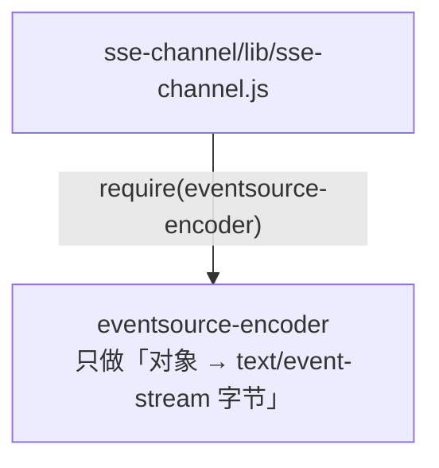
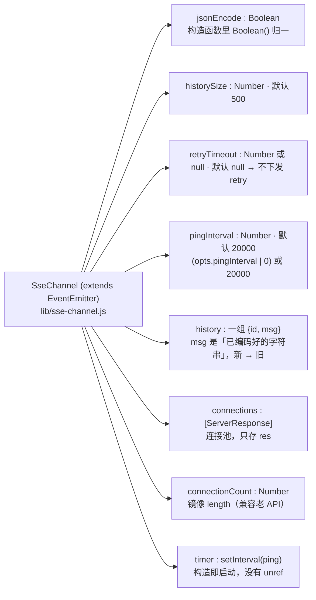
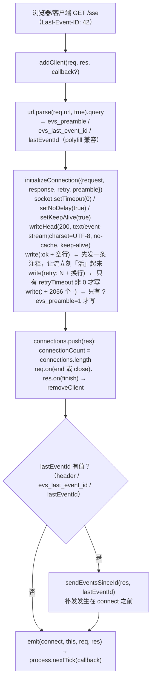
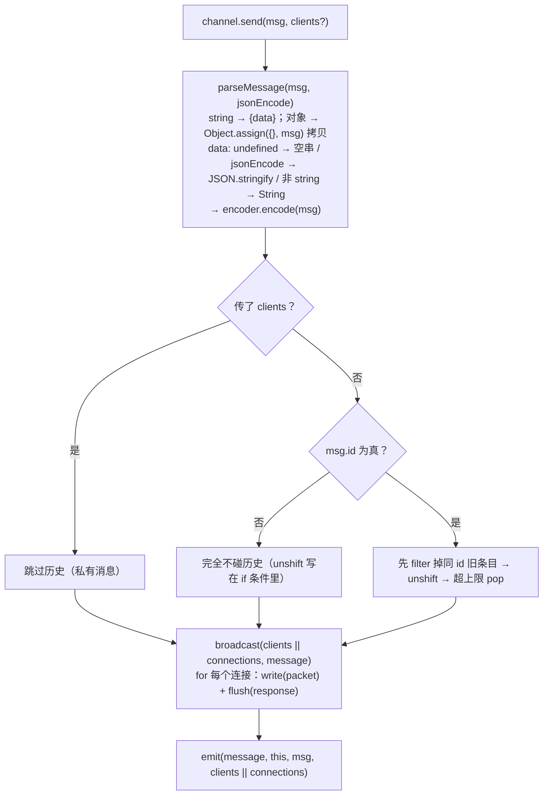
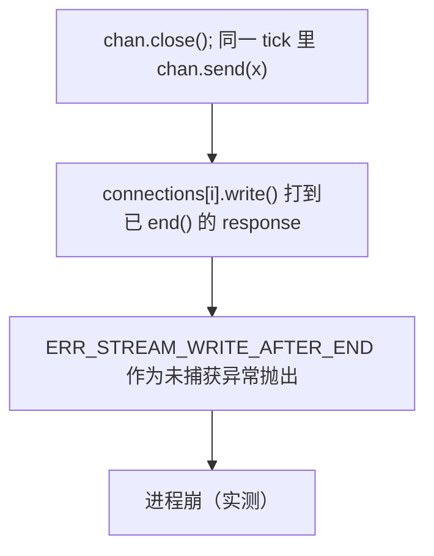

# sse-channel 说明

> 源码：`sse-channel/` —— npm 包 `sse-channel` 上游仓库（作者 rexxars / Espen Hovlandsdal）
> 版本：`4.0.2`，MIT，纯 CommonJS
> 读法：§1–§5 是速查；§6–§8 是三条主路径（发消息 / 历史补发 / 保活）；§9–§11 是兼容 hack、4.0.1 的转折和坑清单。

## 目录

| 章节                                                               | 内容                                   |
| ------------------------------------------------------------------ | -------------------------------------- |
| [§1 一句话](#1-一句话)                                             | 这个库是什么                           |
| [§2 是什么、不是什么](#2-是什么不是什么)                           | 定位、依赖、和 encoder 的分工          |
| [§3 快速上手](#3-快速上手)                                         | 最小可跑示例 + 三个必知点              |
| [§4 结构](#4-结构一个-channel-的全部状态)                          | 一个 channel 的全部状态                |
| [§5 连接进来时](#5-连接进来时字节级)                               | `addClient` 的走位与初始字节           |
| [§6 发消息时](#6-发消息时)                                         | `send` 走位、`data` 归一表、字段顺序   |
| [§7 历史与断线补发](#7-历史与断线补发)                             | 三条规则、补发算法、它的前提           |
| [§8 保活与生命周期](#8-保活重连与生命周期)                         | ping / retry / 定时器 / `close()` 的坑 |
| [§9 兼容 hack](#9-兼容-hackie-与-polyfill)                         | `evs_preamble`、`evs_last_event_id`    |
| [§10 4.0.1 的分水岭](#10-401-的分水岭编码交给-eventsource-encoder) | 手写编码 → 依赖 encoder，注入面变化    |
| [§11 坑清单](#11-坑清单)                                           | 12 条已知行为与限制，按危险程度排      |
| [§12 责任划分](#12-责任划分谁负责什么)                             | 这个库 / encoder / 中间件 / 客户端     |
| [§13 版本历史](#13-版本历史)                                       | 1.0.4 → 4.0.2                          |
| [§14 相关库与选型](#14-同目录相关库与选型)                         | 什么时候该用它、什么时候不该           |

## 1. 一句话

把一个 HTTP `res` 收进「频道」，之后所有 `channel.send()` 都广播给它；带 `id` 的消息自动进历史，客户端重连时按 `Last-Event-ID` 补发。全部逻辑在 `sse-channel/lib/sse-channel.js`，334 行，编码环节外包给 `eventsource-encoder`。

它解决的不是「怎么拼 SSE 字节」（那是 encoder 的事），而是「**怎么管住一堆长连接**」：连接池、历史环形缓冲、定时心跳、断线补发。

## 2. 是什么、不是什么

**是什么**：

- 频道模型：一个 `SseChannel` 实例 = 一组 `ServerResponse`，按 URL 自己决定把哪个 `req/res` 塞给哪个频道（库不做路由）。
- 历史缓冲：只存带 `id` 的消息，默认上限 500 条，重连时按 id 补发。
- 保活：构造时起一个 `setInterval`，定期给所有连接写 `:\n` 注释行。
- 事件：实现 `EventEmitter`，抛 `connect` / `disconnect` / `message` 三个事件。

**不是什么**（这些都得自己加）：

- **不做 CORS**：4.0.0 移除了 CORS 处理（`sse-channel/CHANGELOG.md` 的 4.0.0 条目），跨域要自己上 `cors` 中间件。
- **不做背压**：`broadcast()` 里 `connections[i].write(packet)` 的返回值直接丢掉，慢客户端的内存由 Node 的写缓冲兜着，没有上限控制。
- **不做鉴权/路由/限流**：`addClient(req, res)` 拿到什么都不检查。
- **不做序列化**：只有 `jsonEncode: true` 时才 `JSON.stringify`，其余情况非字符串 `data` 一律 `String()`（见 §6.2，对象会变成 `[object Object]`）。
- **不做重连策略以外的补偿**：断线期间的历史只按 id 补，没 `id` 的消息就是丢了。

依赖只有一个，值得单独记住：



## 3. 快速上手

```js
var SseChannel = require('sse-channel');
var http = require('http');

var channel = new SseChannel({ retryTimeout: 250, historySize: 300 });
setInterval(function () {
  channel.send({
    id: ++counter,
    event: 'sysinfo',
    data: { load: os.loadavg() },
  });
}, 250);

http
  .createServer(function (req, res) {
    if (req.url.indexOf('/channel/sysinfo') === 0) {
      channel.addClient(req, res); // 唯一要求：还没往 res 写过东西
    } else {
      res.writeHead(404);
      res.end();
    }
  })
  .listen(7788);
```

> [!warning] 上生产前必须知道的三个
>
> 1. **构造函数里起了 `setInterval`，且没有 `unref()`** —— 一个没有客户端、也没被 `close()` 的 channel 会一直吊着进程（§8.2）。
> 2. **`close()` 之后同一 tick 里再 `send()` 会让进程崩**：`write()` 打到已 `end()` 的 response，抛 `ERR_STREAM_WRITE_AFTER_END` 且无人接管（§8.2，实测）。
> 3. **`retry()` 绕过 encoder 直接写裸字符串**，把调用方可控的内容拼进去就能伪造事件（§10）。

## 4. 结构：一个 channel 的全部状态



`history` 里存的是**编码后的字符串**而不是原始对象，这一点决定了三件事：

1. 补发时直接 `response.write(msg)`，不用再编码一遍（`sendEventsSinceId`）。
2. 想事后改消息格式（比如切 `jsonEncode`）必须重建 channel。
3. 构造时传进来的 `options.history` 会立刻用当前 `jsonEncode` 编好（构造函数里的 `.map()`）。

## 5. 连接进来时（字节级）

### 5.1 `addClient` 的走位



顺序很关键：**先补历史，再抛 `connect`**，最后才 `nextTick(callback)`。所以在 `connect` 监听器里 `send()` 的新消息一定排在补发之后——这也正是自带测试 `can broadcast simple message` 敢在 `connect` 里直接发的原因。

### 5.2 初始字节（实测）

`?evs_preamble=1`、`retryTimeout: 3000` 时，客户端收到的前几段是：

```text
:ok\n\n
retry: 3000\n
:------------------------------------…（共 2058 字节：1 个冒号 + 2056 个连字符 + \n）
```

三个字段里的东西都值得注意：

- `:ok` 是**注释行**（冒号开头），客户端不会派发事件，纯粹用来把响应头 + 首字节立刻顶出去，避免代理或浏览器缓冲。
- `retry: 3000\n` **后面没有空行**，所以这一行会挂在「未完成的事件」上，直到下一个空行才真正生效（SSE 规范里字段是在分发时处理的）。
- `Content-Type` 带 `charset=UTF-8`（2.0.4 起）；**没有任何 CORS 头**，也没有 `X-Accel-Buffering`。

### 5.3 断线判定：三个事件都挂上，`removeClient` 可重入

```js
req.on('end', removeClient);
req.on('close', removeClient);
res.on('finish', removeClient);
```

`removeClient` 用 `indexOf` + `splice` 循环删掉**所有**同一个 `res`，所以重复调用本身是安全的（不会把别人的连接删掉）。但它在结尾无条件 `emit('disconnect')`——**没删到任何东西也照样抛**。

实测：一个客户端 `close` + `finish` + `end` 三个事件都触发时，`disconnect` 被抛了 **3 次**。监听器要做幂等处理，别把「断开计数」直接当连接数用——要连接数请用 `getConnectionCount()`。

## 6. 发消息时

### 6.1 `send` 的走位



两个容易看漏的点：

- **私有消息（传了 `clients`）既不写历史也不改历史**，这正是「点对点推一条不污染公共历史」的实现（`can send messages to specific clients` 用例专门验证）。
- **没 `id` 的消息不会进历史**，因为 `this.history.unshift(entry)` 写在 `if (msg.id && …)` 的条件里。实测：连续 `send('a')` 三次，`history.length` 仍然是 0。

### 6.2 `parseMessage` 的 `data` 归一表

`sse-channel/lib/sse-channel.js` 的 `parseMessage` 只有 1 个分支顺序要点：**先判 `jsonEncode`，再判 `undefined`**（4.0.2 修的，见 `35bbb86`）。归一完再交给 encoder，所以「encoder 只认字符串」这个坑在这里被补上了。

| `msg.data`   | `jsonEncode: false`（默认）  | `jsonEncode: true`    |
| ------------ | ---------------------------- | --------------------- |
| `undefined`  | `data: \n\n`（冒号后带空格） | `data: ""\n\n`        |
| `null`       | `data: null\n\n`             | `data: null\n\n`      |
| `42`         | `data: 42\n\n`               | `data: 42\n\n`        |
| `'Foobar'`   | `data: Foobar\n\n`           | `data: "Foobar"\n\n`  |
| `{ a: 1 }`   | `data: [object Object]\n\n`  | `data: {"a":1}\n\n`   |
| `['a', 'b']` | `data: a,b\n\n`              | `data: ["a","b"]\n\n` |

结论：**默认模式下传对象是灾难**（`[object Object]`），要结构化数据就开 `jsonEncode`，然后客户端 `JSON.parse`。多行字符串不用管，encoder 会逐行加 `data: ` 前缀（实测多行往返一字不差，`handles multi-line strings properly` 用例）。

### 6.3 字段顺序与「谁吃掉了我的字段」

encoder 的输出顺序固定为 `event → retry → id → data`，实测一条全字段消息：

```
event: drink
retry: 1800
id: 1337
data: Reign in Citra
（空行）
```

但 `send({ retry: '1800' })` 里的 **`retry` 会被静默丢弃**——encoder 只认 `typeof retry === 'number' && Number.isFinite(...)`（`eventsource-encoder/src/encode.ts` 的 `encodeMessage`）。同理 `{ retry: 1.5 }` 会原样写成 `retry: 1.5`，浏览器会当非法值忽略。要给所有客户端改重连间隔，用 `channel.retry(1800)`（§8.1），别指望 `send` 里的 `retry` 字段。

`id: 0` 是个特例：encoder 会老实写出 `id: 0`，但 `send` 里 `if (msg.id && …)` 判假 → **不进历史**，重连补发时也得不到它。

## 7. 历史与断线补发

### 7.1 三条规则

1. **只有带 `id` 的消息进历史**，且 `id` 必须「真值」（`0`、`''`、`null` 都不算）。
2. **同 id 覆盖**：`send` 前先 `filter(entry => entry.id !== msg.id)`，所以历史里每个 id 只有最新版本（`only includes the latest event with the same ID` 用的就是这个）。
   - 注意是 `!==` 严格比较：`7` 和 `'7'` 会被当成两条（实测）。
3. **上限是 `historySize`**：`unshift` 后 `length > historySize` 就 `pop()` 掉最旧的。

### 7.2 补发算法与它的前提

```
history（新 → 旧）：[ {id:5}, {id:4}, {id:3}, {id:2} ]
sendEventsSinceId(res, 4)
   i=0  id 5 > 4  → entries.unshift(msg5)
   i=1  id 4 <= 4 → break                    ← 一旦「不够新」就整体停
   写出的字节顺序：msg5（先反序收集，再顺序写出 → 旧→新）
```

算法本身很简单，但它默认了**两个前提**，破了就出错：

| 前提                                  | 破了会怎样（实测）                                                                             |
| ------------------------------------- | ---------------------------------------------------------------------------------------------- |
| id 单调递增（新消息 id 一定更大）     | 乱序发 `5,3,4` → history `[4,3,5]`，补发 `since=3` 只给 `4`，**旧的 5 被跳过**                 |
| id 是数字（或至少比较语义和数值一致） | id 用字符串 `'900'` / `'1000'` → `'1000' <= '900'` 按字典序为真 → 立刻 `break`，**一条都不补** |

`sinceId` 来自请求头/查询串，天然是字符串；`history[i].id` 是数字时 `<=` 会做数值比较，没问题。所以结论是：**id 就用自增数字**。

### 7.3 构造时预填历史的过滤规则

`options.history` 不是照单全收：`.filter(hasId)`，而 `hasId` 是 `item.id && item.id > 0`。

```js
new SseChannel({
  historySize: 3,
  history: [
    { id: 0, data: 'zero' }, // 丢：0 不大于 0
    { id: 'abc', data: 'string-id' }, // 丢：'abc' > 0 为 false
    { id: 5 },
    { id: 6 },
    { id: 7 }, // 留：再 slice 到最后 3 条 → reverse → [7,6,5]
  ],
});
```

所以**字符串 id 在「预填」这条路上一律被丢掉**，而 `send()` 那条路却接受字符串 id。同一个库两条路规则不一致，别把它当稳定契约。

`historySize: 0` 也不会「不留历史」——`opts.historySize || 500` 把 0 当没传（实测 500）。要关历史只能不传 id。

## 8. 保活、重连与生命周期

### 8.1 ping 与 retry

| 方法                             | 实际写出的字节                | 说明                                                                                   |
| -------------------------------- | ----------------------------- | -------------------------------------------------------------------------------------- | -------------------- |
| `ping()`（每 20s 自动）          | `:\n`                         | 注释行，不派发事件，只为让连接上有流量                                                 |
| `retry(1800)`                    | `retry: 1800\n`               | **裸写，不过 encoder**，同时把 `this.retryTimeout` 改掉，之后新连接的初始 retry 也用它 |
| `new SseChannel({retryTimeout})` | 连接建立时写一次 `retry: N\n` | `N = retry` 经 `                                                                       | 0` 取整；为 0 就不写 |

`ping()` 打的 `:\n` 只有一个换行：它既不加 `data:` 也不加空行，所以它**不会**清掉前面挂着的 `retry:` 字段（字段要靠空行才分发）。这是符合规范的行为，但意味着 `retry()` 单独调用后要等**下一条事件**才真正生效。

### 8.2 定时器与 `close()`

```js
this.timer = setInterval(this.ping.bind(this), this.pingInterval); // 构造函数里，无条件
```

- 没有 `unref()`：**只要 channel 没 `close()`，进程不会自己退出**，哪怕一个客户端都没有（实测：`new SseChannel()` 后 2s 仍存活）。
- `close()` 做两件事：`clearInterval(timer)` + 对所有连接 `res.end()`。它**不清空 `connections` 数组**（靠 `finish` 事件异步回调 `removeClient` 才清）。
- 于是有了这个坑：



要安全就得 `close()` 之后不再 `send()`，或者自己接管这块的连接管理。

### 8.3 构造选项里的位运算

```js
this.pingInterval = opts.pingInterval | 0 || 20000;
```

`| 0` 是 **int32 截断**，两个后果（实测）：

| 传入      | 结果          | 后果                                             |
| --------- | ------------- | ------------------------------------------------ |
| `20000.9` | `20000`       | 小数被截掉，可接受                               |
| `0`       | `20000`       | 想关 ping 做不到（`0` 是假值）                   |
| `3e9`     | `-1294967296` | 负数 → `setInterval` 按 1ms 处理 → **ping 风暴** |
| `'5000'`  | `5000`        | 字符串能被强制转换，侥幸可用                     |

`retryTimeout` 没有默认值（`null`），只在 `initializeConnection` 里做 `opts.retry | 0`：所以 `retryTimeout: 'x'` 会被当成 0 → 不写 `retry:` 行。

## 9. 兼容 hack：IE 与 polyfill

`addClient` 里读三个非标准入口，全部来自 [amvtek/EventSource](https://github.com/amvtek/EventSource) 这个 polyfill：

```
?evs_preamble=1        → 连接建立后写 ':' + 2056 个 '-' + '\n'
                          （IE 需要约 2KB 数据才开始派发 progress 事件）
?evs_last_event_id=42  → 当作 Last-Event-ID（IE 下拿不到自定义头）
?lastEventId=42        → 同上，另一种 polyfill 的参数名
```

真实浏览器的 `Last-Event-ID` 走 `req.headers['last-event-id']`（Node 会小写化）。三条来源的优先级：**header > `evs_last_event_id` > `lastEventId` > 0**。

不用 IE/polyfill 的话，这几条可以完全无视；但要知道 `req.url` 因此被 `url.parse()` 解析了一遍——在 Node 24 上这一步会打 `DEP0169` 运行时弃用警告（实测，`url.parse` 是遗留 API）。

## 10. 4.0.1 的分水岭：编码交给 eventsource-encoder

`41daab0 Validate message fields for newlines before sending` 把 `parseMessage` 里手写的拼接（`parseTextData`）整体换成了 `encoder.encode(msg)`，删掉 46 行。这个改动带来的是**安全面变化**，不是重构：

```
4.0.0 及以前（手写）
   'event' → 直接拼 'event: ' + msg.event + '\n'
              → event 里有 \n 就能伪造第二段事件（注入）

4.0.1 起（encoder）
   event / id 含 \r 或 \n → 抛 TypeError（assertSingleLine）
   data / 注释 → 逐行重加前缀，注入的换行只能变成「同字段的下一行」
```

实测两条：

```
send({ event: 'msg\ndata: pwned', data: 'hi' })
  → TypeError: EventSource `event` field must not contain newline characters (CR/LF)
    且因为 parseMessage 在碰历史之前就抛了，这个 id 也没进历史

send({ data: 'a\n\ndata: pwned' })
  → data: a\ndata: \ndata: data: pwned\n\n     ← 伪造的 data: 只是普通内容
```

**但漏了一条路**：`retry()` 自己拼字符串广播，不过 encoder、也不校验：

```js
channel.retry('1000\ndata: pwned');
// 实际写出：retry: 1000\ndata: pwned\n
```

`retry()` 的入参如果是用户可控的，同样能伪造事件段。这是 4.0.2 之后仍然存在的注入缺口，历史补发/初始 retry 两条路都是安全的（走了 `| 0` 或 encoder）。

细节（`\r` 会被归一掉、`data:` 后只剥一个空格、`id` 里塞 `\0` 等）见 [eventsource-encoder 说明](../eventsource-encoder/overview.md) §6–§8，这里不重复。

## 11. 坑清单

按「会崩 / 会丢数据 / 只是意外」排序，全部经过实测或源码直读：

| 级别 | 行为                                                                | 触发点  |
| ---- | ------------------------------------------------------------------- | ------- |
| 崩   | `close()` 同 tick 再 `send()` → `ERR_STREAM_WRITE_AFTER_END` 未捕获 | §8.2    |
| 崩   | `pingInterval: 3e9` → int32 溢出为负 → 1ms ping 风暴                | §8.3    |
| 崩   | `event` / `id` 含换行 → `send()` 抛 `TypeError`（4.0.1 起）         | §10     |
| 挂   | 构造即起 `setInterval` 且不 `unref` → 无客户端时进程不退出          | §8.2    |
| 漏   | 没 `id` 的消息不进历史 → 断线必丢                                   | §7.1    |
| 漏   | 乱序 id / 字符串 id → 补发提前 `break`，静默漏消息                  | §7.2    |
| 漏   | `send({ retry: '1800' })` → retry 静默消失                          | §6.3    |
| 错   | 默认模式传对象 → `[object Object]`                                  | §6.2    |
| 错   | 预填 `history` 里 id 为 0 或字符串 → 被 `hasId` 丢掉                | §7.3    |
| 错   | `disconnect` 对同一个连接可抛多次（未删到也抛）                     | §5.3    |
| 险   | `retry()` 裸拼字符串 → 注入缺口                                     | §10     |
| 暗   | 无背压控制、无 CORS、`url.parse` 触发 DEP0169                       | §2 / §9 |

## 12. 责任划分：谁负责什么

| 事                             | sse-channel    | eventsource-encoder | 中间件 / 客户端  |
| ------------------------------ | -------------- | ------------------- | ---------------- |
| 响应头、连接保持、flush        | ✅             | —                   | —                |
| 连接池、广播、私有推送         | ✅             | —                   | —                |
| 历史缓冲、`Last-Event-ID` 补发 | ✅             | —                   | —                |
| 心跳（`:\n`）、retry 下发      | ✅             | —                   | —                |
| 字段转义、`event`/`id` 校验    | —              | ✅                  | —                |
| 跨域头（CORS）                 | ❌（4.0 移除） | —                   | ✅               |
| 压缩、`X-Accel-Buffering`      | 只调 `flush()` | —                   | ✅               |
| 重连时机、`JSON.parse`         | —              | —                   | ✅ 浏览器/客户端 |

`flush()` 的实现值得单独看一眼：`response.flush && response.flush.name !== 'deprecated'`——它靠函数名判断，为的是避开 Node 早期那个已弃用的 `OutgoingMessage.flush`。Node 24 的 `ServerResponse` 上根本没有 `flush`（实测 `typeof res.flush === 'undefined'`），所以这段绝大多数时候是空操作，只有在 `compression` 之类中间件挂了 `flush` 时才生效。

## 13. 版本历史

按 `sse-channel/CHANGELOG.md` + git log：

| 版本        | 变化                                                                                         |
| ----------- | -------------------------------------------------------------------------------------------- |
| 1.0.4       | socket timeout 用 `0` 而不是 `Infinity`                                                      |
| 1.0.6       | 存在 `flush()` 时调用，修 express `compression` 下的攒批                                     |
| 2.0.0       | `jsonEncode` 对所有消息生效；`sendMissedEvents` → `sendEventsSinceId`；事件补 `channel` 参数 |
| 2.0.4       | `Content-Type` 加 `charset=UTF-8`                                                            |
| 2.0.5/2.0.6 | 避开已弃用的 `flush`；`close()` 停掉心跳                                                     |
| 3.0.0/3.1.0 | Node ≥ 4；加 `cors: false` 关闭 CORS 检查                                                    |
| 4.0.0       | **移除 CORS 处理**，Node ≥ 10                                                                |
| 4.0.1       | **编码交给 `eventsource-encoder`**，`event`/`id` 换行改抛错（2026-04）                       |
| 4.0.2       | `jsonEncode` 下缺 `data` 时输出 `""` 而不是 `""` 缺失/`undefined`（2026-05）                 |

## 14. 同目录相关库与选型

| 库                    | 位置                                         | 定位                                                                |
| --------------------- | -------------------------------------------- | ------------------------------------------------------------------- |
| `sse-channel`         | `sse-channel/`                               | 服务端「频道」：连接池 + 广播 + 历史 + 心跳                         |
| `eventsource-encoder` | `eventsource-encoder/`                       | 纯编码：对象 → 字节（sse-channel 的依赖）                           |
| `eventsource`         | [`eventsource/`](../eventsource/overview.md) | 客户端实现（浏览器/Node 都能用，兼容 EventSource API）              |
| `eventsource-client`  | `eventsource-client/`                        | 客户端实现（fetch + Web Streams，异步迭代，不兼容 EventSource API） |
| `eventsource-parser`  | `eventsource-parser/`                        | 流式解析：字节 → 事件对象                                           |

选型判断：

- 只是「一个频道广播给所有客户端」，用它最省事；Redis/多进程横向扩展它**不支持**（连接池在进程内存里）。
- 需要断点续传但消息量大、不能接受「全量历史驻留内存」→ 自己做（把历史换成按 id 查存储），这个库的 `history` 是内存数组 + 线性扫描。
- 需要严格的背压/慢客户端隔离 → 自己做，这个库 `write()` 的返回值都不看。
- 只需要「把事件编码成字节」→ 直接用 `eventsource-encoder`，别拉这个库。

## 15. 测试怎么读

`sse-channel/test/sse-channel.test.js`（714 行，mocha + 真实 `http.Server` + `eventsource` 客户端）。它其实是这个库最准确的**行为文档**，几类用例值得对照着看：

| 用例分组                                           | 确认了什么                                                         |
| -------------------------------------------------- | ------------------------------------------------------------------ |
| `can provide a history of events …`（3 条）        | 三种 `Last-Event-ID` 来源都通；`sinceId` 是**不含**的              |
| `sends the right slice of the history`             | `since=1339` 时只收到 4 条（1337 有 6 条，其中 1 条被 since 截掉） |
| `can be configured to a specific max history size` | 100 条消息 + `historySize: 5` → 只补 5 条                          |
| `calls flush() after writes …`                     | flush 的调用次数（连接 1 + 补发 1 + 广播 2 = 4）                   |
| `sends automatic pings`                            | 用裸 `http.request` 数 `:\n` 出现次数                              |
| `sends "preamble" if client requests it`           | 断言响应里出现 `:-{2056,}`                                         |
| `emits connect/disconnect/message events`          | 三个事件的参数形状                                                 |
