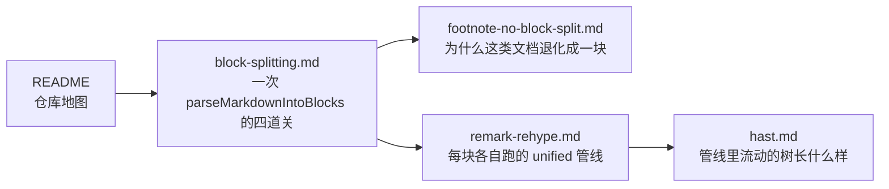
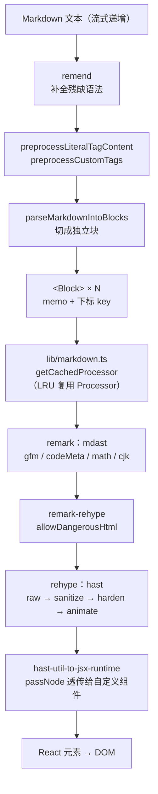

[origin](https://github.com/vercel/streamdown)

# Streamdown 源码笔记

记录阅读 `vercel/streamdown` 源码的结论。源码克隆在 `streamdown/`，笔记在本仓库的 `notes/streamdown/`。
版本 `2.7.1`，monorepo（pnpm + turbo + biome/ultracite），`packages/` 下 6 个包：

| 包（npm 名）          | 位置                                     | 作用                                                                                     |
| --------------------- | ---------------------------------------- | ---------------------------------------------------------------------------------------- |
| `streamdown`          | `streamdown/packages/streamdown`         | 主包：`<Streamdown>` / `<Block>`、切块、markdown 渲染内核、动画                          |
| `remend`              | `streamdown/packages/remend`             | 流式补全残缺 Markdown（未闭合 fence / 强调 / 链接），把半成品修成可解析文本              |
| `@streamdown/cjk`     | `streamdown/packages/streamdown-cjk`     | CJK 强调与自动链接边界（`remarkPluginsBefore` / `remarkPluginsAfter` 夹住 `remark-gfm`） |
| `@streamdown/code`    | `streamdown/packages/streamdown-code`    | 代码高亮（`shiki`）                                                                      |
| `@streamdown/math`    | `streamdown/packages/streamdown-math`    | `remark-math` + `rehype-katex`                                                           |
| `@streamdown/mermaid` | `streamdown/packages/streamdown-mermaid` | Mermaid 图表渲染                                                                         |

## 1. 已有文档

| 文件                                                         | 内容                                                                    |
| ------------------------------------------------------------ | ----------------------------------------------------------------------- |
| [`block-splitting.md`](./block-splitting.md)                 | `parseMarkdownIntoBlocks()`：切块、增量复用、单槽缓存、渲染侧怎么消费块 |
| [`footnote-no-block-split.md`](./footnote-no-block-split.md) | 为什么有脚注（或链接引用定义）就整篇一块                                |
| [`remark-rehype.md`](./remark-rehype.md)                     | remark / rehype / unified 分工、本项目挂了哪些插件、顺序约束            |
| [`hast.md`](./hast.md)                                       | hast 是什么：节点形状、`properties`、与 mdast / DOM 的区别              |

## 2. 从哪读起

先读 `block-splitting.md`（它画出了整条渲染路径），再按兴趣分叉：
关心「为什么某些文档不增量」去 `footnote-no-block-split.md`，
关心「每块里到底跑了什么」去 `remark-rehype.md`，被 `tree` / `properties` 卡住去 `hast.md`。

## 3. 渲染路径全景

只有尾块会在每个 tick 重跑；前面的块靠 `<Block>` 的 `memo` 命中，前提就是切块结果稳定
（`streamdown/packages/streamdown/lib/parse-blocks.tsx` 的 `parseMarkdownIntoBlocks`、
`streamdown/packages/streamdown/index.tsx` 的 `Block`）。

## 4. Obsidian

`notes/` 整体是一个 vault，`.obsidian/` 在 vault 根目录，已在 `notes/.gitignore` 里排除。

笔记已移出上游克隆（原位置 `streamdown/note/`），因此不受 streamdown 仓库的 `ultracite check` 约束。
格式按根目录 `oxfmt` 的规则（printWidth 100）人工保持一致：`.oxfmtrc.jsonc` 把 `notes/**` 排除在自动格式化之外。写作规则见仓库根 `AGENTS.md`。
