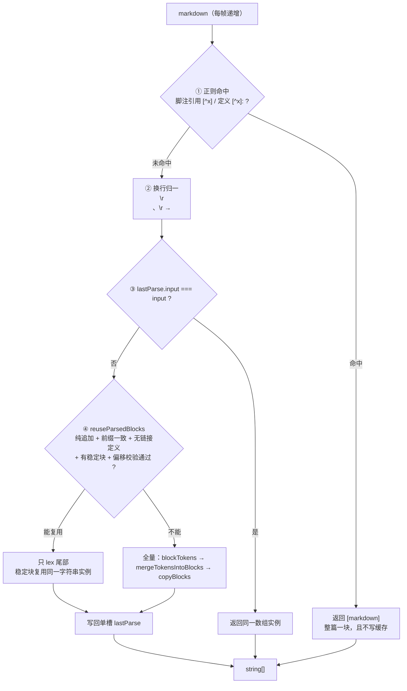
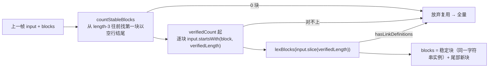

# 切块：`parseMarkdownIntoBlocks`

> 源码：`streamdown/packages/streamdown/lib/parse-blocks.tsx`（v2.7.1）
> 读法：§1–§2 是轮廓，§3–§9 是机制，§10 之后是护栏、取舍与自测。

## 目录

| 章节                                                               | 内容                                        |
| ------------------------------------------------------------------ | ------------------------------------------- |
| [§1 一句话](#1-一句话)                                             | 切块要解决什么                              |
| [§2 一次调用的四道关](#2-一次调用的四道关)                         | 脚注 / 归一 / 缓存命中 / 增量复用           |
| [§3 只切块级 token](#3-只切块级-token)                             | 为什么用 `blockTokens()` 不用 `Lexer.lex()` |
| [§4 后处理：token 不等于可渲染块](#4-后处理token-不等于可渲染块)   | HTML / `space` / `$$` 三条合并规则          |
| [§5 增量复用只信稳定前缀](#5-增量复用只信稳定前缀)                 | 稳定块判定、偏移校验、可信任边界            |
| [§6 单槽缓存与同实例返回](#6-单槽缓存与同实例返回)                 | 一槽缓存、StrictMode                        |
| [§7 强制整篇一块的输入](#7-强制整篇一块的输入)                     | 脚注 / 链接引用定义 / 非追加                |
| [§8 sliced string：块文本必须复制](#8-sliced-string块文本必须复制) | 为什么要 `copyString`                       |
| [§9 渲染侧怎么消费块](#9-渲染侧怎么消费块)                         | memo、key、incomplete、caret、动画          |
| [§10 正确性护栏](#10-正确性护栏每个前缀都等于全量解析)             | `parse-blocks-incremental` 的断言思路       |
| [§11 取舍与已知边界](#11-取舍与已知边界)                           | 有意的保守选择                              |
| [§12 快速自测](#12-快速自测)                                       | 三行可跑的例子                              |
| [§13 相关文件](#13-相关文件)                                       | 文件清单                                    |

## 1. 一句话

`parseMarkdownIntoBlocks()` 把一整篇 Markdown 切成若干个**互相独立的块**，每块之后各自跑一遍 remark → rehype 管线。
目的只有一个：流式输出时能**增量渲染** —— 前面已定稿的块被 `<Block>` 的 `memo` 命中、不重新解析，只有尾块在变。

代价是所有正确性都压在一句不变量上：**任何前缀的增量结果，必须严格等于这个前缀的冷缓存全量解析**（§10）。

## 2. 一次调用的四道关

`streamdown/packages/streamdown/lib/parse-blocks.tsx` 的 `parseMarkdownIntoBlocks` 是一个顺序固定的流水线：



| 关         | 代码                                                     | 作用                                                                                                  |
| ---------- | -------------------------------------------------------- | ----------------------------------------------------------------------------------------------------- |
| ① 脚注检测 | `footnoteReferencePattern` / `footnoteDefinitionPattern` | 有脚注就整篇一块，**不读不写缓存**（见 [`footnote-no-block-split.md`](./footnote-no-block-split.md)） |
| ② 换行归一 | `lineEndingPattern` 与 marked 内部一致                   | `token.raw` 只含 `\n`，不归一则 `blocks.join("")` 拼不回输入，偏移校验全废                            |
| ③ 缓存命中 | `lastParse?.input === input`                             | 内容没变直接返回同一数组实例                                                                          |
| ④ 增量复用 | `reuseParsedBlocks`                                      | 纯追加时只重切尾部，否则全量                                                                          |

四道关的顺序不能换：脚注必须在归一之前判定（判定对象是原文），缓存命中必须在增量之前（更便宜）。

## 3. 只切块级 token

```ts
const lexer = new Lexer({ gfm: true });
const tokens = lexer.blockTokens(markdown); // 只切块，不解析行内
```

用 `blockTokens()` 而不是 `Lexer.lex()`：每块的 `raw` 之后会由自己的 remark 管线完整解析，
这里再跑一遍行内 tokenizer 是纯浪费（见 `lexBlocks`）。

副作用必须知道：`raw` 是**原文切片**，于是 `blocks.join("")` 必须严格等于规范化后的输入。
测试里有一条专门守这个（`joins the blocks back into the normalized input`），
随机组合用例也逐字符验证过。

`lexBlocks()` 额外回传 `hasLinkDefinitions`（来自 `lexer.tokens.links`）：
lexer 会把任意嵌套层级的 `[label]: url` 收进来，但**不会**从代码块里收 —— 这是全篇级信息，尾部单独 lex 看不到前缀里的定义。

## 4. 后处理：token 不等于可渲染块

`mergeTokensIntoBlocks()` 把「语义上不可分割」的 token 合并回去，三条规则：

| 规则                     | 原因                                                                                                  | 实现                                                                                                                                                                                              |
| ------------------------ | ----------------------------------------------------------------------------------------------------- | ------------------------------------------------------------------------------------------------------------------------------------------------------------------------------------------------- |
| HTML 块跨空行合并        | `<div>\n\ntext\n\n</div>` 会被 marked 拆成 3 个 token，但必须作为一个块渲染                           | `htmlStack` 记未闭合标签；`countNonSelfClosingOpenTags` / `countClosingTags` 统计；`voidElements` 排除 `<br>` / `` 等，`<tag/>` 自闭合也被跳过；同名嵌套用栈，内层 `</div>` 不会提前关掉外层 |
| `space` token 折回前一块 | marked v18 起不再把块尾空行并入 `raw`，而是单独给一个 `space` token；不折叠则块边界/块数与 v17 不一致 | `token.type === "space" && mergedBlocksLen > 0` 时直接拼到前一块                                                                                                                                  |
| 数学块合并               | `$$` 里单独一行的 `=` 会被当成 setext 下划线，把数学块切碎                                            | 前一块 `$$` 计数为奇数（`countDoubleDollars`）就继续合并；前一块是 **code** 时跳过（shell 里 `$$` 是合法的 PID 语法）                                                                             |

合并结果必须仍满足 `join("") === 输入`：**不丢也不重**。
`htmlStack` 是 `mergeTokensIntoBlocks` 内的局部数组（每次调用新建），不是跨帧状态 —— 增量复用只搬字符串块，从不复用它。

## 5. 增量复用只信稳定前缀

`reuseParsedBlocks()` 是性能核心，也是最容易写出 bug 的地方。



**稳定块怎么算**（`countStableBlocks`）：

```ts
for (let i = blocks.length - 3; i >= 0; i -= 1) {
  if (blocks[i].endsWith("\n\n")) return i + 1;
}
return 0;
```

- **为什么从 `length - 3` 起**：末尾两块都可能被后续追加的文字改写。原文注释给了具体例子：单独的 `#` 会结束上一段变成标题，而 `#x` 会延续上一段；列表后的 `2` 是段落，`2.` 才是新的列表项。
- **为什么必须 `\n\n` 结尾**：块只有在「下一块是完整块、且自己以空行结束」时才算定稿（lazy continuation 会跨过空行边界）。

**可信任的边界**：`ParseCache.verifiedCount` / `verifiedLength` 跨帧记下「已经校验到哪」：

- marked 会 trim 部分 `raw`（`"- "` 会 lex 成 `"-\n"`），块长度不等于它在原文里的宽度，偏移**不能盲信**，必须 `input.startsWith(block, offset)` 真实比对。
- 只校验「即将复用」的块；把进度持久化到缓存后，每帧只校验新增块，整体从 O(帧数 × 块数) 退化成 O(总块数)。
- `verifiedLength` 同时是尾部 lex 的起点：`input.slice(verifiedLength)` 就是本次真正要重切的部分。
- 不变量：`verifiedLength === Σ previous.blocks[0 .. verifiedCount-1].length`，两者必须同步增减。

**两个细节**：

- **前缀比较为什么用 `slice(...) !== ...`**：走 V8 的批量字符串比较，比逐字符的 `startsWith` 快，而这段每个 tick 都要跑一次。
- **稳定区可能缩小**：setext 下划线能跨若干行把多块并成一块，所以 `verifiedCount` 被夹到 `stableCount`，超出时把长度累计重算。

**尾部单独 lex 后还要复查**：`tail.hasLinkDefinitions` 为真就放弃 —— 上方 `linkDefinitionPattern` 只认行首 0~3 空格，
嵌套在引用块 / 列表项里的定义会漏网，而 marked 的 lexer 能收到。合并时稳定块**复用同一个字符串实例**，避免调用方做身份比较时抖动。

五个 `return null` 的闸门（每个都是「宁可全量，不可错切」）：

| 闸门 | 条件                                                                  |
| ---- | --------------------------------------------------------------------- |
| ①    | `input.length <= previous.input.length`（不是追加）                   |
| ②    | 前缀不再等于上次全文，或 `linkDefinitionPattern.test(input)`          |
| ③    | `countStableBlocks` 返回 0（全文不到 3 块，或尾部没有以空行结尾的块） |
| ④    | 逐块偏移校验后 `verifiedCount !== stableCount`                        |
| ⑤    | `lexBlocks(尾部).hasLinkDefinitions`                                  |

## 6. 单槽缓存与同实例返回

```ts
if (lastParse?.input === input) {
  return lastParse.blocks; // 同一数组引用
}
```

- StrictMode 双调用、多次 layout pass 下这能省掉整轮切块，也让 `<Block>` 的 `memo` 与 `useMemo` 依赖稳定（测试用 `toBe` 断言）。
- `let lastParse: ParseCache | null = null` 是**模块级单槽缓存**，只服务「同一时刻一个文档在流式」。两个文档交替更新会互相踢掉，退化为每次全量解析 —— 测试 `keeps parsing correctly when two documents stream at the same time` 覆盖的是「结果正确」而非「仍然增量」。

## 7. 强制整篇一块的输入

| 触发条件                       | 原因                                                                                | 位置                                                                                                                        |
| ------------------------------ | ----------------------------------------------------------------------------------- | --------------------------------------------------------------------------------------------------------------------------- |
| 脚注引用 `[^1]` / 定义 `[^1]:` | 引用与定义必须同一棵 mdast 树，定义要在文末聚合出唯一的 `<section data-footnotes>`  | `footnoteReferencePattern` / `footnoteDefinitionPattern`，详见 [`footnote-no-block-split.md`](./footnote-no-block-split.md) |
| 链接引用定义 `[1]: url`        | `[text][1]` 只有定义在同一块才能解析；`hasLinkDefinitions` 含任意嵌套层级，不含代码 | `lexBlocks`、`reuseParsedBlocks` 闸门②⑤、全量分支                                                                           |
| 纯追加之外的任何变化           | 不是前缀关系就没法复用                                                              | `reuseParsedBlocks` 闸门①                                                                                                   |

脚注判定用的是 `[\w-]{1,200}` 而不是 `[^\s]`：后者会把代码里的正则字符类 `[^\s]`、`[^>]` 误判成脚注，
让整篇退化成一块（回归测试 `__tests__/footnotes.test.tsx` 的 `should not treat regex negated character classes as footnotes`）。

## 8. sliced string：块文本必须复制

```ts
const copyString = (value: string): string => ` ${value}`.slice(1);
const copyBlocks = (blocks: string[]): string[] => blocks.map(copyString);
```

V8 里 slice 出的小字符串是「sliced string」，会持有整个父字符串。块文本直接来自 `input` 的切片，
若不复制，缓存里每个块都会 pin 住一份完整的中间态文档 —— 流式几十个 tick 就是几十份原文常驻内存。
「拼一个空格再切掉再重建」是为了强制生成 flat string。

注意区分：**稳定块故意复用同一字符串实例**（§5），**尾部新块和全量结果才 copyBlocks**。

## 9. 渲染侧怎么消费块

下表「位置」列的 `index.tsx` 都指 `streamdown/packages/streamdown/index.tsx`。

| 机制                             | 位置                                                                           | 说明                                                                                                                                          |
| -------------------------------- | ------------------------------------------------------------------------------ | --------------------------------------------------------------------------------------------------------------------------------------------- |
| `Block` memo + 自定义 comparator | `index.tsx` 的 `Block`                                                         | 比较 `content` / `index` / `isIncomplete` / `dir` / `components`（浅）/ `rehypePlugins` / `remarkPlugins`（引用比较）/ `animatePlugin` 存在性 |
| key 只用下标                     | `index.tsx` 的 `blockKeys`                                                     | `` `${generatedId}-${idx}` ``，**故意不用内容 hash**：内容变化会 unmount/remount，交给 props 更新                                             |
| 只有尾块做 incomplete 检测       | `index.tsx` 的 `isLastBlock` 分支                                              | `isAnimating && isLastBlock && hasIncompleteCodeFence(block)`                                                                                 |
| caret 抑制                       | `index.tsx` 的 `shouldHideCaret`                                               | 尾块有未闭合 fence 或表格时隐藏光标，避免落进半成品结构                                                                                       |
| `dir="auto"` 按块检测            | `index.tsx` 的 `blocksToRender.map(detectTextDirection)`                       | 方向检测按块跑一次，而不是每次 render                                                                                                         |
| 可替换的切块器                   | `index.tsx` 的 `parseMarkdownIntoBlocksFn`                                     | 默认 `parseMarkdownIntoBlocks`，宿主可换实现（例如自己做了语法扩展）                                                                          |
| 动画时间线                       | `index.tsx` 的 `getBlockPlugins` + `lib/animate.ts` 的 `createAnimateTimeline` | 每块一个 `AnimatePlugin`，共享一条 `AnimateTimeline`；块划分直接决定 cascade 的切分粒度（脚注文档整篇一块 → 只有一次 `take()`）               |

## 10. 正确性护栏：每个前缀都等于全量解析

`__tests__/parse-blocks-incremental.test.tsx` 是这块的护栏，思路值得借鉴：

- 41 篇手写文档（`documents`），专挑「追加文字会改变尾块含义」的构造：setext 下划线、lazy continuation、列表内空行、未闭合 fence、跨空行的 HTML、被切成两半的 `$$`、还没出现分隔行的表格、CRLF/CR、tab 缩进、自定义标签……
- 对每篇文档，**每个前缀**都断言 `parseMarkdownIntoBlocks(prefix)` 与「冷缓存全量解析」一致；切片粒度覆盖 1 字符 / 固定 5 字符 / 变长。
- 另有 400 篇随机行组合，按字符逐位流式验证。
- 断言块 `join("") === 规范化输入`、与 `Lexer.lex` 的 `raw` 逐块一致、`toBe` 同一实例、脚注阈值穿越（文档增长到出现 `[^1]` 那一刻）、重复链接定义。

冷缓存靠每次解析前先喂一句 `"unrelated\n\ndocument\n"` 实现（`parseFresh`），否则上一轮缓存会让测试悄悄走增量分支。

结论：**任何增量复用逻辑都必须在「每个前缀」上等于全量解析**，只测几个典型用例不够。

## 11. 取舍与已知边界

1. 含脚注 / 链接引用定义的文档整篇一块 → 失去增量渲染，动画也只有一个 cascade。
2. 增量只对「纯追加」生效；流式过程中前缀被改写（外部编辑、remend 回溯修正）就直接全量。
3. 单槽缓存不支持真正并发的多个流。
4. HTML 块合并依赖标签配平统计：同名嵌套没问题，但跨块的**不配对** HTML（作者写错、或流式中途只到一半）会一直合并到文档末尾 —— 有意保守，避免把半个标签单独渲染。
5. `space` 折叠是对 marked v18 行为的适配，升级 marked 时这块要重新验证（块数与 v17 一致性）。
6. 代码块里出现 `$$` 会让「前一块是 code」这条例外生效；这是 shell 语法与数学块之间的启发式，不是语法分析。

## 12. 快速自测

```ts
import { parseMarkdownIntoBlocks } from "streamdown";

// 普通文档：按空行切块
parseMarkdownIntoBlocks("# H\n\npara one\n\npara two\n");
// → ["# H\n\n", "para one\n\n", "para two\n"]

// 跨空行的 HTML 合成一块
parseMarkdownIntoBlocks("<div>\n\ntext\n\n</div>\n\nafter\n");
// → ["<div>\n\ntext\n\n</div>\n\n", "after\n"]

// 脚注：整篇一块
parseMarkdownIntoBlocks("see[^1]\n\n[^1]: note\n");
// → ["see[^1]\n\n[^1]: note\n"]
```

## 13. 相关文件

| 文件                                                                         | 内容                                                                                                     |
| ---------------------------------------------------------------------------- | -------------------------------------------------------------------------------------------------------- |
| `streamdown/packages/streamdown/lib/parse-blocks.tsx`                        | 全部切块逻辑：正则、`lexBlocks`、`mergeTokensIntoBlocks`、`reuseParsedBlocks`、`parseMarkdownIntoBlocks` |
| `streamdown/packages/streamdown/index.tsx`                                   | 调用点、key、memo、per-block 插件与动画时间线                                                            |
| `streamdown/packages/streamdown/lib/incomplete-code-utils.ts`                | `hasIncompleteCodeFence` / `hasTable`（incomplete 与 caret 判定）                                        |
| `streamdown/packages/streamdown/lib/animate.ts`                              | `createAnimateTimeline` / `createRenderAnimatePlugin`                                                    |
| `streamdown/packages/streamdown/__tests__/parse-blocks-incremental.test.tsx` | 增量正确性护栏                                                                                           |
| `streamdown/packages/streamdown/__tests__/footnotes.test.tsx`                | 脚注检测与整篇一块的断言                                                                                 |
| `streamdown/packages/streamdown/__tests__/link-references.test.tsx`          | 链接引用定义整篇一块                                                                                     |
| [`footnote-no-block-split.md`](./footnote-no-block-split.md)                 | 脚注为何不切块                                                                                           |
| [`hast.md`](./hast.md)                                                       | 块的输出形态（hast）                                                                                     |
