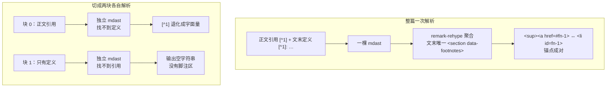

# 脚注文档为什么不切块

**一句话结论：** `parseMarkdownIntoBlocks()` 一旦发现文档里出现**脚注引用**或**脚注定义**，就放弃切块，直接返回 `[markdown]`（整篇一个块）。
原因是脚注的引用与定义必须在**同一棵 mdast / hast 树**里才能配对，而块切分后每块是各自独立的解析树。

## 1. 代码位置

```ts
// streamdown/packages/streamdown/lib/parse-blocks.tsx
const footnoteReferencePattern = /\[\^[\w-]{1,200}\](?!:)/;
const footnoteDefinitionPattern = /\[\^[\w-]{1,200}\]:/;

// parseMarkdownIntoBlocks
const hasFootnoteReference = footnoteReferencePattern.test(markdown);
const hasFootnoteDefinition = footnoteDefinitionPattern.test(markdown);

// 有脚注 → 整篇一块；并且**不写**解析缓存
if (hasFootnoteReference || hasFootnoteDefinition) {
  return [markdown];
}
```

这是「四道关」里的第一道，且**故意不读也不写** `lastParse`（见 [`block-splitting.md`](./block-splitting.md) §2）。

## 2. 为什么必须整篇一棵树



### 2.1 脚注是「文档级」结构，不是块级结构

`remark-rehype` 会把**全篇**的脚注定义收集起来，在文档末尾生成唯一一个 `<section data-footnotes>`；
引用处生成 `<sup><a href="#fn-1" id="fnref-1">`。定义和引用分属两块时，两边互相看不见。

实测（`remark-parse` + `remark-gfm` + `remark-rehype` + `rehype-stringify`）：

整篇一次解析 ✅（`rehype-stringify` 序列化后的真实输出）

```text
<p>正文引用<sup><a href="#user-content-fn-1" id="user-content-fnref-1" data-footnote-ref aria-describedby="footnote-label">1</a></sup>，再来一个<sup><a href="#user-content-fn-2" id="user-content-fnref-2" data-footnote-ref aria-describedby="footnote-label">2</a></sup>。</p>
<section data-footnotes class="footnotes"><h2 class="sr-only" id="footnote-label">Footnotes</h2>
<ol>
<li id="user-content-fn-1">
<p>第一条脚注 <a href="#user-content-fnref-1" data-footnote-backref="" aria-label="Back to reference 1" class="data-footnote-backref">↩</a></p>
</li>
<li id="user-content-fn-2">
<p>第二条脚注 <a href="#user-content-fnref-2" data-footnote-backref="" aria-label="Back to reference 2" class="data-footnote-backref">↩</a></p>
</li>
</ol>
</section>
```

拆成两块各自解析 ❌

```html
<!-- block 0：引用退化成字面量，没有 <sup>，也没有脚注区 -->
<p>正文引用[^1]，再来一个[^2]。</p>

<!-- block 1：只有定义、没有引用 → 输出空字符串 -->
```

### 2.2 锚点是双向的，跨块会断链 + 重复前缀

脚注 id 是成对的：`fnref-N`（引用）↔ `fn-N`（定义 + 回链）。`remark-rehype` 会加 `user-content-` 前缀（clobberPrefix），
Streamdown 再用 `rehypeUndoubleClobberPrefix`（`streamdown/packages/streamdown/index.tsx`）去掉重复前缀。

若引用与定义被分到两个块，每个块都会各自做一遍前缀与 sanitize：
`href="#user-content-fn-1"` 指向的目标块可能还不存在或已换块，锚点跳转、回链、去重都会失效。

### 2.3 流式到来顺序：定义几乎总在引用之后

Markdown 里脚注定义惯例写在文末，流式输出时引用先到、定义后到。
块一旦被 `memo` / 缓存成「稳定块」就不再重新解析，先稳定下来的引用块永远等不到定义 —— 页面上会永久留下字面量 `[^1]`。
整篇一块则每个 tick 都重新解析，引用与定义同步到位。

### 2.4 缓存不能污染后续文档

脚注文档**故意不写** `lastParse` 缓存（代码注释：_"footnote documents are not block-split, and leaving a prior entry avoids poisoning the next non-footnote stream extension check"_）。
否则「整篇 = 1 块」这个结论会被后续非脚注文档的增量复用逻辑继承，导致块边界错乱。
`__tests__/parse-blocks-incremental.test.tsx` 的 `does not let a footnote parse poison a later stream` 守着这点。

### 2.5 同族问题：链接引用定义也一样

`[text][1]` 只有在 `[1]: url` 同一棵树里才能解析成链接。所以 `lexBlocks()` 会返回 `hasLinkDefinitions`，
命中时同样整篇一块（全量分支、增量闸门②和⑤各查一次，见 [`block-splitting.md`](./block-splitting.md) §5）。

## 3. 代价（有意接受的取舍）

| 影响       | 说明                                                                                                                                                                     |
| ---------- | ------------------------------------------------------------------------------------------------------------------------------------------------------------------------ |
| 全篇重解析 | 每个流式 tick 都要重跑整篇 mdast → hast → React diff，失去「前面块稳定、只重算尾块」的增量收益                                                                           |
| 动画粒度   | `index.tsx` 每块一个 `AnimatePlugin`：整篇 = 一个块 = 一个插件，只发生一次 `timeline.take(全篇新增词数)`，脚注区与正文共用同一条 cascade，**不会**出现「脚注区单独渐显」 |
| memo 收益  | 长文档中正文任何变动都会使整篇块失效，前面的块也无法被 `Block` 的 `memo` 命中                                                                                            |
| 空脚注处理 | 流式早期定义未到齐时，`lib/components.tsx` 的 `MemoSection` 会过滤掉空脚注项并整段抑隐（检测 `data-footnotes`）                                                          |

只有含脚注的文档退化为单块；普通文档仍然逐块增量渲染。

## 4. 判定规则与坑

- `\[\^[\w-]{1,200}\](?!:)`：引用；`(?!:)` 排除定义写法；`{1,200}` 限制长度以抑制回溯。
- `\[\^[\w-]{1,200}\]:`：定义。
- 用 `[\w-]` 而不是 `[^\s]` 是修过的 bug：旧写法会把代码里的正则字符类 `[^\s]`、`[^>]` 误判成脚注
  （回归测试 `__tests__/footnotes.test.tsx` 的 `should not treat regex negated character classes as footnotes`）。现在代码块里的这类内容仍可正常多块切分。
- 仍然存在的边界：任何位置出现字面量 `[^x]`（教程文本、未闭合示例、被转义的写法漏网）都会让整篇退化为单块。这是「宁可退化、不可错切」的保守选择。

## 5. 如果将来要恢复切分（方案草案，未实现）

1. **全局脚注表 + 逐块注入**：先扫描全篇收集所有 `footnoteDefinition`，给每块注入一个自定义 remark 插件，把本块引用到的定义塞进本块 mdast 尾部；渲染时抑制自动生成的 section，最后由一个专门的「脚注块」统一输出 `<section data-footnotes>`。
   难点：同一 label 的多处引用（backref 有多个）、id 去重、前缀只加一次。
2. **尾块保留**：脚注区固定作为一个尾块单独渲染，前面的正文块可独立切分。
   难点：跨块锚点解析、流式中途定义到达时的尾块重算、memo 复用边界。

无论哪种方案，验收点都是：跨块引用/定义能配对、重复引用不丢 backref、`user-content-` 只出现一次、
`<section data-footnotes>` 只渲染一次、流式中途到达不闪空列表。

## 6. 复现实验

```js
// 在 streamdown/packages/streamdown 目录下运行（这几个包都在该包的 devDependencies 里）
import { unified } from "unified";
import remarkParse from "remark-parse";
import remarkGfm from "remark-gfm";
import remarkRehype from "remark-rehype";
import rehypeStringify from "rehype-stringify";

const render = (md) =>
  String(
    unified()
      .use(remarkParse)
      .use(remarkGfm)
      .use(remarkRehype)
      .use(rehypeStringify)
      .processSync(md),
  );

const full = "正文引用[^1]，再来一个[^2]。\n\n[^1]: 第一条脚注\n[^2]: 第二条脚注\n";
console.log(render(full)); // 有 <sup> + <section data-footnotes>
console.log(render("正文引用[^1]。\n")); // 字面量 [^1]
console.log(render("[^1]: 定义\n")); // 空输出
```

## 7. 相关文件与测试

| 文件                                                                         | 内容                                                                                   |
| ---------------------------------------------------------------------------- | -------------------------------------------------------------------------------------- |
| `streamdown/packages/streamdown/lib/parse-blocks.tsx`                        | 脚注正则、单块早退、缓存策略、`hasLinkDefinitions` 同族处理                            |
| `streamdown/packages/streamdown/index.tsx`                                   | `parseMarkdownIntoBlocks` 调用点、`rehypeUndoubleClobberPrefix`、每块一个 animate 插件 |
| `streamdown/packages/streamdown/lib/components.tsx`                          | `MemoSection`：`data-footnotes` 分区识别、空脚注项过滤                                 |
| `streamdown/packages/streamdown/lib/animate.ts`                              | 块级动画时间线（整篇一块时只 take 一次）                                               |
| `streamdown/packages/streamdown/__tests__/footnotes.test.tsx`                | 脚注检测与单块断言（`blocks.length === 1`）、正则字符类回归                            |
| `streamdown/packages/streamdown/__tests__/footnote-section.test.tsx`         | 脚注分区渲染、空项过滤、非脚注 section 不受影响                                        |
| `streamdown/packages/streamdown/__tests__/parse-blocks-incremental.test.tsx` | 脚注阈值穿越、脚注缓存不污染后续流                                                     |
| [`block-splitting.md`](./block-splitting.md)                                 | 切块四道关与增量复用                                                                   |
| [`remark-rehype.md`](./remark-rehype.md)                                     | `remark-rehype` 桥与 rehype 顺序                                                       |
