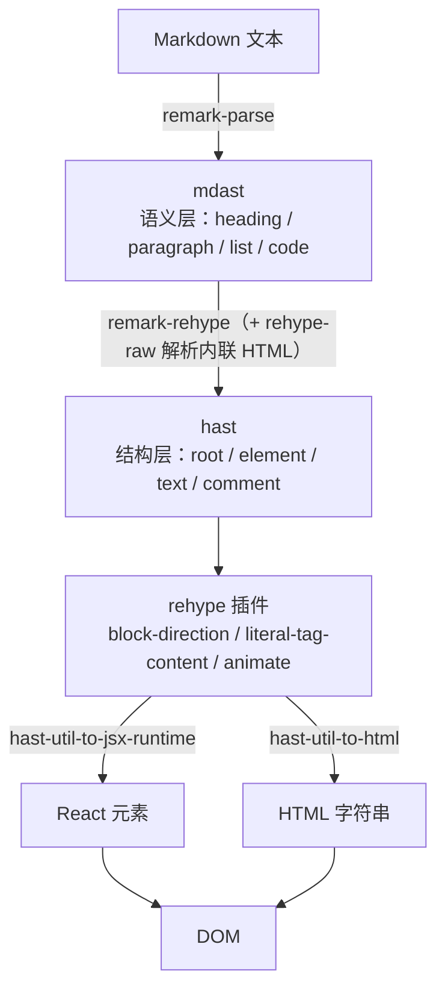

# hast 是什么

**hast = HTML Abstract Syntax Tree（HTML 抽象语法树）**，是 unified 生态里表示 HTML 的 AST 规范，就像 mdast 表示 Markdown、xast 表示 XML。

- 规范：<https://github.com/syntax-tree/hast>
- TypeScript 类型：`@types/hast`
- 基于 unist（`@types/unist`）：所有节点都有 `type`，可选 `data` / `position`

一句话：**hast 就是「还没实例化成 DOM 的 HTML 结构对象」**。插件直接改这棵树，最后由渲染器一次性转成 React 元素或 HTML 字符串。

## 1. 在流水线中的位置



要点：hast 已贴近 DOM，但**没有 DOM 实例**，也不绑定任何框架；同一棵树既能渲染成 React，也能渲染成字符串或 Vue。

## 2. 节点结构

hast 继承 unist 的通用形状（`type`、`data`、`position`、`children`）：

```jsonc
{
  "type": "root",
  "children": [
    {
      "type": "element",
      "tagName": "p",
      "properties": {
        "className": ["lead"],
        "data-sd-animate": true,
        "style": "--sd-animation:sd-fadeIn;--sd-duration:150ms",
      },
      "children": [{ "type": "text", "value": "hello" }],
    },
  ],
}
```

四种标准节点：

| type                  | 关键字段                            | 说明                          |
| --------------------- | ----------------------------------- | ----------------------------- |
| `root`                | `children`                          | 文档根或片段，对应类型 `Root` |
| `element`             | `tagName`、`properties`、`children` | 对应 HTML 元素                |
| `text`                | `value`                             | 纯文本                        |
| `comment` / `doctype` | `value`                             | 注释与 doctype                |

`raw` 不是标准节点：它是 `rehype-raw` 认识的一种中间态（`{ type: "raw", value: "<div>" }`），
`remark-rehype` 在 `allowDangerousHtml` 下只产出它，必须再挂 `rehype-raw` 才变成真正的 `element`（见 [`remark-rehype.md`](./remark-rehype.md) §3）。

## 3. `properties` 与 HTML 属性的差别

`properties` 是**规范化后**的属性表，不是 HTML 属性字符串：

| HTML                | hast properties                                   |
| ------------------- | ------------------------------------------------- |
| `class="a b"`       | `className: ["a", "b"]`                           |
| `for="x"`           | `htmlFor: "x"`                                    |
| `disabled`          | `disabled: true`（布尔属性用 boolean 表达存在性） |
| `data-foo="1"`      | `"data-foo": "1"`（`data-*` / `aria-*` 原名保留） |
| `style="color:red"` | `style: "color:red"` 或对象（渲染器决定）         |

类型是 `boolean | number | string | null | undefined | Array<string | number>`。
想精确控制属性 → 字符串的映射，用 `property-information`（hast 生态的同一套规则）。

## 4. 与 mdast / DOM 的区别

|                | mdast                  | hast                      | DOM                    |
| -------------- | ---------------------- | ------------------------- | ---------------------- |
| 抽象级别       | 语义（「这是个标题」） | 结构（「这是个 `<h2>`」） | 活的浏览器对象         |
| 节点例子       | `heading`、`listItem`  | `element`、`text`         | `HTMLHeadingElement`   |
| 可否声明式改写 | 可以                   | 可以                      | 会触发样式/布局计算    |
| 有状态         | 无                     | 无                        | 有（引用、事件、动画） |

在 Markdown 渲染器里，**语义信息在 mdast，DOM 信息在 hast**：
插件要「改结构」就在 hast 层做，「改语义」在 mdast 层做；mdast 的元信息带到 hast 的唯一官方通道是 `node.data.hProperties`。

## 5. 在本仓库中的体现

`streamdown/packages/streamdown/lib/animate.ts` 的 rehype 插件是手写 hast 的最好例子：

```ts
import type { Element, Node, Parent, Root, Text } from "hast";

const rehypeAnimate = () => (tree: Root) => {
  visitParents(
    tree,
    (node) => node.type === "text" || isVoidAnimateElement(node),
    (node, ancestors) => {
      if (node.type === "text") {
        // Text → 若干 span
        return processTextNode(node as Text, ancestors, config);
      }
      // 给 img / hr 打标
      processVoidElement(node as Element, config);
    },
  );
};
```

- `tree: Root`：rehype transformer 收到的整棵树。
- `parent.children.splice(index, 1, ...nodes)`：把 `text` 节点**原地替换**成多个 `element` 节点（`Text` → `Element[]`）。
- `makeSpan()` 返回的就是手写 hast 节点：

  ```ts
  {
    type: "element",
    tagName: "span",
    properties: { "data-sd-animate": true, style },
    children: [{ type: "text", value: word }],
  }
  ```

- `properties.style` 给字符串或对象都行：走 `hast-util-to-jsx-runtime` 转 React 时**原样透传**，
  这也是 `animate.ts` 的 `styleObjects` 能跳过逐词 CSS 字符串解析的原因。
- `visitParents` 给的 `ancestors` 是 hast 的父子链：用来判断是否落在 `SKIP_TAGS`（`pre` / `svg` / `math` / `annotation`）子树内，
  以及定位最近的 `<li>`（给它打 `data-sd-animate-marker`）。
- 给祖先元素打 `data-sd-animated`，让 `Block` 的 comparator 廉价地感知「这里曾有动画 span」（#570）。

类型解析上的一个真实坑：npm 上确实有个叫 `hast` 的包，但那是 2014 年的静态站点生成器，和这套类型毫无关系。
本项目只声明 `@types/hast`（`hast-util-to-jsx-runtime` 的 dependencies 里也传递性带了它），所以 `import type … from "hast"` 靠 TS 的 `@types` 兜底规则解析，**不要安装 `hast`**。

## 6. 常用工具

| 包                                              | 用途                                  |
| ----------------------------------------------- | ------------------------------------- |
| `hast-util-from-html`                           | HTML 字符串 → hast                    |
| `hast-util-to-html`                             | hast → HTML 字符串                    |
| `hast-util-to-jsx-runtime`                      | hast → React 元素（本仓库用的就是它） |
| `hast-util-select`                              | 用 CSS 选择器查询 hast                |
| `hast-util-to-string`                           | 提取纯文本                            |
| `hast-util-find-and-replace`                    | 文本层查找替换                        |
| `unist-util-visit` / `unist-util-visit-parents` | 遍历（后者带祖先链，本仓库在用）      |
| `unist-util-position`                           | 读写 `position`（源码行列信息）       |

## 7. 自测片段

```ts
import { fromHtml } from "hast-util-from-html";
import { toHtml } from "hast-util-to-html";
import { visit } from "unist-util-visit";

const tree = fromHtml('<p class="a b">hi <strong>there</strong></p>', { fragment: true });

visit(tree, "text", (node) => {
  node.value = node.value.toUpperCase();
});

console.log(toHtml(tree)); // <p class="a b">HI <strong>THERE</strong></p>
```

## 8. 参考

- hast 规范：<https://github.com/syntax-tree/hast>
- unist（通用 AST 基础）：<https://github.com/syntax-tree/unist>
- unified 文档：<https://unifiedjs.com>
- hast 工具集：<https://github.com/syntax-tree#hast>

相关笔记：[`remark-rehype.md`](./remark-rehype.md)（哪个阶段在改这棵树）、[`block-splitting.md`](./block-splitting.md)（一棵树对应一个块）。
