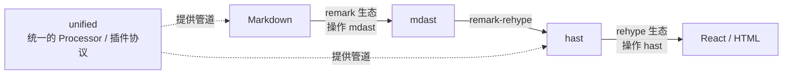
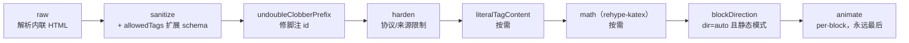

# remark 和 rehype 是干嘛的

一句话：**remark 是「处理 Markdown」的插件生态，rehype 是「处理 HTML」的插件生态**，两者都跑在 unified 这个统一处理器框架上，区别只是操作的 AST 不同。



- **remark**：生态前缀 `remark-*`，操作 **mdast**（`heading` / `paragraph` / `list` / `code` …，语义层）
- **rehype**：生态前缀 `rehype-*`，操作 **hast**（`element` / `text` …，结构层，见 [`hast.md`](./hast.md)）
- **unified**：两者共用的管道框架（`unified()` / `remark()` / `rehype()` 都是它的 Processor）

命名不能混：`remark-gfm` 是 remark 插件，`rehype-raw` 是 rehype 插件，写反了类型可能对得上但节点结构完全不同。

## 1. 分工对照

|               | remark                                                                       | rehype                                                                                 |
| ------------- | ---------------------------------------------------------------------------- | -------------------------------------------------------------------------------------- |
| 输入/输出 AST | mdast                                                                        | hast                                                                                   |
| 节点长什么样  | `{ type: "paragraph", children: [...] }`                                     | `{ type: "element", tagName: "p", properties, children }`                              |
| 能做的事      | 语法扩展（脚注、数学、表格）、语义改写、把元信息挂到 `node.data.hProperties` | 改标签/属性/结构、清洗（sanitize）、代码高亮、KaTeX、加锚点/包裹 span                  |
| 典型插件      | `remark-gfm`、`remark-math`、`remark-directive`、`remark-cjk-friendly`       | `rehype-raw`、`rehype-sanitize`、`rehype-katex`、`rehype-slug`、`rehype-highlight`     |
| 本仓库例子    | `lib/remark/code-meta.ts`、`lib/remark/disable-autolink-protocols.ts`        | `lib/rehype/block-direction.ts`、`lib/rehype/literal-tag-content.ts`、`lib/animate.ts` |

（本表里的 `lib/…` 均相对于 `streamdown/packages/streamdown/`。）

## 2. 桥：`remark-rehype`

`remark-rehype` 把 mdast 转成 hast，是**单向**的（反方向是 `rehype-remark`，很少用）。

关键点：mdast 里没有「HTML 标签」的概念。`remark-rehype` 默认会把 mdast 的 `html` 节点**丢弃**；
要保留内联 HTML，必须：

1. `allowDangerousHtml: true` —— 它只产出 `raw` 节点（还是字符串，不是元素）；
2. 再挂 `rehype-raw` 把 `raw` 解析成真正的 `element`。

本项目的处理（`lib/markdown.ts` 顶部注释写得很详细）是二选一、绝不留中间态：

| 调用方的 rehype 插件里 | 处理                                                                                               |
| ---------------------- | -------------------------------------------------------------------------------------------------- |
| 有 `rehype-raw`        | HTML 正常解析成元素（Streamdown 默认就是这条：`rehype-raw` → `rehype-sanitize` → `rehype-harden`） |
| 没有 `rehype-raw`      | 追加 `remarkEscapeHtml`，把 mdast 的 `html` 节点降级为 `text`，React 渲染时转义成字面量            |

判定方式是 `getCachedProcessor` 里比对函数身份（兼容 `rehypeRaw` 和 `[rehypeRaw, opts]` 两种写法），
不是比对 `name === "rehypeRaw"` —— 避免恰好同名的自定义插件误命中。

## 3. 插件长什么样

两个生态的插件签名**完全相同**，都是 unified 的「柯里化 transformer」：

```ts
// 返回 (tree, file) => void；直接改 tree，不返回新树
const myPlugin = (options?: Options) => (tree, file) => {
  // remark 插件：tree 是 mdast
  // rehype 插件：tree 是 hast
};
```

- `.use(plugin, options)` 的顺序 = `transform` 阶段的执行顺序，**顺序常常决定正确性**（§5 有四个真实例子）。
- `tree` 是原地修改（比如 `parent.children.splice(index, 1, ...nodes)`），没有「返回新树」的约定。
- `file` 是 vfile：`file.value` 是当前正文（流式场景每帧都变，别缓存）、`file.data` 用来在插件间传数据。
- 插件可以在 `this.data` 上声明 `micromarkExtensions` / `fromMarkdownExtensions` 等，从而**扩展语法本身**（`remark-gfm`、`remark-math` 就是这么做的），不只是改树。

## 4. 本项目实际挂了哪些

| 阶段   | 插件                                                                                                             | 作用                                                                                                      | 位置                                                                                                                     |
| ------ | ---------------------------------------------------------------------------------------------------------------- | --------------------------------------------------------------------------------------------------------- | ------------------------------------------------------------------------------------------------------------------------ |
| remark | `remark-gfm`                                                                                                     | 表格、删除线、任务列表、自动链接、脚注语法                                                                | `streamdown/packages/streamdown/index.tsx` 的 `defaultRemarkPlugins`                                                     |
| remark | `remarkCodeMeta`                                                                                                 | 把代码围栏的 meta（`startLine=10`）写进 `data.hProperties.metastring`，供 code 组件读取                   | `streamdown/packages/streamdown/lib/remark/code-meta.ts`                                                                 |
| remark | `remark-cjk-friendly`（gfm 前）/ `remarkCjkAutolinkBoundary` + `remark-cjk-friendly-gfm-strikethrough`（gfm 后） | 中日韩文本的强调与自动链接边界，必须在 `remark-gfm` 前/后分别插入                                         | `streamdown/packages/streamdown-cjk/index.ts` 的 `remarkPluginsBefore` / `remarkPluginsAfter`                            |
| remark | `remarkDisableAutolinkProtocols`                                                                                 | 关掉指定协议的自动链接（如 `mailto`）；它检查的是 gfm 建的 link 节点，所以排在 gfm 之后、cjk 后置插件之前 | `streamdown/packages/streamdown/index.tsx`、`lib/remark/disable-autolink-protocols.ts`                                   |
| remark | `remark-math`                                                                                                    | `$…$` / `$$…$$` 变成 `math` / `inlineMath` 节点                                                           | `streamdown/packages/streamdown-math/index.ts`                                                                           |
| **桥** | `remark-rehype`（`allowDangerousHtml: true`）                                                                    | mdast → hast，保留 `raw`                                                                                  | `streamdown/packages/streamdown/lib/markdown.ts`                                                                         |
| rehype | `rehype-raw`                                                                                                     | 把 `raw` 字符串解析成真正的 hast `element`                                                                | `streamdown/packages/streamdown/index.tsx` 的 `defaultRehypePlugins.raw`                                                 |
| rehype | `rehype-sanitize`（+ 扩展 schema）                                                                               | XSS 清洗；`allowedTags` 会合并进 `defaultSanitizeSchema`                                                  | `streamdown/packages/streamdown/index.tsx` 的 `defaultSanitizeSchema`、`mergedRehypePlugins`                             |
| rehype | `rehypeUndoubleClobberPrefix`                                                                                    | 修掉脚注 id 的 `user-content-` 双前缀、对齐 fragment 链接                                                 | `streamdown/packages/streamdown/index.tsx`                                                                               |
| rehype | `rehype-harden`                                                                                                  | 链接/图片协议与来源限制                                                                                   | `streamdown/packages/streamdown/index.tsx` 的 `defaultRehypePlugins.harden`                                              |
| rehype | `rehype-katex`                                                                                                   | `math` 节点渲染成 KaTeX HTML                                                                              | `streamdown/packages/streamdown-math/index.ts`                                                                           |
| rehype | `rehypeLiteralTagContent`                                                                                        | 把指定自定义标签的内容降级为纯文本                                                                        | `streamdown/packages/streamdown/lib/rehype/literal-tag-content.ts`                                                       |
| rehype | `animate`（每块一个实例）                                                                                        | 拆词 span、写 CSS 动画变量                                                                                | `streamdown/packages/streamdown/lib/animate.ts` 的 `createRenderAnimatePlugin`，由 `index.tsx` 的 `getBlockPlugins` 追加 |

`index.tsx` 的 `mergedRehypePlugins` 决定实际顺序：



## 5. 顺序为什么重要（四个真实约束）

1. **`rehype-raw` 必须在 `rehype-sanitize` 之前**：`raw` 节点还是字符串，sanitize 只处理元素，顺序反了等于没清洗内联 HTML。
2. **`animate` 必须放在 rehype 链尾**：它要把文本拆成 `<span>` 并写 `style`，排在 sanitize 之前会被清洗掉。所以 `getBlockPlugins` 返回的是 `[...mergedRehypePlugins, blockAnimatePlugin.rehypePlugin]`。
3. **CJK 插件必须夹着 `remark-gfm`**：`remarkPluginsBefore` 要在 gfm 之前（改强调解析），`remarkPluginsAfter` 要在之后（gfm 的 autolink-literal 扩展已经建好链接节点，边界切分才能生效）。
4. **sanitize 之后想加标签/属性只能走 schema**：`allowedTags` 不是「后置插件」，而是合并进 `defaultSanitizeSchema` 的 `tagNames` / `attributes`；
   而且这条只在调用方仍用默认插件数组时生效 —— 传了自定义 sanitize 插件，就得自己把标签写进 schema。

## 6. 典型坑

| 坑                                     | 说明                                                                                         |
| -------------------------------------- | -------------------------------------------------------------------------------------------- |
| 在 remark 插件里找 `tagName`           | mdast 节点没有 `tagName` / `properties`，那是 hast 的概念                                    |
| 在 rehype 插件里找 `node.value` 的语义 | 只有 `text` / `comment` / `doctype` / `raw` 有 `value`；`element` 要看 `children`            |
| 属性名写 `class` / `for`               | hast `properties` 用 `className` / `htmlFor`，见 [`hast.md`](./hast.md) §3                   |
| 返回新树                               | unified 忽略返回值，必须原地改 `tree`                                                        |
| 缓存了 `file.value` 或树               | 流式下每帧内容都变；树每次都是新对象，绝不能被复用                                           |
| mdast 元信息想带到 hast                | 唯一官方通道是 `node.data.hProperties`（`remarkCodeMeta` 就是这么把 `metastring` 送下去的）  |
| 想用 HTML 但没挂 `rehype-raw`          | `remark-rehype` 默认丢掉 `html` 节点 → 内容「消失」；本项目的兜底是 `remarkEscapeHtml`（§2） |

## 7. 两个最小模板

```ts
// ① remark 插件：把代码围栏的 meta 送进 hast 属性（本仓库真实写法）
export const remarkCodeMeta: Plugin<[], Root> = () => (tree) => {
  visit(tree, "code", (node: Code) => {
    if (node.meta) {
      node.data = node.data ?? {};
      node.data.hProperties = {
        ...((node.data.hProperties as Record<string, unknown>) ?? {}),
        metastring: node.meta,
      };
    }
  });
};

// ② rehype 插件：给所有图片加上懒加载与动画标记
const rehypeImg = () => (tree: Root) => {
  visit(tree, "element", (node: Element) => {
    if (node.tagName !== "img") return;
    node.properties ??= {};
    node.properties.loading ??= "lazy";
    node.properties["data-sd-animate"] = true;
  });
};
```

挂载：

```ts
unified()
  .use(remarkParse)
  .use(remarkGfm) // mdast 阶段
  .use(remarkRehype, { allowDangerousHtml: true })
  .use(rehypeRaw) // 先还原内联 HTML
  .use(rehypeSanitize) // 再清洗
  .use(rehypeImg) // 最后才加自己的属性
  .use(rehypeStringify)
  .process(markdown);
```

## 8. 和本项目其它笔记的关系

- [`hast.md`](./hast.md) —— hast 节点结构（rehype 插件的操作对象）
- [`block-splitting.md`](./block-splitting.md) —— 每个块各自跑一条完整 remark/rehype 管线（所以这里每次调用的输入只有一块）
- [`footnote-no-block-split.md`](./footnote-no-block-split.md) —— 为什么脚注文档必须整篇一条管线
- `streamdown/packages/streamdown/lib/markdown.ts` 顶部注释 —— 本项目管道的完整实现细节（Processor 缓存、`remarkEscapeHtml`、post 过滤、转 JSX）

## 9. 参考

- unified：<https://unifiedjs.com>
- remark 插件列表：<https://github.com/remarkjs/remark/blob/main/doc/plugins.md>
- rehype 插件列表：<https://github.com/rehypejs/rehype/blob/main/doc/plugins.md>
- `remark-rehype`：<https://github.com/remarkjs/remark-rehype>
