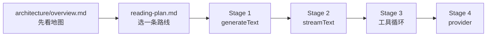

# AI SDK 源码笔记

[origin](https://github.com/vercel/ai) · 本地 clone 在 `ai/`（v7.0.177，learn 分支）

记录读 `vercel/ai` 的过程。旧笔记已清空，这一版按 v7 的代码重写；目前只有骨架，正文随 [阅读计划](reading-plan.md) 逐段补。

## 1. 两篇主文档

| 文档                                             | 回答什么                                                                 |
| ------------------------------------------------ | ------------------------------------------------------------------------ |
| [architecture/overview.md](architecture/overview.md) | 88 个包怎么分组、四层职责、`packages/ai` 里有什么、三条主干怎么走        |
| [reading-plan.md](reading-plan.md)               | 按什么顺序读、每阶段看哪些文件、读完要能回答什么、大概花多久             |

另有一张 archify 生成的示意图 `architecture/ai-sdk-core-architecture.html`，用浏览器打开。它是视觉版，**以文字版为准**；同目录的 `*.json` 是出图工具的凭据，不用读。

## 2. 从哪开始

- 想改核心、查怪 bug：内核路线 `0 → 1 → 2 → 3 → 4`。
- 想写 Agent / 做应用：`0 → 1 → 2 → 5 → 7`。
- 只想加个厂商：`0 → 4`。

## 3. 约定

- 路径从项目名写起：`ai/packages/ai/src/generate-text/stream-text.ts`，不写 `projects/ai/...`。
- 每条结论锚在符号名上；行号只作参考，对不上时按函数名搜。
- 没查清的写进 `architecture/questions.md`，按「背景 / 我的假设 / 验证方式 / 结论 / 证据 / 相关」六段填；结论留空就是待办。
- 主题文档只写已经验证过的内容，不把猜测写成结论。
- 中文正文，代码标识符保留原文；流程、分层、调用链先用 Mermaid 画一遍再写文字。
