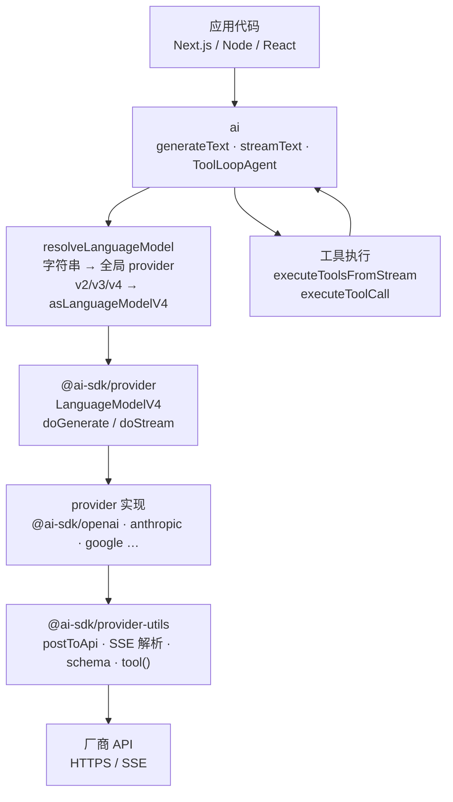
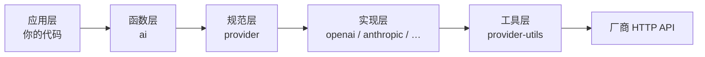
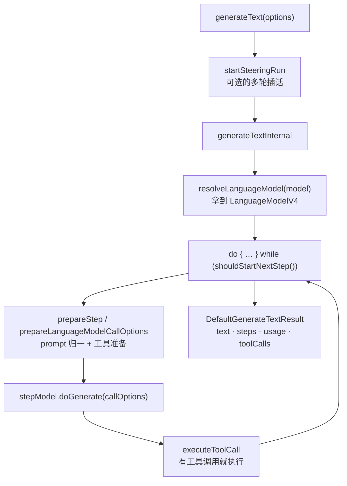
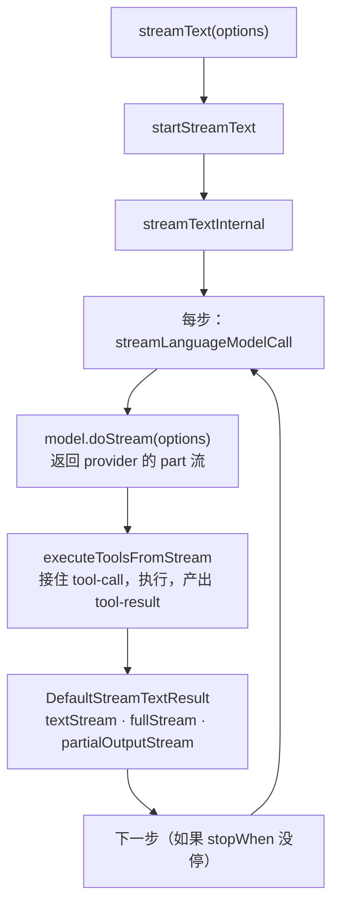
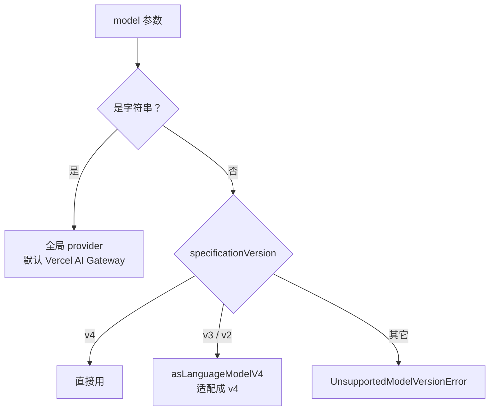
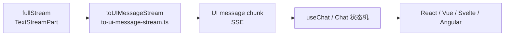

# AI SDK 架构总览

> 对象：`vercel/ai`，本地 clone 是 **v7.0.177**（`ai/`，learn 分支）。
> 这里只画静态地图。一次调用怎么走、按什么顺序读，看 [reading-plan](../reading-plan.md)。

## 0. 一句话

应用调用 `ai` 包的函数（`generateText` / `streamText` / `ToolLoopAgent`），函数把参数整理成 provider 规范（`LanguageModelV4`）的调用，provider 实现用 `provider-utils` 发 HTTP，最后拿回文本、工具调用或一条流。

## 1. 全局图

图里三个契约要记住：`LanguageModelV4`（模型能干什么）、`ProviderV4`（怎么拿到一个模型）、`ToolSet`（工具长什么样）。它们都在 `@ai-sdk/provider` 和 `@ai-sdk/provider-utils` 里。

## 2. 88 个包，按角色分六组

| 组           | 代表包                                                             | 作用                                       |
| ------------ | ------------------------------------------------------------------ | ------------------------------------------ |
| 核心         | `ai` `provider` `provider-utils` `gateway`                         | 函数层、规范、工具、默认网关               |
| provider 实现 | `openai` `anthropic` `google` `mistral` `xai` `deepseek` …（约 50 个） | 一个厂商一个包，实现 `LanguageModelV4`     |
| Agent 高层   | `ai`（`src/agent`）、`workflow`、`workflow-harness`、`code-mode`   | 循环、持久化步骤、代码执行                 |
| Harness      | `harness` + `harness-*`（11 个）、`sandbox-*`（2 个）              | 把外部编码 agent 接进来                    |
| UI           | `react` `vue` `svelte` `angular` `rsc` `tui`                       | 消费 UI message stream                     |
| 辅助         | `mcp` `devtools` `otel` `policy-opa` `tool-bash` `tool-web-fetch` `codemod` `test-server` | 工具、观测、策略、迁移                     |

包数量按 `ls ai/packages | wc -l` = 88。除了核心四个和 UI，其余大多是「同一套接口的一个具体实现」，读的时候不必平铺。

## 3. 四层职责

### 3.1 规范层：`@ai-sdk/provider`

`LanguageModelV4` 只有几样东西（`ai/packages/provider/src/language-model/v4/language-model-v4.ts`）：

| 成员                           | 说明                                             |
| ------------------------------ | ------------------------------------------------ |
| `specificationVersion: 'v4'`   | 版本号，`ai` 靠它判断要不要适配                  |
| `provider` / `modelId`         | 标识，错误信息和遥测里用                         |
| `supportedUrls`                | 哪些 URL 可以直接传给模型，不用先下载            |
| `doGenerate(options)`          | 非流式：一次返回完整结果                         |
| `doStream(options)`            | 流式：返回一串 part                              |

`do` 前缀是故意的：防止使用者绕过 `ai` 直接调 provider。

### 3.2 工具层：`@ai-sdk/provider-utils`

provider 实现共享的那部分：`postToApi`、SSE / JSON 解析、schema 校验（`asSchema`）、`tool()`、媒体类型识别、`fetch` 包装、错误格式化。它不关心业务，只提供「写一个 provider 需要的手脚架」。

### 3.3 函数层：`ai`

`ai/packages/ai/src` 下有 30 个目录，见 §4。所有对外的 API 最终都从 `ai/packages/ai/src/index.ts` 出去。

### 3.4 实现层：`@ai-sdk/openai` 这类包

以 OpenAI 为例：`ai/packages/openai/src/openai-provider.ts` 的 `languageModel(modelId)` 走到 `createResponsesModel`，返回一个实现 `LanguageModelV4` 的对象；真正的请求在 `ai/packages/openai/src/responses/` 里。别的 provider 是同一套形状，换的是 HTTP 细节和字段映射。

## 4. `packages/ai/src` 里有什么

| 目录                            | 职责                                                       |
| ------------------------------- | ---------------------------------------------------------- |
| `generate-text/`                | 非流式与流式文本生成、step 循环、工具执行、结果对象         |
| `prompt/`                       | 把 `prompt` / `messages` / `instructions` 归一成 provider 的 prompt |
| `model/`                        | `resolveLanguageModel` 和 v2/v3 → v4 的适配                 |
| `agent/`                        | `ToolLoopAgent`、默认停止条件、Agent 的 UI 流辅助           |
| `tool-search/`                  | 工具太多时的检索式选取                                     |
| `ui/`                           | 框架无关的 chat 状态机、transport、UI 消息转换             |
| `ui-message-stream/`            | 模型流 → UI chunk → SSE Response                           |
| `middleware/`                   | 语言模型/embedding 中间件（默认值、模拟流式等）            |
| `registry/`                     | provider 注册表与自定义 provider                           |
| `telemetry/`、`logger/`、`error/` | 观测、日志、错误类型                                       |
| `embed/` `generate-object/` `generate-image/` `generate-speech/` `generate-video/` `transcribe/` `translate/` `rerank/` `batch/` `realtime/` `decide/` `extract/` | 其它模态和任务，套路和 `generate-text/` 一样但更薄 |

读核心链路时，前四行是重点，其余可以先只记名字。

## 5. 一次 `generateText` 的静态结构

关键点：

- 默认 `stopWhen = isStepCount(1)`（`ai/packages/ai/src/generate-text/generate-text.ts`）。也就是说**工具会执行，但不会再发第二次模型请求**；要循环就显式传 `stopWhen`。
- 循环是 `do { … } while (await shouldStartNextStep())`，和 `streamText` 各写各的，非流式路径**不会**经过 `streamText`。
- 结果类叫 `DefaultGenerateTextResult`，`steps` 是每步 `DefaultStepResult` 的数组。

## 6. 一次 `streamText` 的静态结构

- 在文本生成链路里，`streamLanguageModelCall` 是**唯一**调 `model.doStream` 的地方（`ai/packages/ai/src/generate-text/stream-language-model-call.ts`）。别的模态（`generate-object`、`generate-speech` 等）各有自己的入口。
- `executeToolsFromStream` 把 `tool-call` part 换成 `tool-result` part，再把结果拼回下一条 message。
- `DefaultStreamTextResult` 同时提供「增量文本」（`textStream`）和「全部 part」（`fullStream`）。
- `streamTextLowMemory`（`ai/packages/ai/src/generate-text/stream-text.ts`）复用同一个引擎，只是关掉 replay 和内容收集，给单消费者用。

## 7. 工具循环

工具定义在 `@ai-sdk/provider-utils` 的 `tool()`，运行时由 `ai` 包执行：

1. 模型返回 `tool-call` part。
2. `executeToolsFromStream` 调 `executeToolCall`，拿到 `tool-result`。
3. 结果变成一条 `tool` message，进入下一步的 prompt。
4. `stopWhen`（`StopCondition`）决定还走不走下一步。

`ToolLoopAgent` 只是给这套循环配了默认值：`stopWhen` 默认 `isStepCount(20)`（`ai/packages/ai/src/agent/tool-loop-agent.ts`）。审批走 `needsApproval` / `toolApproval`，中间态由 `ai/packages/ai/src/generate-text/collect-tool-approvals.ts` 收集。

## 8. 版本兼容：v2 / v3 / v4

`ai/packages/ai/src/model/resolve-model.ts` 只允许 `v4` / `v3` / `v2`；字符串模型 id 走 `getGlobalProvider()`，默认是 Gateway（`ai/packages/ai/src/global.ts` 的注释写明了）。适配层在 `ai/packages/ai/src/model/as-language-model-v4.ts`。

## 9. 三条支线

### 9.1 Agent 与 Workflow

`Agent` 是接口，`ToolLoopAgent` 是实现（`ai/packages/ai/src/agent/index.ts`）。它不发明新引擎，内部就是 `generateText` / `streamText` 加默认停止条件。

`@ai-sdk/workflow` 的 `WorkflowAgent` 把每一步放进 durable workflow（依赖 `workflow@5`），所以能在崩溃后从某个 step 继续。核心在 `ai/packages/workflow/src/model-call-iterator.ts` 和 `do-stream-step.ts`。

### 9.2 Harness

`@ai-sdk/harness` 定义 Harness 规范和 `HarnessAgent`：外部编码 agent（Claude Code、Codex、Cursor…）跑在 sandbox 里，通过 bridge 协议和 AI SDK 交换消息和工具调用。`harness-*` 是一个个适配器，`sandbox-*` 提供执行环境。包 README 自己标了 experimental。

### 9.3 code-mode

`@ai-sdk/code-mode` 让模型写 JS/TS 调你的工具，代码在 QuickJS 沙箱里跑，只回传 JSON 可序列化的结果。它不是 provider，也不是 agent，而是「工具调用的一种执行方式」。

## 10. UI 与流式协议

- `ai/packages/ai/src/ui-message-stream/to-ui-message-stream.ts`：`toUIMessageStream` 把模型 part 转成 UI chunk（单个 part 的映射在 `to-ui-message-chunk.ts` 的 `toUIMessageChunk`）。
- `create-ui-message-stream-response.ts`：`createUIMessageStreamResponse` 包成 SSE `Response`。
- `ai/packages/ai/src/ui/chat.ts`：框架无关的 chat 状态机；`ai/packages/react/src/use-chat.ts` 是 React 绑定。
- `rsc` 走另一条路：在 Server Component 里直接流式渲染，不经过浏览器端 chat 状态机。

## 11. 为什么这样分层

- **provider 实现只依赖规范**：`ai/packages/openai/package.json` 的 dependencies 只有 `@ai-sdk/provider` 和 `@ai-sdk/provider-utils`，没有 `ai`。所以 provider 可以独立发版，`ai` 也能独立升级，两边只靠 `LanguageModelV4` 对齐。
- **脏活放在 provider-utils**：HTTP、SSE、schema 校验、错误格式化只写一遍，50 多个 provider 共用。
- **策略留在 ai**：循环、停止条件、审批、遥测、UI 协议都不下放。provider 只做「把 AI SDK 的调用翻译成厂商 HTTP」这一件事，所以换模型不用重写业务逻辑。

## 12. 影响读码的工程约定

- monorepo + turbo，包之间靠 `workspace:*` 和 `package.json` 的 `source` 字段直连 TS 源码，读的时候不用先 build。
- 每个包的 `src/index.ts` 是出口；实现和测试同目录，`*.test.ts` 往往比实现更能说明边界。
- `experimental_` 前缀 = 还没稳定的 API。v7 里很多参数同时有 `experimental_x` 和 `x`，后者是新名，前者是兼容别名（例如 `experimental_telemetry` / `telemetry`）。
- 文档在 `ai/content/docs`，是确认 API 形状最快的入口；源码和行为冲突时以源码为准。
