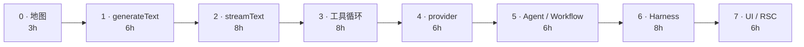

# 源码阅读计划（v7）

> 配套：[架构总览](architecture/overview.md)。
> 计划按「一次只回答一个问题」组织，每阶段给入口文件、要回答的问题、产出物。时间按每天 1–2 小时估。

## 0. 怎么用这份计划



三条路线，不必全走：

| 路线       | 走哪几段           | 适合谁                       |
| ---------- | ------------------ | ---------------------------- |
| 内核路线   | 0 → 1 → 2 → 3 → 4  | 想改 AI SDK 核心、查诡异 bug |
| 应用路线   | 0 → 1 → 2 → 5 → 7  | 写 Agent / 做产品            |
| provider 路线 | 0 → 4           | 只想加一个厂商               |

每阶段结束问自己一句：**合上笔记，能不能把这条链路讲给同事听？** 讲不出就回到入口文件重读，不要往下走。

## 1. Stage 0 · 先钉住地图（3 小时）

目标：知道东西在哪，不追细节。

读：

- `ai/README.md` —— 仓库自我介绍
- `ai/content/docs/03-ai-sdk-core/01-overview.mdx` —— 官方对「AI SDK Core」的划分
- `ai/content/docs/02-foundations/04-tools.mdx` —— 工具的形状
- [架构总览](architecture/overview.md) 的 §1、§2、§4

跑（有 API key 的话）：

```bash
cd projects/ai
pnpm --filter @example/ai-functions exec tsx src/generate-text/openai/basic.ts
```

验收问题：

1. `ai`、`@ai-sdk/provider`、`@ai-sdk/provider-utils` 三者的边界各是什么？
2. `packages/ai/src` 里和文本生成直接相关的目录有哪几个？
3. 一个 provider 包最少要实现哪个接口？

先别看：`packages/ai/src/generate-text/stream-text.ts`（4000 行），现在打开只会迷路。

## 2. Stage 1 · `generateText`：最短的一条完整链路（6 小时）

目标：从公开函数跟到 `doGenerate`，理解「一步」是什么。

入口：

- `ai/packages/ai/src/generate-text/generate-text.ts` —— `generateText`、`generateTextInternal`、`do { … } while (shouldStartNextStep())`
- `ai/packages/ai/src/prompt/standardize-prompt.ts` —— `prompt` / `messages` 归一
- `ai/packages/ai/src/prompt/convert-to-language-model-prompt.ts` —— 变成 provider 认识的 prompt
- `ai/packages/ai/src/model/resolve-model.ts` —— 模型解析
- `ai/packages/ai/src/generate-text/default-generate-text-result.ts` —— 结果对象
- `ai/packages/ai/src/generate-text/step-result.ts` —— 单步结果

要回答的问题：

1. `prompt`、`messages`、`instructions`、`system` 四个入口，最后在哪一步合并成一份 prompt？为什么 `system` 和 `instructions` 要并存？
2. 默认 `stopWhen = isStepCount(1)` 时，工具还会执行吗？执行完为什么不再请求模型？
3. `usage` 和 `totalUsage` 差在哪？`steps` 是谁往里 push 的？
4. 非流式路径会不会经过 `streamText`？如果不会，两套实现的代码重复是有意的吗？

产出：`core/generate-text.md`（读完再建），至少一张 `generateTextInternal` 的流程图 + 四个问题的答案。

先别看：`telemetry/`、`middleware/`。它们会把你从主线上带走。

## 3. Stage 2 · `streamText`：一条流怎么被拆开（8 小时）

目标：能说清 `textStream`、`fullStream`、`partialOutputStream` 各自从哪来。

入口：

- `ai/packages/ai/src/generate-text/stream-text.ts` —— 只看 `streamText` / `startStreamText` / `streamTextInternal` / `DefaultStreamTextResult` 四块，别顺序读
- `ai/packages/ai/src/generate-text/stream-language-model-call.ts` —— 唯一调 `doStream` 的地方
- `ai/packages/ai/src/generate-text/stream-text-result.ts` —— 结果接口
- `ai/packages/ai/src/generate-text/smooth-stream.ts` —— 平滑输出
- `ai/packages/ai/src/generate-text/execute-tools-from-stream.ts` —— 先混个脸熟，Stage 3 细看

要回答的问题：

1. provider 的一个 chunk，到 `textStream` 之间经过几次转换？每次转换的输入输出类型是什么？
2. `fullStream` 里有哪些 part？`textStream` 是从哪几种 part 抽出来的？
3. `experimental_transform` 插在哪一层？它拿到的是整个流还是单个 chunk？
4. `DefaultStreamTextResult` 为什么要 replay？`streamTextLowMemory` 关掉了什么、换来了什么？

产出：`core/stream-text.md`，一张 `doStream → part 流 → 结果对象` 的图。

先别看：重试（`maxRetries` / `streamRetries`）、超时、steering。这些是加在主干上的补丁，等主干清楚再看。

## 4. Stage 3 · 工具循环：`tool-call` 怎么变成下一次请求（8 小时）

目标：理解循环、审批、停止条件三件事。

入口：

- `ai/packages/ai/src/generate-text/execute-tools-from-stream.ts`
- `ai/packages/ai/src/generate-text/execute-tool-call.ts`
- `ai/packages/ai/src/generate-text/collect-tool-approvals.ts`
- `ai/packages/ai/src/agent/default-stop-condition.ts` —— `isStepCount`
- `ai/packages/provider-utils/src/types/tool.ts` —— `tool()` 的定义（路径以实际文件为准，搜 `export function tool`）

要回答的问题：

1. `tool-call` part 到 `execute` 之间，参数校验和 `inputSchema` 在哪一步做？
2. 工具抛错、返回不可序列化的值、返回 `undefined`，分别会变成什么？
3. 审批（`needsApproval` / `toolApproval`）在哪个环节暂停？恢复时靠什么把「批准」接回原来的调用？
4. `stopWhen` 在循环的哪个位置判定？为什么默认是 1 而不是无限？

产出：`core/tool-loop.md`，一张 `tool-call → execute → tool-result → 下一步` 的图。

先别看：`tool-search`、`code-mode`、`mcp`。它们改变的是「工具从哪来」，不是循环本身。

## 5. Stage 4 · provider：规范的边界在哪（6 小时）

目标：能自己加一个最小 provider，或判断 bug 该找 `ai` 还是找 provider。

入口：

- `ai/packages/provider/src/language-model/v4/language-model-v4.ts`
- `ai/packages/provider/src/language-model/v4/language-model-v4-stream-part.ts` —— part 的种类
- `ai/packages/ai/src/model/as-language-model-v4.ts` —— v3/v2 适配
- `ai/packages/provider-utils/src/post-to-api.ts`
- `ai/packages/openai/src/openai-provider.ts` —— 看 `createLanguageModel` / `createResponsesModel`
- `ai/packages/openai/src/responses/` —— 选一个模型实现看 `doStream`

要回答的问题：

1. 一个 provider 最少要实现哪些成员？`supportedUrls` 不实现会怎样？
2. v3 模型适配成 v4 时，哪些字段被改名/搬位置？适配层为什么放在 `ai` 而不是 `provider`？
3. HTTP 错误、流中途错误、重试，分别归 `provider-utils`、provider 实现还是 `ai`？
4. `doGenerate` 和 `doStream` 的结果类型为什么是两套，而不是「流就是 generate 的增量版」？

产出：`architecture/provider-layer.md`，一份「新增 provider 要动哪些文件」的清单。

先别看：其它 50 个 provider。看完 OpenAI 一个就够了，剩下的都是字段映射。

## 6. Stage 5 · Agent 与 Workflow（6 小时）

目标：分清「循环封装」和「持久化执行」是两件事。

入口：

- `ai/packages/ai/src/agent/tool-loop-agent.ts` —— 重点看 `generate()` / `stream()` 怎么转发
- `ai/packages/ai/src/agent/tool-loop-agent-settings.ts`
- `ai/packages/ai/src/agent/default-stop-condition.ts`
- `ai/packages/workflow/src/workflow-agent.ts`
- `ai/packages/workflow/src/model-call-iterator.ts`
- `ai/packages/workflow/src/do-stream-step.ts`

要回答的问题：

1. `ToolLoopAgent` 和「`streamText` + `stopWhen`」的本质差别，只有默认值吗？
2. `runtimeContext` 和 `toolsContext` 各解决什么问题？它们在循环里怎么传递、能不能改？
3. `WorkflowAgent` 的 durable 落在哪一层？一个 step 的边界是「一次模型调用」还是「一次工具执行」？
4. `createAgentUIStream` 和普通 `toUIMessageStream` 是什么关系？

产出：`architecture/agent-workflow.md`，一张 `Agent → streamText → step` 的分层图。

先别看：`workflow@5` 这个第三方依赖的内部实现。先把 AI SDK 这边的边界看清楚。

## 7. Stage 6 · Harness 与 Sandbox（8 小时）

目标：搞清「外部编码 agent」是怎么被接进来的。

入口：

- `ai/packages/harness/src/agent/harness-agent.ts`
- `ai/packages/harness/src/v1/harness-v1-bridge-protocol.ts`
- `ai/packages/harness/src/v1/harness-v1-lifecycle-state.ts`
- `ai/packages/harness-claude-code/src/claude-code-harness.ts`
- `ai/packages/sandbox-vercel/src/vercel-sandbox-session.ts`

要回答的问题：

1. Harness 和 provider 的边界：外部 agent 是被当成 model、tool，还是第三种东西？
2. 一次 session 的生命周期（bootstrap → run → 结束）由谁驱动？失败/断开怎么处理？
3. bridge 协议传什么？为什么不直接 `child_process.spawn` 然后解析 stdout？
4. sandbox 接口为什么单独抽成 `Experimental_SandboxSession`？`sandbox-just-bash` 和 `sandbox-vercel` 的差别在哪？

产出：`architecture/harness.md`，一张 `HarnessAgent → sandbox → 外部 agent → bridge` 的图。

先别看：12 个 `harness-*` 适配器。选 Claude Code 一个读透，其它只是启动参数不同。

## 8. Stage 7 · UI 与 RSC（6 小时）

目标：能解释一条 token 从模型到屏幕的全过程。

入口：

- `ai/packages/ai/src/ui-message-stream/to-ui-message-chunk.ts` —— part → chunk 的映射
- `ai/packages/ai/src/ui-message-stream/to-ui-message-stream.ts`
- `ai/packages/ai/src/ui-message-stream/create-ui-message-stream-response.ts`
- `ai/packages/ai/src/ui/chat.ts`
- `ai/packages/react/src/use-chat.ts`
- `ai/packages/rsc/src/streamable-ui/`

要回答的问题：

1. 模型 part 和 UI chunk 的对应关系，在哪张 `switch` 里？哪些 part 被丢掉、哪些被合并？
2. `Chat` 状态机负责什么，`useChat` 又加了什么（重连、乐观更新、节流）？
3. RSC 路径和 UI 路径在哪个函数分叉？为什么 RSC 不需要浏览器端 chat 状态机？
4. 断线续传靠什么标识（message id / stream id）？服务端要保留什么？

产出：`architecture/ui-stream.md`，一张 `fullStream → UI chunk → SSE → useChat` 的图。

先别看：`05-ai-sdk-rsc` 的全部文档。先把 UI 路径走通，再看 RSC 的差异。

## 9. 时间与节奏

| 阶段 | 内容             | 预计 | 难度 | 读完能做的事                     |
| ---- | ---------------- | ---- | ---- | -------------------------------- |
| 0    | 地图             | 3h   | 低   | 知道该去哪个目录找               |
| 1    | generateText     | 6h   | 中   | 定位 prompt / 结果字段的问题      |
| 2    | streamText       | 8h   | 高   | 定位流式顺序、丢 chunk 的问题     |
| 3    | 工具循环         | 8h   | 高   | 解释工具为什么没执行 / 没续上     |
| 4    | provider         | 6h   | 中   | 加 provider、判断 bug 归属        |
| 5    | Agent / Workflow | 6h   | 中   | 选 Agent 还是自己写循环           |
| 6    | Harness          | 8h   | 高   | 接一个外部编码 agent              |
| 7    | UI / RSC         | 6h   | 中   | 改协议、做自定义 chat UI          |

合计约 51 小时。按每天 1–2 小时，大约一个月；只走内核路线约 31 小时。

## 10. 读法上的几个提醒

- **先看测试名**。同目录的 `*.test.ts` 比实现更能说明边界，先扫 `describe` / `it` 的标题，再决定读哪段实现。
- **一次只回答一个问题**。打开 4000 行的文件之前，先写下你要找的那一个函数名。
- **用 codegraph 定位**。在 `projects/ai` 里跑 `codegraph explore "<符号或问题>"`，比 grep 快，还能看到调用链。
- **每阶段的结论落到文档**。没查清的写进 `architecture/questions.md`（等第一条真实问题出现再建），别留在脑子里。
- **不要按目录顺序读**。`packages/ai/src` 的目录是按功能分的，不是按依赖顺序；主线只有 `generate-text → prompt → model → provider` 这一条。
